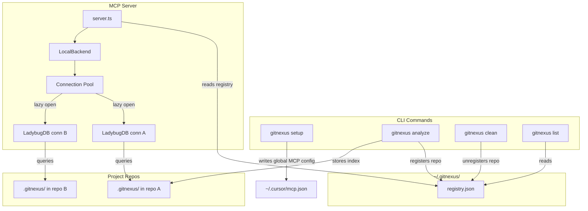

# CLI reference

[Back to GitNexus](../README.md)

## Commands

Everyday commands:

```bash
gitnexus setup                   # Configure MCP for detected editors (one-time; -c to select)
gitnexus analyze [path]          # Index a repository (or update a stale index)
gitnexus analyze [path] --watch  # Watch local files and serialize incremental refreshes
gitnexus mcp                     # Start MCP server (stdio; one server PER CLIENT) — all indexed repos
gitnexus mcp --http              # Start MCP server (Streamable HTTP + SSE) — ONE server, many clients
gitnexus serve                   # Start local HTTP server (multi-repo) for web UI connection
gitnexus eval-server             # Start lightweight evaluation HTTP tools (loopback by default)
gitnexus list                    # List all indexed repositories
gitnexus status                  # Show index status for current repo
gitnexus clean                   # Delete index for current repo
gitnexus wiki [path]             # Generate repository wiki from knowledge graph
gitnexus uninstall               # Preview removal of GitNexus MCP/skills/hooks (--force to apply)
```

### Multi-client setups: use `--http`, not stdio

MCP-over-stdio is **one server process per client** by protocol design — every client
spawns its own `gitnexus mcp` child, with its own copy of the loaded index. If you run N
concurrent agents/workers, that is N full index servers.

`gitnexus mcp --http` starts **one** server (Streamable HTTP at `POST /mcp`, legacy SSE at
`GET /sse` + `POST /messages`) that any number of clients can connect to:

```bash
gitnexus mcp --http --host 127.0.0.1 --port 3111
```

Point clients at `http://127.0.0.1:3111/mcp`. A non-loopback bind (`--host 0.0.0.0`)
requires `--auth-token` (or `GITNEXUS_MCP_AUTH_TOKEN`) and refuses to start without it.

Measured on a 5-core host with 3 indexed repos, 5 concurrent clients issuing the same
query: shared `--http` ran the batch in 7.7 s at a flat 517 MB, versus 30.0 s and
+514 MB (~103 MB per extra client) for per-client stdio — with identical results.

You can also query the graph directly from the terminal — `gitnexus query`, `context`, `impact`, `trace`, `cypher`, `detect-changes`, and `check` mirror the MCP tools of the same names, and `gitnexus doctor` prints runtime platform capabilities.

`gitnexus analyze --watch` requires a Git repository. It runs one initial
analysis, then debounces scanner-admitted working-tree changes for 300 ms by
default and applies serialized incremental refreshes. Events arriving during a
refresh remain queued, and retryable failures retain the same batch with bounded
backoff. Invalid `.gitnexusrc` or ignore-file reloads pause ordinary refreshes
until the control file is fixed. Stop the watcher with Ctrl+C.

Watch mode accepts `--debounce`, `--workers`, `--worker-timeout`,
`--max-file-size`, `--max-processes`, `--max-process-branching`,
`--max-process-trace-depth`, `--max-entry-point-candidates`, `--branch`, `--pdg`, `--skip-fts`, `--name`, `--allow-duplicate-name`, and
`--verbose`. Explicit one-shot options such as `--force`, `--repair-fts`,
embedding flags, `--skills`, `--self-commit`, `--index-only`, and `--skip-git`
are rejected. Unsupported defaults from `.gitnexusrc` are ignored with a
warning rather than making an otherwise valid repository unwatchable.

POSIX requests clone-first copy-and-swap publication when the live index has no
orphan sidecars. Windows and sidecar fallback runs update in place: failures
known to occur before writes are retried, while a failure that may have mutated
the live index stops the watcher. Watch mode does not pull remotes. Running MCP
and `serve` processes reopen a newly published index automatically; MCP observes
the replacement on its next tool call, typically within five seconds, so no
restart is required.

## Authenticated eval-server binding

`gitnexus eval-server` binds to `127.0.0.1` by default. Loopback bindings do not require authentication. Any non-loopback bind, including `0.0.0.0`, a LAN address, or a hostname that resolves to a LAN IPv4 address, requires `GITNEXUS_AUTH_TOKEN`. Every endpoint then requires an exact `Authorization: Bearer <token>` header.

```bash
GITNEXUS_AUTH_TOKEN='replace-me' gitnexus eval-server --host 0.0.0.0
```

The token may be set in the shell, `.env.local`, or `.env` in the working directory. Precedence is shell > `.env.local` > `.env`. Only `GITNEXUS_AUTH_TOKEN` is read from those files; their other values are not added to the process environment. Keep token files uncommitted.

## All analyze flags

```bash
gitnexus analyze --force         # Full graph + FTS rebuild (reuses unchanged parser output)
gitnexus analyze --no-parse-cache # Full rebuild that re-parses every source file
gitnexus analyze --repair-fts    # Fast path: rebuild/verify only FTS indexes on existing index data
gitnexus analyze --skip-fts      # Index graph/embeddings without loading FTS or building keyword indexes
gitnexus analyze --skills        # Generate repo-specific skill files from detected communities
gitnexus analyze --skip-embeddings  # Skip embedding generation (faster)
gitnexus analyze --embeddings [limit]  # Enable embedding generation (slower, better search)
gitnexus analyze --skip-agents-md   # Preserve custom AGENTS.md/CLAUDE.md gitnexus section edits
gitnexus analyze --skip-skills      # Skip installing standard skill files under .claude/skills/ and .agents/skills/
gitnexus analyze --skip-git         # Index folders that are not Git repositories
gitnexus analyze --default-branch develop  # Branch used in the generated regression-compare example (base_ref)
gitnexus analyze --verbose       # Log skipped files when parsers are unavailable
gitnexus analyze --worker-timeout 60  # Increase worker idle timeout for slow parses
gitnexus analyze --workers <n>   # Parse worker pool size (>=1; default: cores-1, capped at 16,
                                 # auto-sized to the repo). 0 is rejected — there is no sequential mode.
gitnexus analyze --max-processes <n>  # Process-detection process cap (replaces dynamic max(20, round(symbols/10)))
gitnexus analyze --max-entry-point-candidates <n>  # Ranked entry-point pool (default 200; raise when the warning names it)
gitnexus analyze --spring-actuator ./actuator  # Enrich with local Spring Boot Actuator JSON snapshots
gitnexus analyze --asyncapi-spec ./docs/asyncapi  # Resolve broker addresses from AsyncAPI 3.x documents
gitnexus analyze --memory-budget 3000  # Main-thread V8 heap in MB (>= 200); overrides the auto-sizer and --max-old-space-size
gitnexus analyze --wal-checkpoint-threshold 67108864  # LadybugDB WAL auto-checkpoint threshold in bytes
                                 # (default 67108864 = 64 MiB; -1 keeps Ladybug stock ~16 MiB)
```

`--skip-fts` (or `GITNEXUS_SKIP_FTS=1`) disables FTS extension loading and keyword-index construction for this analysis. Graph queries, communities, processes, and existing embeddings remain available. Status and search report "FTS disabled for this index". Remove both the flag and environment setting and run `analyze` again to restore keyword search, even at the same commit. Only the exact environment value `1` enables the opt-out; the flag takes precedence. It cannot be combined with `--repair-fts`. Disabling an existing FTS index may require one graph-store rebuild to avoid unsafe writes through native indexes.

`--spring-actuator` is explicitly opt-in and accepts either a JSON bundle keyed by `mappings`, `beans`, `conditions`, `configprops`, and/or `env`, or a directory containing endpoint-named JSON files. It confirms matching static nodes and adds conservative runtime-only routes, beans, and property keys. The configured input is excluded from source scanning; only normalized repository-relative exclusions are retained for future scans, never absolute paths. Env/configprops values, origins, condition messages, and source names are never persisted or printed. Because snapshots are external runtime state, an enabled run always rebuilds; the first later run without the option rebuilds once to remove runtime evidence. The same path can be set as `springActuator` in `.gitnexusrc`.

`--asyncapi-spec` is explicitly opt-in and accepts a directory of AsyncAPI documents or a single document; the path is resolved against the repository root, so a committed `docs/asyncapi` and an absolute cache written by something else both work. Each `operations[]` entry of an **AsyncAPI 3.x** document can contribute a `Destination` node keyed by broker and address, with `action: send` emitting `PUBLISHES_TO` and `action: receive` emitting `CONSUMES_FROM`, so a document and source code that name one address on one broker land on the same node. Edges start at the document, not at a callable — a document states that the service talks to an address, not which method does — and no address a document names is ever attached to an unresolved source site.

An operation must name a protocol, either through its own `bindings` or through the `servers[].protocol` of the servers its channel resolves to (a channel that lists no `servers` resolves to all of them); operations that name none are refused, as are operations whose two readings name different brokers, and channels that inherit a multi-protocol server set without choosing. HTTP and WebSocket documents are refused for destination minting: there the host rather than the address names the place, and an HTTP endpoint is already modelled as a `Route`. A parameterized address — a channel declaring `parameters`, or an address containing `{` — is refused rather than keyed: two services publishing `{env}.orders` share a pattern, not a queue. AsyncAPI **2.x is refused** under its own counted reason and never mapped, because its `publish`/`subscribe` are inverted relative to 3.x `send`/`receive` and a naive mapping would reverse the async graph while leaving it connected. Every refusal is counted, and a configured path that yields nothing is reported rather than passed over in silence.

Like Actuator snapshots, documents are external to git freshness — replacing one moves no commit and dirties no file — so an enabled run always rebuilds, and the first later run without the option rebuilds once to remove document-derived evidence. There is no glob-based auto-discovery, and the option is unsupported with `--watch`.

If `analyze` reports a worker parse timeout on a large or unusual repository, it keeps running and falls back safely. To give slow worker jobs more time, use `--worker-timeout 60` or set `GITNEXUS_WORKER_SUB_BATCH_TIMEOUT_MS=60000`. For very large files, `GITNEXUS_WORKER_SUB_BATCH_MAX_BYTES` controls the worker job byte budget.

**Embeddings node limit** — `gitnexus analyze --embeddings` generates semantic search vectors with a default 50,000-node safety cap to protect memory on large repositories:

```bash
gitnexus analyze --embeddings          # default 50,000 node safety cap
gitnexus analyze --embeddings 0        # disable the cap entirely
gitnexus analyze --embeddings 100000   # custom cap
```

If embeddings are skipped on a large repository, the indexed graph likely exceeds the default cap — re-run with `--embeddings 0` or a higher limit.

## Keep remote repositories indexed with gitnexus auto-sync

`gitnexus auto-sync` clones or pulls configured repositories, analyzes new commits, and optionally syncs their group. It runs once immediately, then repeats on the configured interval. It runs in the foreground; use your process manager if it must survive a shell session. `gitnexus watch` is reserved and prints this split; it does not start auto-sync or local file watching.

```bash
# 1. Create the config once. It never overwrites an existing file.
gitnexus auto-sync init

# 2. Edit $GITNEXUS_HOME/watch_config.yml, then start it.
gitnexus auto-sync start              # `gitnexus auto-sync` is equivalent
gitnexus auto-sync status
gitnexus auto-sync restart            # Required after config changes
gitnexus auto-sync stop
gitnexus auto-sync reset             # Clear failure state; leaves clones and indexes intact
```

`GITNEXUS_HOME` defaults to `~/.gitnexus`. A minimal configuration:

```yaml
sync_interval_minutes: 10
analyze_timeout: 5m
# Extra hosts beyond github.com, gitlab.com, and gitee.com. Exact names only.
# allowed_hosts: [gitlab.mycompany.com]
projects:
  - local_path: /absolute/path/to/clones
    branches: [main, master]
    # pdg: omit = preserve live index mode; true = keep PDG current;
    # false = init default (warns, then strips PDG on the next successful rebuild).
    # Do not paste pdg: false onto an existing watch file unless you intend to drop PDG.
    pdg: false
    overwrite_local_changes: false
    remote_urls:
      - git@github.com:owner/repo.git
```

- `sync_interval_minutes` must be at least `5`; `local_path` must be an absolute path. Clones are stored below it as `host/namespace/repo`.
- Remote URLs may use SSH SCP or HTTPS. Hosts are github.com, gitlab.com, and gitee.com unless listed in top-level `allowed_hosts` (exact DNS names, no wildcards). The CLI image includes OpenSSH; mount keys yourself. Invalid `watch_config.yml` skips auto-sync immediately. Auto-sync honors `.gitnexusrc` embeddings (HTTP embeddings env still required in the image).
- `branches` are tried in order. The legacy `branch` field is supported, but do not set both.
- Set per-project `pdg: true` to keep the full control-flow, control/data-dependence, and taint layers current. Untouched configs that omit `pdg` preserve an existing index's mode and cannot silently strip PDG data. Do not paste `pdg: false` from this example onto an existing watch file unless you intend to drop PDG; an explicit `false` opt-out logs a warning before removing existing PDG data. Auto-sync requests atomic incremental publication where supported, so readers keep using the previous graph until a successful update is ready and a failed staged analysis leaves it intact; unsupported paths retain the analyzer's existing in-place behavior.
- Analysis runs in an isolated worker; `analyze_timeout` defaults to half of `sync_interval_minutes`, but may be longer (for example, a `30m` analysis timeout with `5` minute polling) up to Node's timer limit. If a polling tick arrives while analysis is active, it is coalesced into one immediate follow-up run using the newest commit. If the parent times out and leaves that worker running, the follow-up is deferred to the next interval so a leftover lock holder is not counted as a hard analyze failure. Timeout and `auto-sync stop` request safe cancellation; a worker in native work exits after reaching a JS-visible safe point. Until then, auto-sync reports `cancelling` or `stopping` and retains ownership so another auto-sync cannot take over, for up to 5 seconds — after that the parent stops waiting and leaves the worker to exit on its own rather than killing it mid-write. This behavior is the same on macOS and Windows. `overwrite_local_changes` defaults to `false`, so a dirty local clone is skipped rather than overwritten; setting it to `true` also deletes untracked files in the clone, while keeping ignored paths.
- Add `group_name` only after creating that group with `gitnexus group create <name>`. Partial clone output is isolated and removed after 14 days.

See the [full auto-sync configuration and runtime reference](../gitnexus/README.md#gitnexus-auto-sync) for concurrency, timeouts, failure thresholds, and runtime files.

## Repository groups (multi-repo / monorepo service tracking)

```bash
gitnexus group create <name>                           # Create a repository group
gitnexus group add <group> <groupPath> <registryName>  # Add a repo. <groupPath> is a hierarchy path
                                                       # (e.g. hr/hiring/backend); <registryName> is the
                                                       # repo's name from the registry (see `gitnexus list`)
gitnexus group remove <group> <groupPath>              # Remove a repo by its hierarchy path
gitnexus group list [name]                             # List groups, or show one group's config
gitnexus group sync <name>                             # Extract contracts and match across repos/services
gitnexus group contracts <name>                        # Inspect extracted contracts and cross-links
gitnexus group query <name> <q>                        # Search execution flows across all repos in a group
gitnexus group status <name>                           # Check staleness of repos in a group
gitnexus group impact <name> --target <symbol> --repo <groupPath>  # Cross-repo blast radius
```

## Project config (.gitnexusrc)

Commit a `.gitnexusrc` JSON file at the repo root to preconfigure recurring `analyze` options per project, instead of re-passing the same flags every run. It is read from the resolved repo root (not `.gitnexus/`, which is gitignored index storage). **CLI flags always override `.gitnexusrc`.**

```jsonc
{
  // Default branch used in the generated regression-compare example (base_ref).
  // Use this so a project on `develop`/`master` doesn't get "main" rewritten
  // over its fix on every analyze. (Alias: "branch".)
  "defaultBranch": "develop",
  "skipContextFiles": true, // alias of skipAgentsMd: keep your own AGENTS.md/CLAUDE.md
  "skipSkills": true, // don't install standard skill files under .claude/skills/ and .agents/skills/
  "embeddings": true, // generate embeddings by default
  "springActuator": "./actuator", // optional local runtime snapshot directory or bundle
  "workerTimeout": 60,
}
```

A nested `analyze` block is also accepted (and overrides flat keys for the same option):

```json
{ "analyze": { "defaultBranch": "develop", "skipSkills": true } }
```

Notes:

- The default branch is resolved as: `--default-branch` > `.gitnexusrc` `defaultBranch`/`branch` > auto-detected `origin/HEAD` > `main`.
- `skipContextFiles` / `skipAiContext` are aliases for `skipAgentsMd` — they skip the `AGENTS.md` / `CLAUDE.md` block only. They do **not** imply `skipSkills`. `indexOnly` is the stronger option that skips all file injection.
- Supported keys: `defaultBranch` (`branch`), `skipAgentsMd` (`skipContextFiles`, `skipAiContext`), `skipSkills`, `indexOnly`, `stats`/`noStats`, `embeddings`, `dropEmbeddings`, `name`, `allowDuplicateName`, `maxFileSize`, `workerTimeout`, `walCheckpointThreshold`, `workers`, `maxProcesses`, `maxProcessBranching`, `maxProcessTraceDepth`, `maxEntryPointCandidates`, `springActuator`, `embeddingThreads`, `embeddingBatchSize`, `embeddingSubBatchSize`, `embeddingDevice`.
- The file is JSON only. Unknown keys and wrong JSON types fail fast with an actionable error before analysis starts. Process-detection knobs (`maxProcesses`, `maxProcessBranching`, `maxProcessTraceDepth`, `maxEntryPointCandidates`) that are not a positive integer warn and fall through to env, then the built-in default.

## Environment variables

Read queries have a process-wide native-memory guard. See the
[query memory runbook](../RUNBOOK.md#query-memory-limit) for exit code 70,
sampling limits, and recovery.

Most `analyze` knobs are also CLI flags (`--workers`, `--worker-timeout`, `--max-file-size`, `--verbose`). Use the env-var form when you'd otherwise repeat the same flag every run, or when invoking GitNexus from a long-running host (MCP server, eval-server, CI shell) that already manages its own environment. CLI flags take precedence over `.gitnexusrc`, which takes precedence over env vars, which take precedence over built-in defaults.

| Query variable | Default | Effect | When to tune |
| --- | --- | --- | --- |
| `GITNEXUS_QUERY_MAX_RSS_MB` | max(8192 MiB, 25% of available RAM), capped at 75% of available RAM | Process-memory ceiling while pooled reads run; available RAM is the smaller of physical RAM and a reported runtime/container constraint. Positive MiB values override it; `0` disables the guard. Invalid, overflowing, or sub-byte values use the default. A breach exits the process with code 70. | Set in the CLI/MCP/serve environment when a legitimate read workload needs a different budget. It does not resize the database buffer pool. |
| `GITNEXUS_QUERY_TRACE` | unset | `1` writes query duration, row count, and sampled memory to stderr. Bound parameters are omitted; query text is included. | Diagnose an expensive read or a memory-guard exit. Inspect trace output before sharing it. |

| Variable                                        | Default                                                         | Effect                                                                                                                                                                                                                                                                                                                                                                                                                                                                                                                                                                                                                                                                                                                                                                                                                                                                                                                                                                                                                   | Tune when…                                                                                                                                                                                                                                                                                |
| ----------------------------------------------- | --------------------------------------------------------------- | ------------------------------------------------------------------------------------------------------------------------------------------------------------------------------------------------------------------------------------------------------------------------------------------------------------------------------------------------------------------------------------------------------------------------------------------------------------------------------------------------------------------------------------------------------------------------------------------------------------------------------------------------------------------------------------------------------------------------------------------------------------------------------------------------------------------------------------------------------------------------------------------------------------------------------------------------------------------------------------------------------------------------ | ----------------------------------------------------------------------------------------------------------------------------------------------------------------------------------------------------------------------------------------------------------------------------------------- |
| `GITNEXUS_TEST_REPORT`                          | unset                                                           | Write a JSON execution receipt from `scripts/run-cross-platform.ts`; accepts a basename ending in `.json`.                                                                                                                                                                                                                                                                                                                                                                                                                                                                                                                                                                                                                                                                                                                                                                                                                                                                                                               | CI platform shards use distinct filenames so the completeness check can require every report.                                                                                                                                                                                             |
| `GITNEXUS_SHARD_PROFILE` | `coverage` | Selects the timing profile for Vitest shard balancing and merged timing reports: `coverage`, `windows-latest`, or `macos-latest`. | CI selects its native OS; set the matching profile when reproducing a shard locally. See [Automatic shard balancing](../TESTING.md#automatic-shard-balancing). |
| `GITNEXUS_WORKER_POOL_SIZE`                     | `cores - 1`, capped at 16                                       | Parse worker pool size (must be ≥ 1). Equivalent to `--workers <n>`. The worker pool is the sole parse path — there is no sequential parser, so `0` is rejected with an actionable error (the pool self-heals via quarantine + respawn).                                                                                                                                                                                                                                                                                                                                                                                                                                                                                                                                                                                                                                                                                                                                                                                 | Constrained containers (cgroup CPU limits) or CI runners with explicit quotas. To narrow down a worker crash set `1` for a single-worker pool — not `0`.                                                                                                                                  |
| `GITNEXUS_PARSE_CHUNK_CONCURRENCY`              | `2`                                                             | Number of chunks whose file contents may be read into memory in parallel while the pool dispatches the current chunk. Worker dispatch itself stays serial.                                                                                                                                                                                                                                                                                                                                                                                                                                                                                                                                                                                                                                                                                                                                                                                                                                                               | Repos large enough to chunk (multi-MB total source) where disk I/O is a measurable fraction of analyze wall-clock.                                                                                                                                                                        |
| `GITNEXUS_VERBOSE`                              | unset                                                           | When `1`, enables verbose ingestion logs (skipped-file warnings, per-chunk throughput, parse-cache stats). Equivalent to `--verbose`.                                                                                                                                                                                                                                                                                                                                                                                                                                                                                                                                                                                                                                                                                                                                                                                                                                                                                    | Debugging an analyze that "completed" but seems to have missed files; tuning `--workers` / chunk concurrency against observable throughput.                                                                                                                                               |
| `GITNEXUS_EMBEDDING_RETRY_TIMEOUTS`             | unset                                                           | When truthy (`1`/`true`/`yes`), per-attempt HTTP embedding timeouts (`TimeoutError` on fetch or body read) go through the bounded `GITNEXUS_EMBEDDING_MAX_ATTEMPTS` retry loop instead of failing the job. Any other value leaves it off, so cloud/default timeouts remain terminal.                                                                                                                                                                                                                                                                                                                                                                                                                                                                                                                                                                                                                                                                                                                                     | Local accelerators that drop a device lock when the client disconnects and succeed on the next request (observed with FastFlowLM on Ryzen AI).                                                                                                                                            |
| `GITNEXUS_EMBEDDING_SIDECAR_TIMEOUT_MS`         | `180000` (3 minutes)                                            | Per-request IPC timeout for local embedding sidecar embed batches. On overrun the parent SIGKILLs the sidecar child and rejects the batch. Init still uses the HF download budget (`HF_DOWNLOAD_TIMEOUT_MS` × attempts), not this knob.                                                                                                                                                                                                                                                                                                                                                                                                                                                                                                                                                                                                                                                                                                                                                                                  | Large embed batches or slow local ONNX inference cause sidecar request timeouts during `analyze --embeddings`, `embeddings sync`, serve, or MCP.                                                                                                                                          |
| `GITNEXUS_VECTOR_MAX_DISTANCE`                  | `0.6` for CLI/MCP `query`; `0.5` for standalone semantic search | Maximum cosine distance for vector hits, applied to both indexed search and exact-scan fallback. Hits must have `distance < cutoff`. Unset/blank uses the default; non-numeric, non-finite, zero, or negative values warn and use the default; finite values above `2` warn and clamp to `2`.                                                                                                                                                                                                                                                                                                                                                                                                                                                                                                                                                                                                                                                                                                                            | Paraphrased queries have weak semantic recall with your embedding model. See [Vector cutoff tuning](#vector-cutoff-tuning).                                                                                                                                                               |
| `GITNEXUS_ANALYZER_IDENTITY_IN_PROCESS_GUARDS`  | unset                                                           | When truthy (`1`/`true`/`yes`), forces in-process cache-guard validation once a batch has ≥128 requests. In-process mode also auto-selects when `packageRoot`/`buildRoot` fail `W_OK` with `EACCES`/`EROFS`. Otherwise those large batches use a Node subprocess probe. Batches under 128 always stay in-process.                                                                                                                                                                                                                                                                                                                                                                                                                                                                                                                                                                                                                                                                                                        | Trusted or read-only installs where two identity subprocess spawns per analyze dominate wall time; leave unset to keep the default isolation path on writable trees.                                                                                                                      |
| `GITNEXUS_RESOLVE_DEF_GRAPH_ID_MEMO`            | on (unset)                                                      | Memoizes `resolveDefGraphId` per `nodeLookup` instance (WeakMap). Enabled by default. Set to `0`/`false`/`off`/`no` to disable and recompute on every call (debug / bisect memo bugs).                                                                                                                                                                                                                                                                                                                                                                                                                                                                                                                                                                                                                                                                                                                                                                                                                                   | Suspecting stale graph-id resolution after a lookup rebuild, or comparing memo vs uncached cost on a large index.                                                                                                                                                                         |
| `GITNEXUS_AUTH_TOKEN`                           | unset                                                           | Bearer token required when `eval-server` binds beyond loopback. May also be read from `.env.local` or `.env`; shell values take precedence.                                                                                                                                                                                                                                                                                                                                                                                                                                                                                                                                                                                                                                                                                                                                                                                                                                                                              | Exposing the evaluation HTTP tools to a container, VM, or LAN.                                                                                                                                                                                                                            |
| `GITNEXUS_MCP_AUTH_TOKEN`                       | unset                                                           | Bearer token for the dedicated `gitnexus mcp --http` server, for a **directly reachable** `gitnexus serve` `/api/mcp` route, and for the `docker-server` / web proxy in front of one. A non-loopback dedicated MCP bind requires it; `serve` enables protocol-layer MCP auth when it is set. Behind a proxy, set the **same** value on both services: the proxy spends the edge `GITNEXUS_SERVE_AUTH_TOKEN`, then replaces `Authorization` with this token on `/api/mcp` only.                                                                                                                                                                                                                                                                                                                                                                                                                                                                                                                                           | Dedicated MCP, a `serve` the client can reach directly, or a proxied deploy (Render Blueprint) where the backend runs protocol-layer MCP auth — configure it on the proxy too.                                                                                                            |
| `GITNEXUS_PROFILE_DEFERRED`                     | unset                                                           | When `1`, emits `[deferred-profile]` timing/progress logs for the post-chunk deferred resolution band (imports → heritage → buildHeritageMap → legacy call resolution). Implied by `GITNEXUS_VERBOSE`.                                                                                                                                                                                                                                                                                                                                                                                                                                                                                                                                                                                                                                                                                                                                                                                                                   | Diagnosing analyze stalls in "Resolving calls (all chunks)" on large Java/Kotlin repos (issue #1741) without the full verbose ingestion noise.                                                                                                                                            |
| `GITNEXUS_PROFILE_DEFERRED_SLOW_MS`             | `3000` (verbose) / `5000`                                       | Per-file threshold in ms above which `processCallsFromExtracted` emits a `slow file …` log line. Parsed via `Number()`: accepts integers (`5000`), scientific notation (`2.5e3`), decimals (`.5`), and hex (`0x10`). Non-finite or non-positive values fall back to the default.                                                                                                                                                                                                                                                                                                                                                                                                                                                                                                                                                                                                                                                                                                                                         | Hunting a few outlier files dominating the deferred call-resolution stage; lower to surface more, raise to focus only on the worst.                                                                                                                                                       |
| `PROF_LBUG_LOAD`                                | unset                                                           | When `1`, emits one `[lbug-load prof]` summary line per `loadGraphToLbug` call breaking the graph-DB persistence wall into stages (`csv-emit` / `copy-nodes` / `copy-rels` / `fallback` / `total`) plus node & edge counts. Zero-cost when unset.                                                                                                                                                                                                                                                                                                                                                                                                                                                                                                                                                                                                                                                                                                                                                                        | Attributing large-repo analyze wall time across CSV generation vs. LadybugDB `COPY` (issue #2203) — the analyze "emit" timing is the scope-resolution bucket, not this DB-write path.                                                                                                     |
| `GITNEXUS_MAX_FILE_SIZE`                        | `512` (KB)                                                      | Walker skip threshold in KB. Hard cap is `32768` (tree-sitter buffer ceiling). Equivalent to `--max-file-size <kb>`.                                                                                                                                                                                                                                                                                                                                                                                                                                                                                                                                                                                                                                                                                                                                                                                                                                                                                                     | Indexing repos with intentionally-large source files (generated parsers, vendored bundles) that should still be parsed.                                                                                                                                                                   |
| `GITNEXUS_MAX_PROCESSES`                        | dynamic (`max(20, round(symbols/10))`)                          | Analyze-time process-detection process cap. Equivalent to `--max-processes <n>` / `.gitnexusrc` `maxProcesses`. Explicit values replace the dynamic formula (not a multiplier). `0` is invalid, not unlimited. Changing this re-detects flows on the next analyze without `--force`. Distinct from query-time `IMPACT_MAX_CHUNKS`.                                                                                                                                                                                                                                                                                                                                                                                                                                                                                                                                                                                                                                                                                       | `[processes] … whole flows are MISSING` names `--max-processes` after entry points were never traced or flows were dropped. Tracing does not start the next entry once collected traces already reach `maxProcesses * 2`; a started entry can still emit every trace that entry produces. |
| `GITNEXUS_MAX_PROCESS_BRANCHING`                | `4`                                                             | Analyze-time per-node branching cap during flow tracing. Equivalent to `--max-process-branching <n>`. Shape-only: raising it shortens fewer traces; it does not restore whole missing flows.                                                                                                                                                                                                                                                                                                                                                                                                                                                                                                                                                                                                                                                                                                                                                                                                                             | A flow is present but `calleesDropped` is high at debug.                                                                                                                                                                                                                                  |
| `GITNEXUS_MAX_PROCESS_TRACE_DEPTH`              | `10`                                                            | Analyze-time DFS depth cap during flow tracing. Equivalent to `--max-process-trace-depth <n>`. Shape-only.                                                                                                                                                                                                                                                                                                                                                                                                                                                                                                                                                                                                                                                                                                                                                                                                                                                                                                               | A reported flow is shorter than the code path (`tracesDepthCapped` at debug).                                                                                                                                                                                                             |
| `GITNEXUS_MAX_ENTRY_POINT_CANDIDATES`           | `200`                                                           | Ranked entry-point candidate pool. Equivalent to `--max-entry-point-candidates <n>`. Raising `--max-processes` alone does not clear `entryPointCandidatesDropped`. Doubling the current cap is the usual first raise; setting it to the full remaining candidate count can exhaust CPU and memory.                                                                                                                                                                                                                                                                                                                                                                                                                                                                                                                                                                                                                                                                                                                       | The `[processes]` warning reports candidate entry points that never ranked in.                                                                                                                                                                                                            |
| `GITNEXUS_WORKER_SUB_BATCH_TIMEOUT_MS`          | `30000`                                                         | Worker idle timeout in milliseconds before retry/fallback. Equivalent to `--worker-timeout <seconds>` × 1000.                                                                                                                                                                                                                                                                                                                                                                                                                                                                                                                                                                                                                                                                                                                                                                                                                                                                                                            | Slow-parsing files (large minified JS, deeply-nested TS types) that legitimately need more than 30s.                                                                                                                                                                                      |
| `GITNEXUS_WORKER_READY_TIMEOUT_MS`              | `5000`                                                          | Startup budget in milliseconds for a parse worker to load its grammar bindings and report `{type:'ready'}`. Slots that miss it are treated as startup crashes.                                                                                                                                                                                                                                                                                                                                                                                                                                                                                                                                                                                                                                                                                                                                                                                                                                                           | Slow or heavily loaded hosts where a full pool cold-starting concurrently needs more than 5s, and analyze aborts with "did not report ready within 5000ms".                                                                                                                               |
| `GITNEXUS_FTS_STEMMER`                          | `porter`                                                        | Stemmer used when rebuilding BM25/FTS indexes. Use `none` for CJK-heavy repositories, or a language stemmer such as `german`, `french`, or `spanish` for matching repository comments. Re-run `gitnexus analyze --repair-fts` after changing it.                                                                                                                                                                                                                                                                                                                                                                                                                                                                                                                                                                                                                                                                                                                                                                         | Keyword search quality is poor for non-English comments or identifiers under English stemming.                                                                                                                                                                                            |
| `GITNEXUS_STORAGE_PATH`                         | unset (`<repo>/.gitnexus/`)                                     | Complete external index directory. This preserves the existing configuration semantics and takes precedence over `GITNEXUS_STORAGE_ROOT` when both are set.                                                                                                                                                                                                                                                                                                                                                                                                                                                                                                                                                                                                                                                                                                                                                                                                                                                              | You already keep one repository index outside its checkout or need one explicit index location.                                                                                                                                                                                           |
| `GITNEXUS_STORAGE_ROOT`                         | unset                                                           | Absolute root directory for external indexes. GitNexus creates an isolated `<repo-basename>-<canonical-path-hash>/` slot beneath it for each repository, then registers the resolved slot so `status`, MCP, and `serve` can reopen it later.                                                                                                                                                                                                                                                                                                                                                                                                                                                                                                                                                                                                                                                                                                                                                                             | You want to manage multiple repository indexes centrally or keep generated data outside source checkouts.                                                                                                                                                                                 |
| `GITNEXUS_SHARED_STORE`                         | unset (on)                                                      | Set to `off` (or `0`, `false`, `no`) to turn off shared index stores for both linked git worktrees and sibling clones; every checkout then indexes into its own `.gitnexus/`. Sharing is also off whenever `GITNEXUS_STORAGE_PATH` or `GITNEXUS_STORAGE_ROOT` is set.                                                                                                                                                                                                                                                                                                                                                                                                                                                                                                                                                                                                                                                                                                                                                    | Disk or memory is not a concern, or you want each worktree's index fully independent.                                                                                                                                                                                                     |
| `GITNEXUS_CONTENT_RETENTION`                    | `full`                                                          | Source-text retention profile: `full` keeps file and symbol text, `symbol` keeps symbol snippets without full file content, and `none` keeps the structural graph without source body text.                                                                                                                                                                                                                                                                                                                                                                                                                                                                                                                                                                                                                                                                                                                                                                                                                              | You need to reduce persisted source text while preserving graph structure.                                                                                                                                                                                                                |
| `GITNEXUS_SKIP_FTS`                             | unset                                                           | When exactly `1`, skips FTS extension loading and keyword index creation during analyze. Equivalent to `--skip-fts`; a later analyze without either option restores FTS.                                                                                                                                                                                                                                                                                                                                                                                                                                                                                                                                                                                                                                                                                                                                                                                                                                                 | Graph-only consumers with their own retrieval, or short-lived indexes that do not need keyword search.                                                                                                                                                                                    |
| `GITNEXUS_WAL_CHECKPOINT_THRESHOLD`             | `67108864` (64 MiB)                                             | LadybugDB WAL auto-checkpoint threshold in bytes. Equivalent to `--wal-checkpoint-threshold <bytes>`. `-1` keeps LadybugDB's stock threshold (~16 MiB). Larger thresholds reduce checkpoint frequency but increase the WAL size at rotation time — choose a smaller value on disk-constrained environments.                                                                                                                                                                                                                                                                                                                                                                                                                                                                                                                                                                                                                                                                                                              | You need a larger or smaller WAL auto-checkpoint threshold for your analyze workload.                                                                                                                                                                                                     |
| `GITNEXUS_LBUG_BUFFER_POOL_SIZE`                | min(2 GiB, 80% RAM)                                             | LadybugDB buffer-pool ceiling in bytes for every GitNexus database (analyze, MCP server, serve, group bridges). `0` restores LadybugDB's native unbounded default of 80% of system RAM; invalid values warn and fall back to the default (#2557). During `analyze` the pool is right-sized to the graph, scaled on non-4 KiB-page hosts by the page-size granule ratio up to min(2 GiB × pageSize/4 KiB, 80% RAM) (#2631); this env var overrides all of that as an absolute value.                                                                                                                                                                                                                                                                                                                                                                                                                                                                                                                                      | A long-lived `gitnexus mcp` or a big incremental `analyze` uses too much memory, or a huge repo's working set genuinely needs a pool larger than 2 GiB.                                                                                                                                   |
| `GITNEXUS_LBUG_MAX_DB_SIZE`                     | `17179869184` (16 GiB)                                          | Maximum size in bytes of a single LadybugDB database file — an mmap/disk-address-space ceiling, not a memory limit (it does not constrain the buffer pool). The native engine requires a power of two: any other positive integer is rounded up to the next power of two with a warning, and invalid values silently fall back to the default.                                                                                                                                                                                                                                                                                                                                                                                                                                                                                                                                                                                                                                                                           | Indexing a genuinely huge monorepo whose on-disk graph index approaches 16 GiB.                                                                                                                                                                                                           |
| `GITNEXUS_ATOMIC_INCREMENTAL`                   | unset (the caller's choice)                                     | `1` stages an incremental analyze into a copy of the index and swaps it in at the end, so a failed run leaves the live index untouched. `0` turns that off even for callers that request it (watch mode, auto-sync); the run logs a line when it overrides one. The cost: a failed in-place write can leave the live index partly written, and the next run then rebuilds it in full. A full rebuild, and an incremental run that escalates to a staged rebuild, still stage. POSIX only.                                                                                                                                                                                                                                                                                                                                                                                                                                                                                                                                | A staged incremental analyze fails (see _Troubleshooting_ in the package README), or you need in-place writes.                                                                                                                                                                            |
| `GITNEXUS_WORKER_SUB_BATCH_MAX_BYTES`           | `8388608` (8 MB)                                                | Per-job byte budget the pool will send to a worker in one `postMessage`.                                                                                                                                                                                                                                                                                                                                                                                                                                                                                                                                                                                                                                                                                                                                                                                                                                                                                                                                                 | Very large individual files; mostly diagnostic — bumping past 8 MB risks structured-clone memory pressure.                                                                                                                                                                                |
| `GITNEXUS_WORKER_MAX_RESPAWNS_PER_SLOT`         | `3`                                                             | Max replacement spawns per worker slot before the slot is dropped from the active rotation. Bounds respawn loops on a chronically-crashing slot.                                                                                                                                                                                                                                                                                                                                                                                                                                                                                                                                                                                                                                                                                                                                                                                                                                                                         | Hosts where a flaky worker should retry more (raise) or fail-fast (lower) before the slot is dropped.                                                                                                                                                                                     |
| `GITNEXUS_WORKER_MAX_CUMULATIVE_TIMEOUT_MS`     | `5 × subBatchTimeoutMs`                                         | Total retry wall-time budget per job before quarantining. Combined with `timeoutBackoffFactor`, prevents exponentially-growing retries from stalling for hours.                                                                                                                                                                                                                                                                                                                                                                                                                                                                                                                                                                                                                                                                                                                                                                                                                                                          | Slow files that legitimately need long total retry windows; lower to fail-fast on stalls.                                                                                                                                                                                                 |
| `GITNEXUS_WORKER_CONSECUTIVE_FAILURE_THRESHOLD` | `max(3, poolSize)`                                              | Per-slot consecutive deaths before the pool's circuit breaker trips. After tripping, every subsequent dispatch rejects until a fresh pool is created.                                                                                                                                                                                                                                                                                                                                                                                                                                                                                                                                                                                                                                                                                                                                                                                                                                                                    | Hosts where a SIGSEGV-prone native grammar should trip the breaker sooner; CI runners that should fail loudly.                                                                                                                                                                            |
| `GITNEXUS_WORKER_SHUTDOWN_DRAIN_MS`             | `30000`                                                         | Max wait at pool shutdown for a retired worker still inside native code. The worker is terminated at its next JS-safe point instead of mid-native-call (which aborts the whole process with `Napi::Error`, #2432); on expiry it is left running, unref'd, and terminated when it surfaces.                                                                                                                                                                                                                                                                                                                                                                                                                                                                                                                                                                                                                                                                                                                               | Shutdown latency matters more than draining a wedged worker (lower), or a legitimately-slow native grammar needs longer to surface (raise).                                                                                                                                               |
| `GITNEXUS_CPP_CAPTURE_BUDGET_MS`                | `20000`                                                         | Per-file wall-clock budget for C++ capture extraction. On breach the file keeps the captures accumulated so far and logs a warning — the worker returns to JS instead of stalling in native-heavy loops (#2432). `0` expires immediately.                                                                                                                                                                                                                                                                                                                                                                                                                                                                                                                                                                                                                                                                                                                                                                                | Pathological generated C++ that still exceeds the budget after the indexed lookups; raise for completeness, lower to fail-fast.                                                                                                                                                           |
| `GITNEXUS_CHUNK_BYTE_BUDGET`                    | `2097152` (2 MB)                                                | Per-bucket byte budget for parse-cache packing. Files are grouped by `(language, hash(path) mod 128)`; packs inside a bucket are cut at this limit. Smaller = finer-grained invalidation and more dispatch. Default is always 2 MiB and no longer scales with worker count.                                                                                                                                                                                                                                                                                                                                                                                                                                                                                                                                                                                                                                                                                                                                              | Tuning incremental-analyze cache invalidation on monorepos without changing `--workers`.                                                                                                                                                                                                  |
| `GITNEXUS_NO_GITIGNORE`                         | unset                                                           | When set, skips `.gitignore` parsing. `.gitnexusignore` is still honored.                                                                                                                                                                                                                                                                                                                                                                                                                                                                                                                                                                                                                                                                                                                                                                                                                                                                                                                                                | Indexing a repo whose `.gitignore` excludes files you actually want indexed (e.g., generated code committed for cross-repo lookup).                                                                                                                                                       |
| `GITNEXUS_SKIP_OPTIONAL_GRAMMARS`               | unset                                                           | When exactly `1`, skips optional vendored Dart, Proto, Swift, Kotlin and Zig grammar setup. The C grammar and other native dependencies remain required.                                                                                                                                                                                                                                                                                                                                                                                                                                                                                                                                                                                                                                                                                                                                                                                                                                                                 | Skipping optional language parsers when their prebuilds are unavailable and no source-build toolchain is installed.                                                                                                                                                                       |
| `GITNEXUS_MCP_READ_ONLY`                        | unset                                                           | Set to `1` to expose only proven single-repository read tools and resources; `0` disables the policy and any other value fails startup.                                                                                                                                                                                                                                                                                                                                                                                                                                                                                                                                                                                                                                                                                                                                                                                                                                                                                  | The MCP server runs in an environment where graph mutation, raw Cypher, and cross-repository group routing must be unavailable.                                                                                                                                                           |
| `GITNEXUS_MCP_ALLOWED_REPOS`                    | unset                                                           | Comma-separated allowlist of canonical indexed repository names or absolute paths. Invalid, ambiguous, or blank entries fail startup.                                                                                                                                                                                                                                                                                                                                                                                                                                                                                                                                                                                                                                                                                                                                                                                                                                                                                    | One MCP process must expose only a bounded subset of the repositories in the global registry.                                                                                                                                                                                             |
| `GITNEXUS_MCP_DEFAULT_REPO`                     | unset                                                           | Canonical indexed repository name or absolute path used when a tool or resource omits its repository. Must belong to the allowlist when one is set.                                                                                                                                                                                                                                                                                                                                                                                                                                                                                                                                                                                                                                                                                                                                                                                                                                                                      | Several repositories are available but unqualified MCP calls should resolve deterministically.                                                                                                                                                                                            |
| `GITNEXUS_MCP_DEFAULT_MAX_TOKENS`               | unset                                                           | Default positive-integer response budget for MCP `query`, `context`, and `impact`, estimated at four UTF-8 bytes per token. Explicit `maxTokens` wins.                                                                                                                                                                                                                                                                                                                                                                                                                                                                                                                                                                                                                                                                                                                                                                                                                                                                   | Long MCP responses consume too much model context and callers cannot reliably add a per-request budget.                                                                                                                                                                                   |
| `GITNEXUS_PUBLIC_ORIGIN`                        | unset                                                           | The single browser origin `serve` is reached through, added to the CORS allowlist and to the write-route origin guard. A wildcard bind (`0.0.0.0`) has no host identity, so without this the server's own UI is refused. **Setting it currently refuses to start:** `serve` has no authentication, requests carrying no `Origin` header already reach `POST /api/analyze` and `DELETE /api/repo`, and this is the setting that would admit browser writes on top of that. Matching rules for when the gate lifts: the hostname must match exactly, and so must the scheme. A value with no scheme (`app.example.com`) means `https`, since a bare host comes from platform service discovery and those terminate TLS; spell out `http://app.example.com` for plain HTTP. An explicit port must match; with no port, any port on that hostname is accepted. Anything that is not one reachable host (a list, `*`, a bare port number, a `:0` port, a trailing dot) warns at startup and allows nothing.                   | `gitnexus serve` runs behind a reverse proxy or on a wildcard bind, and the UI's index/delete requests return `origin_not_allowed`.                                                                                                                                                       |
| `GITNEXUS_TRUST_PROXY`                          | `loopback, linklocal, uniquelocal`                              | Express `trust proxy` value — which upstream hops may set `X-Forwarded-*`, and so what the per-IP rate limiter reads as the client IP. Set it to the exact number of proxies you control. Every hop past that is one more entry of the chain the caller gets to write. `false`/`no`/`off` (and a `0` hop count) trust no hop; a proxy list Express can compile (`loopback`, `10.0.0.0/8, 127.0.0.1`) names them instead. `true`/`yes`/`on` is **rejected**: it reads the client-controlled leftmost `X-Forwarded-For` entry, so a spoofed chain earns a fresh rate-limit key per request, and express-rate-limit rejects it too (`ERR_ERL_PERMISSIVE_TRUST_PROXY`). Counts above `16` are rejected as well, as a sanity ceiling rather than a safety boundary. Any invalid value warns and falls back to the default. Bind non-loopback with this unset and `serve` warns: a load balancer outside the private ranges is untrusted, so every request keys to the balancer and the per-IP limit becomes one shared limit. | `serve` sits behind a load balancer outside the private ranges (AWS ALB, Cloudflare, CGNAT), where every request otherwise collapses to the proxy hop and rate limiting goes global.                                                                                                      |

### Vector cutoff tuning

`GITNEXUS_VECTOR_MAX_DISTANCE` controls which vector candidates enter hybrid search. Cosine distance is lower for more similar vectors; the appropriate cutoff depends on the embedding model and repository. A higher cutoff can recover useful semantic matches, but can also admit less relevant hits and change the fused ranking. The default is `0.6` for CLI and MCP `query`, and `0.5` for the standalone semantic-search function.

For an index that already has embeddings, compare the default with `0.8` and `1.0` on representative queries, including paraphrases, exact symbol names, and queries that should have no relevant result:

```bash
GITNEXUS_VECTOR_MAX_DISTANCE=0.8 gitnexus query "how are expired sessions removed" --limit 10
```

Check both whether the expected symbols appear and where they rank. In [#3457](https://github.com/abhigyanpatwari/GitNexus/issues/3457), the reporter's `voyage-code-4` sample found 20 of 32 paraphrased targets at `0.6`, 25 at `0.8`, and 28 at `1.0`. Those values are a tuning starting point for that model, not universal recommendations: one paraphrased target fell from first to twelfth at `1.0`. The sample covered eight repositories, recorded no raw distances, used agent-written queries after reading the code, and did not send Voyage's `input_type`.

Set the variable in the process that runs the search. For MCP, add it to the server's launch environment and restart the server; for `gitnexus serve`, set it in that process's environment and restart it. Setting it only during `analyze`, or exporting it in another shell, does not configure an existing server. Changing the cutoff requires no reindex.

The cutoff only filters available vector candidates. It cannot add missing embeddings or repair a mismatch between the indexing and query-time embedding configuration; see the [embeddings runbook](../RUNBOOK.md#embeddings). A cutoff of `2` is very permissive, but still rejects distance exactly `2` and retains the search candidate limits.

## gitnexus uninstall

`gitnexus uninstall` reverses `gitnexus setup` — it removes the GitNexus MCP entries, hooks, and skill directories it added to each detected editor. Skill directories are identified **by bundled gitnexus skill name** (e.g. `gitnexus-cli/`), so if you customized files inside an installed skill directory, back them up first. It is a dry-run preview by default and prints the exact paths it would remove; pass `--force` to apply. Per-repo indexes (`gitnexus clean --all`) and the global npm package (`npm uninstall -g gitnexus`) are left for you to remove.

## Publishing to understand-quickly (opt-in)

[`looptech-ai/understand-quickly`](https://github.com/looptech-ai/understand-quickly) is a public registry of code-knowledge graphs that lists `gitnexus@1` as a first-class format. After registering your repo once (`npx @understand-quickly/cli add` or the [wizard](https://looptech-ai.github.io/understand-quickly/add.html)), `gitnexus publish` fires a single `repository_dispatch` event so the registry resyncs your entry on demand instead of waiting for the nightly job.

It is opt-in and a no-op without `UNDERSTAND_QUICKLY_TOKEN` — a fine-grained GitHub PAT with `Repository dispatches: write` on the registry repo. Nothing else happens; no graph file is uploaded. See the [protocol spec](https://github.com/looptech-ai/understand-quickly/blob/main/docs/integrations/protocol.md) for the full contract.

## Index storage and multiple repositories

GitNexus uses a **global registry** so one MCP server can serve multiple indexed repos. No per-project MCP config needed — set it up once and it works everywhere.

Each `gitnexus analyze` stores the index in `.gitnexus/` inside the repo by default (portable, gitignored). `GITNEXUS_STORAGE_PATH` selects one complete external index directory and preserves the established configuration behavior. To manage multiple repositories under one external directory, set `GITNEXUS_STORAGE_ROOT`; GitNexus derives an isolated `<repo-basename>-<canonical-path-hash>/` slot beneath it for each repository. If both variables are set, `GITNEXUS_STORAGE_PATH` takes precedence. GitNexus registers the resolved slot in `~/.gitnexus/registry.json`, allowing later `status`, MCP, and `serve` commands to reopen the index without repeating the environment variable. LadybugDB connections are opened lazily on first query and evicted after 5 minutes of inactivity (max 5 concurrent). Read-only tools can omit `repo` when only one repo is indexed, an MCP default is configured, or the GitNexus process cwd is inside a registered path without crossing into an unindexed nested Git checkout. Outside those paths—and for mutating tools with multiple indexed repos and no MCP default—pass `repo` explicitly.

**Worktrees share one index store.** When a repository has linked worktrees (`git worktree add`), the main checkout and every worktree index into one store at `~/.gitnexus/stores/<repo>/` instead of each keeping a full `.gitnexus/`. Checkouts at the same commit with no local changes read one shared, read-only graph: one copy on disk and one open database in MCP. A checkout with uncommitted changes gets its own graph, copied from the nearest shared graph and updated incrementally rather than rebuilt. Parse caches are shared too. Each worktree keeps a small `.gitnexus/store.json` pointer, and an index it had before sharing is left in place; `gitnexus status` reports it and `gitnexus clean --local-index --force` removes it. `gitnexus clean` in one worktree removes only that worktree's slot and any shared graph no other checkout uses; `gitnexus clean --gc` also drops slots whose worktree was deleted. Independent clones of one repository share too: when another registered clone has the same `origin` URL, `gitnexus analyze` in a clone joins that clone's store (or starts one the other clone joins on its next analyze). A lone clone keeps its own `.gitnexus/`. `gitnexus analyze --share-with <name-or-path>` joins a specific checkout's store after checking the `origin` URLs match, and `--no-share` moves a clone back to its own `.gitnexus/` and keeps it out until `--share-with`. On filesystems with copy-on-write clones (APFS, btrfs, XFS) a checkout's private graph shares its unchanged pages with the shared graph on disk; elsewhere it is a full copy, and `gitnexus status` says which. Queries cannot combine two graphs, because LadybugDB reads one database per query, so a checkout with edits always has a complete graph of its own. Set `GITNEXUS_SHARED_STORE=off` (or `0`, `false`, `no`) to turn sharing off for worktrees and clones alike.

## Architecture diagram


