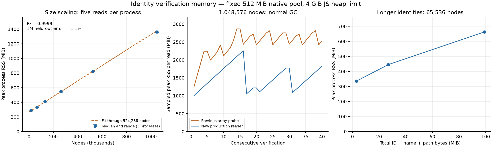

# Identity reader memory fix — 2026-11-03

Status: implementation and validation complete. Local changes are not published.

PR #3805 remains at `6aeeace8e96603fb062dcc709e834042d5a6df74`. This follow-up starts at `9952270d81fc1f79bb8de34d43991b169d104289`, whose runtime is identical to that PR head. The compiled candidate hashes and complete measurements are in the accompanying JSON artifact. Node v22.23.3, LadybugDB 0.22.0, Linux x64.

## Change

Identity reconciliation consumes each row immediately through a direct native query. It no longer builds a JavaScript array for a complete table. The existing connection lock covers execution, synchronous row reads, cooperative yields every 1,024 rows, and cursor close. A read, validation or cleanup failure still prevents freshness publication. If validation and cleanup both fail, the original error is preserved.

Both checks remain in place: after COPY/checkpoint and immediately before freshness publication after the final checkpoint. The queries still scan each included label without filters and check every ID, name, path and source range, including unchanged nodes. Existing CSV normalization and exclusions are preserved. The general executeQuery/executePrepared/streamQuery behavior is unchanged.

Direct execution follows the evidence in [the preceding memory study](identity-memory-scaling-20261103.md): the prepared cooperative probe exhausted the fixed native pool on read 9 even with cursor closes; the direct-query probe completed 40 reads. This does not establish the precise C++ ownership defect or fix prepared execution globally.

## Memory evidence

All **172 complete identity verifications across 26 fresh reader processes passed**. Measurements use the same seeded fixtures, a 512 MiB native pool and a 4 GiB JavaScript heap limit. No GC is forced between reads. Initial/final GC is used only to measure retained memory. RSS includes native allocations and uses the OS high-water mark as well as periodic samples.

Two comparisons answer different questions:

- **Original PR implementation, matched first 12 million-node reads:** 1972.1 → 1926.7 MiB peak RSS (-2.3%). Median verification time: 43.54 → 2.68 seconds. This is one fresh paired memory comparison; an earlier original-reader run peaked at 2,223.8 MiB, so the small RSS difference should not be generalized beyond these runs.
- **Previous fast direct-query array probe, matched 40-read soak:** 2900.2 → 2253.0 MiB (-22.3%). The new reader completes all 40 million-node reads. Retained heap returns from 433.2 to 432.6 MiB after final GC. RSS rises and falls with normal GC; a flat RSS line is not claimed.

The following table compares the previous direct-query array probe with the implemented streaming reader. Each point is the median of three fresh processes, each performing five reads; all ranges are shown for the new reader.

|     Nodes | Previous array probe peak MiB | Streaming peak MiB | Streaming range MiB | Change |
| --------: | ----------------------------: | -----------------: | ------------------: | -----: |
|    16,384 |                         300.5 |              285.0 |         285.0–286.1 |  -5.1% |
|    65,536 |                         410.5 |              335.6 |         333.7–336.8 | -18.3% |
|   131,072 |                         556.3 |              408.8 |         408.6–408.8 | -26.5% |
|   262,144 |                         806.2 |              546.7 |         545.9–547.6 | -32.2% |
|   524,288 |                        1283.9 |              822.1 |         816.3–822.6 | -36.0% |
| 1,048,576 |                        2306.2 |             1362.0 |       1354.0–1375.2 | -40.9% |

Fit only through 524,288 nodes:

`peak RSS ≈ 268.12 MiB + 1,109.57 bytes × node count`

R² = 0.99994720. The held-out 1,048,576-node result is 1362.0 MiB versus 1377.7 MiB predicted (-1.14%). Retained heap fits approximately 9.38 MiB + 424.01 bytes/node, including the original graph.

Long identities are checked separately at 65,536 nodes. Adding 128 or 512 ASCII bytes to each ID/name/path gives 26.94 or 98.94 MiB of identity input and median RSS peaks of 445.7 and 662.6 MiB. Memory depends on identity bytes as well as node count.

## What is established

The JavaScript live-data bound follows from the implementation: expected-node maps contain at most one entry per included graph node; each successful visit deletes one entry; the reader holds one decoded row and never accumulates rows. Auxiliary live JavaScript memory is O(N_expected + normalized expected-ID bytes + maximum row size). The original graph remains resident. There is no per-read global cache or retained result list.

Native query results still consume memory for the current label. The finite RSS measurements support approximately linear growth over 16,384–1,048,576 fixed-width nodes under the stated pool, heap and read count. They are not a mathematical proof about every native allocator, unlimited string widths, unlimited repetitions, or the full indexing pipeline. The 40-read soak separately checks repeated use; the held-out size and string-width cases guard against fitting only a convenient small range.

## End-to-end comparison

Three independent sessions each contain three paired edits in fresh processes and three in long-lived processes. Initial runtime order alternates between sessions, and edit order alternates within each session. Both runtimes use two parsing workers, a 4 GiB heap and FTS. The sparse 862-file corpus is pinned to `4916e0d5e1f4d6d70d41c1f39cd244bca2c7b390`. Each edit changes one file and uses incremental writes.

All 18 timed pairs have equal semantic graph digests and expected persisted call targets. Cold seeds are excluded from timing medians.

| Session | Process mode | Original median | Streaming median |  Change |
| ------: | ------------ | --------------: | ---------------: | ------: |
|       1 | fresh        |         19.164s |          17.356s |  -9.43% |
|       1 | persistent   |         18.397s |          16.569s |  -9.94% |
|       2 | fresh        |         19.144s |          17.377s |  -9.23% |
|       2 | persistent   |         18.504s |          16.805s |  -9.18% |
|       3 | fresh        |         20.554s |          17.635s | -14.20% |
|       3 | persistent   |         20.385s |          17.766s | -12.85% |

Across all nine edit runs per mode, fresh-process medians are **19.164s → 17.435s (−9.02%)**, and long-lived-process medians are **18.826s → 16.805s (−10.73%)**. Median paired reductions are 9.23% and 10.76%, respectively. All 18 individual pairs improved, with visible variation; the host is shared. These results establish this corpus/workload, not a universal full-repository or watch-mode speedup.

Whole-process RSS high-water marks across timed samples are 1,947.6 → 1,937.7 MiB for fresh processes and 3,104.4 → 2,898.3 MiB for long-lived processes. The latter includes allocations from seeding and previous edits; these values must not be interpreted as isolated verifier memory.

## Validation

- Build, source typecheck and test typecheck passed. Changed-file ESLint completed with 0 errors and 44 warnings (including adapter/native-mock `any` types and an existing FTS-fixture non-null assertion).
- 39 focused tests passed: corruption rejection and recovery, CSV Unicode/null parity, row-at-a-time consumption, connection serialization across yields, cursor cleanup, incomplete/multiple results, and primary-error preservation.
- Native benchmark passed its normalized-scaling budget (0.713, budget 2), missing/swapped-field controls, and independent tuple oracle through selective DELETE/COPY, checkpoint and reopen.
- All 18 end-to-end timing pairs passed semantic graph and persisted-target checks.
- Full regression run: 31,574 passed, 103 skipped, five failures in one FTS crash-marker mock (4,788.40 s). The mock still wired the old row-array API; after adapting it to the visitor, all 38 tests in that file passed (50.04 s), as did test typechecking. The full run was not repeated after this test-only correction. Production sources and compiled runtime hashes remained identical to those measured.
- The local graph was refreshed. Final change analysis includes the new reader and completed without a partial or truncated result.
- Sequential source review found no actionable defect. No independent reviewer was dispatched under the user's AGENTS delegation mapping; this is not an independent review receipt.

## Reproduction

See [the benchmark instructions](../../gitnexus/bench/incremental-write-integrity/README.md#memory-scaling). The committed `memory.mjs` runs the actual compiled baseline or streaming implementation without prototype patches. Use separate processes and identical fixtures/limits for comparisons. The accompanying JSON preserves every raw run, fixture fingerprints, exact identity bytes, runtime hashes and per-read samples; CSV and PNG/PDF provide the plotted values.

[Raw evidence and scripts](identity-reader-fix-20261103.json) · [Process samples CSV](identity-reader-fix-20261103.csv) · [Figure PDF](identity-reader-fix-20261103.pdf)
