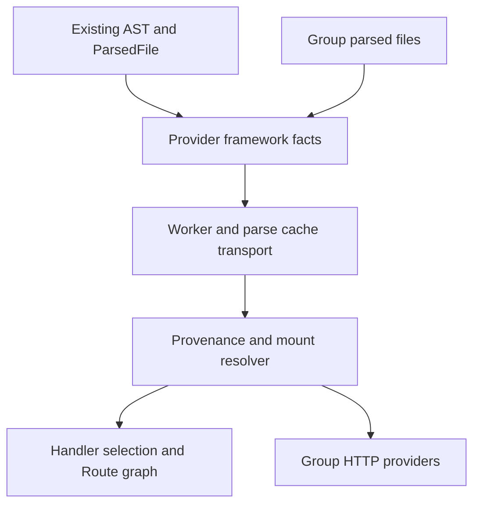

# Fix Express route provenance and mounted paths

## Goal Capsule

**Objective:** GitNexus users see real Express endpoints at their mounted URLs without unrelated object methods appearing as HTTP routes.

**Means:** Resolve framework receiver provenance and mount relationships through the existing parsing and route-emission pipeline (KTD1–KTD4).

**Authority:** The user's requested follow-up to PR #3561, this Product Contract, repository instructions, then implementation choices. Assumptions below are autonomous planning choices, not user-approved decisions.

**Execution profile:** One focused code PR from current `main`; implementation, tests, simplification and review run autonomously. LFG owns shipping and CI handoff; ce-work returns to its caller. Do not merge the new PR.

**Stop conditions:** A product-contract contradiction, unavailable required capability, or repository-mandated impact approval that existing user authorization does not cover. Ordinary implementation details are the executor's responsibility.

## Product Contract

### Summary

Replace receiver-name guesses with static framework provenance, and compose Express Router mount prefixes in ingestion and group HTTP contracts.

### Problem Frame

The prior architecture review of PR #3561 reproduced two gaps that its middleware correction did not address: a router mounted at `/api` still contributes `/users`, and `storage.get('/not-http', 'fallback')` contributes a false Route. Group extraction has an independent name-based fallback that can reproduce incorrect paths even after ingestion is corrected.

### Requirements

#### Receiver and registration accuracy

- **R1:** Emit Express endpoints only when the receiver is statically tied to an Express app, Router, or route builder. Recognize ordinary ESM default/namespace/named Router imports, CommonJS require forms, immutable aliases, and explicit named/default/CommonJS exports across repository files. Respect lexical shadowing, runtime versus type-only bindings, and ambiguous or mutated values; names such as `app` and `router` alone are not evidence.
- **R2:** Preserve the supported method set and handler requirement, `.all` wildcard semantics, chained route registrations, source precedence, and handler attribution. `.use`, a builder alone, and one-argument settings reads do not create endpoints. Preserve directly proven Hono verb registrations already covered by the shared capture path; do not apply Express builder or mounting semantics to Hono.

#### Externally visible paths

- **R3:** Compose literal Express mount prefixes through local and imported routers, root mounts, nested mounts, multiple mounts and literal path arrays. Middleware before or after the router argument does not hide a mount. Emit distinct composed paths once and retain the registration's file, line and handler evidence.
- **R4:** Preserve local paths for proven standalone routers with no known incoming mount. A router with a known dynamic or otherwise unresolved mount must not fall back to an invented root path. Retain independently proven static mount paths alongside unknown mounts. Cycles terminate without preventing distinct acyclic mount chains from contributing routes.

#### Consumer and lifecycle consistency

- **R5:** Ingestion and group HTTP extraction agree on Express provider paths and receiver admission, including source-only extraction and mixed JS/TS/TSX repositories. Group fallback must not reintroduce raw local paths or arbitrary receivers. Existing HTTP consumer detection and other framework behavior remain intact.
- **R6:** Cold parsing, serialized warm cache, worker/sequential parsing and the durable ParsedFile path produce equivalent results. A mount-file-only edit recomputes dependent router paths. Existing cached guesses are invalidated by the parse-cache version change.

### Acceptance Examples

| Example | Expected result | Requirements |
|---|---|---|
| Express Router `/users`, mounted on an app at `/api` | `/api/users`; no `/users` ghost | R1, R3, R5 |
| Storage object `.get('/not-http', 'fallback')` | No provider Route | R1 |
| Router mounted at `/v1` and `/v2`, with nested `/admin` router | Both composed endpoint sets | R3 |
| Proven Router with no incoming mount | Existing local endpoint paths | R4 |
| Router mounted only at a runtime prefix | No guessed root endpoint | R4 |
| Parameter named `router` shadows a real outer Router | Inner calls are not admitted from outer provenance | R1 |
| Warm cache; change only `/api` mount to `/v2` | `/v2/users`, old path absent in both consumers | R5, R6 |

### Scope Boundaries

This correction does not execute user code, evaluate regex routes or arbitrary factories, infer implicit HEAD/OPTIONS endpoints, or model all runtime control flow. Dynamic factories, computed exports and conflicting writes may remain unresolved. It does not redesign the graph schema or generic scope-resolution pipeline. Hono mount expansion and new framework support are outside this change.

## Planning Contract

### Assumptions

- The earlier finding means both receiver provenance and mounted paths, as stated in the task acknowledgment.
- Preserving proven standalone Router paths is the compatibility default: `test/fixtures/lang-resolution/express-route-mapping/server.ts` intentionally exposes a standalone Router.
- Finite, statically proven facts are preferable to speculative paths when dynamic code prevents resolution. Unsupported constructs fail closed for affected candidates, not for unrelated routes.

### Context and Research

Evidence is pinned to `6c0c75c40ce6c7d1ad7a8c8656197d68cb79fb4b`. PR #3561 is already on main as `94f167a9`; this is a separate correction.

`workers/parse-worker.ts` currently handles Express/Hono captures with a client-name blacklist. Its provider extraction stage already has the parsed tree and ParsedFile. `languages/typescript.ts` is the JS/TS framework-hook owner. `pipeline-phases/parse-impl.ts` loads language import-resolution configuration and selects handler winners before `routesPhase`; finalized scope-resolution scopes are not yet available there. Use the ParsedFile scope captures already produced at parsing time.

`group/extractors/http-patterns/node.ts` independently scans receivers literally named app/router, and Node route coverage remains partial. The group plugin exposes repository/project scan seams and already owns JS/TS parsing. `route-extractors/fastapi-router-prefixes.ts` is a precedent for sharing composition with group extraction, not for file/name-based router identity.

The target index is current. Upstream impact on `extractJsTsRoutes` is LOW (23 impacted symbols); on `resolveRouteHandlerSymbols` LOW (2). Recheck every additional shared symbol before editing, following AGENTS.md and GUARDRAILS.md. Index creation reported skipped unrelated relationship rows; source verification remains necessary even where impact reports exactness.

No relevant repository learnings or configured Compound Packs were found.

### Key Technical Decisions

- **KTD1 — Provider-owned facts using existing lexical identities.** Capture compact, JSON-safe framework facts from the existing AST and ParsedFile scope/binding identities. Nearest lexical declarations block outer identities even when unknown; capture writes conservatively. Shared ingestion only transports facts and invokes generic provider hooks. A separate parse pass, custom scope database or receiver-name allowlist would duplicate authority and fail shadowing (R1, R6).
- **KTD2 — Explicit module provenance.** Use ScopeResolver import-target/configuration hooks, including TypeScript path mappings, and explicit export facts for ordinary ESM/CommonJS aliases and barrels. Do not infer default exports from a unique named symbol. Resolve a bounded transitive module closure; decline ambiguous stars, cycles without a resolved seed, type-only imports and conflicting mutations. Existing route-handler import resolution supplies the integration pattern (R1).
- **KTD3 — Compose before winner selection.** Resolve allocation identities and mount edges before `resolveRouteHandlerSymbols` reserves method/path winners. Treat proven apps and routers without incoming mount evidence as roots; rootless cycles contribute no standalone paths. Traverse all distinct app-rooted and standalone-rooted acyclic chains with path-local cycle guards, deduplicate router/prefix outcomes, and impose an explicit expansion budget. Budget exhaustion declines the affected component atomically; never publish an arbitrary partial prefix set. Reuse route path normalization and the existing registry, keeping registration metadata attached (R2–R4).
- **KTD4 — One resolver, both consumers.** Share framework fact extraction and composition between ingestion and Node's group plugin. The group adapter consumes its existing parsed trees and does not introduce another parser stack. Add a generic optional project-scan family key so JS/TS/TSX can share already-parsed inputs. Complete that project composition before graph-provider fallback enrichment can consult per-file detections. Keep Node coverage partial and replace only its speculative Express provider scan; preserve consumers and independent framework scans (R5).
- **KTD5 — Cache facts, recompute relationships.** Persist per-file facts through ParseWorkerResult, accumulation and content-addressed cache; resolve relationships across all admitted facts each run. Do not store cross-file final prefixes in an unchanged router's parse-cache entry. Increment schema version 143 and update the regression pin. Keep AST nodes out of serialized results and do not misuse ParsedFile.captureSideChannel, whose restoration occurs later (R6).

### High-Level Technical Design

This diagram locates the integration seams; exact helper names remain implementation choices.

### System-Wide Impact and Risks

ParsedFile scope and binding data, SemanticModel handler lookup, Route identities and group contracts remain authoritative. No new agent tool or UI action is added; existing graph and group consumers expose the corrected facts equally.

Strict provenance will intentionally remove unsupported guesses. Update fixtures that use undeclared app variables to genuine Express construction so their priority assertions retain meaning. Protect Hono direct routes with a real fixture. Cross-file ambiguity and repeated mounts can increase work; KTD2/KTD3 bound resolution and require deterministic failure behavior. Source parsing errors omit affected facts without crashing unrelated files.

### Sources and References

- `AGENTS.md`, `GUARDRAILS.md`, `ARCHITECTURE.md`: provider boundaries, scope authority, impact and validation gates.
- `gitnexus/src/core/ingestion/pipeline-phases/parse-impl.ts`: import-aware route handler resolution.
- `gitnexus/src/core/group/extractors/http-patterns/node.ts`: Node provider/consumer fallback.
- [Express routing](https://expressjs.com/en/5x/guide/routing/), [Router API](https://expressjs.com/en/5x/api/router/), [Application API](https://expressjs.com/en/5x/api/application/): Router composition, use argument forms, route builders, settings reads. Preserve declared path syntax rather than translating Express versions.
- [Node CommonJS exports](https://nodejs.org/api/modules.html#exports-shortcut): module.exports and exports alias semantics.

## Implementation Units

### U1. Extract and resolve framework receiver facts

**Goal:** Establish truthful receiver identities and registrations (R1, R2; KTD1, KTD2).

**Files:** `gitnexus/src/core/ingestion/route-extractors/` (new focused framework modules); `language-provider.ts`; `languages/typescript.ts`; `workers/parse-worker.ts`; corresponding unit tests under `gitnexus/test/unit/`.

**Approach:** Inspect existing ParsedFile scope helpers before defining fact shapes. Move Express-specific admission out of the generic capture block. Resolve literal framework imports, constructors, stable aliases, explicit exports and route builders without executing source. Preserve directly proven Hono registrations through provider-owned logic.

**Test scenarios:** ESM aliases and namespace Router, CJS factory/Router/destructuring; named/default exports and barrels; lexical parameters, block/catch shadows, shadowed require, type-only imports, reassignment and conflicting captured writes; storage false positive; builder-only, chained/assigned builders, all and comments; real Hono direct route.

**Verification:** Proven registrations are admitted with original source metadata; misleading names and unsafe provenance are rejected.

### U2. Compose mounts and integrate parsing/cache lifecycle

**Dependencies:** U1.

**Goal:** Resolve external endpoint paths before handler selection (R3, R4, R6; KTD2, KTD3, KTD5).

**Files:** Framework modules from U1; `gitnexus/src/core/ingestion/pipeline-phases/parse-impl.ts`; `parsing-processor.ts`; `workers/parse-worker.ts`; parse-cache module/version test; `gitnexus/test/integration/resolvers/express-routes.test.ts`; `test/unit/resolve-route-handler-symbols.test.ts`; `test/unit/incremental-parse-cache.test.ts`.

**Approach:** Transport facts over every parse return/cache path. Load required transitive imports through the existing resolver. Recompute mount outcomes each run and pass expanded registrations to existing handler/source-priority selection. Select the next schema version from the actual branch when editing.

**Test scenarios:** Local/imported/nested/default/named/CJS routers; TS path mapping and mixed JS/TS barrels; root and multiple mounts, path arrays, middleware argument arrays, diamond and cycle; unknown prefix with and without another static mount; disconnected standalone root; deterministic expansion-limit handling; colliding paths and handler priority. Compare cold/warm results, durable ParsedFile transport, sequential/worker paths and mount-only, barrel-only and resolution-config edits.

**Verification:** `/api/users` is emitted with the registration handler, `/users` is absent when mounted, and all execution modes agree.

### U3. Align group contracts with ingestion

**Dependencies:** U1, U2.

**Goal:** Prevent fallback extraction from undoing the correction (R5; KTD4).

**Files:** `gitnexus/src/core/group/extractors/http-patterns/node.ts`; existing plugin types/orchestrator only if required by the shared project context; `gitnexus/test/unit/group/http-route-extractor.test.ts`.

**Approach:** Adapt existing project/repository scan seams to shared framework facts and composition, keeping source-only operation available. Remove name-only Express providers and retain HTTP consumers/Nest/data-route scans.

**Test scenarios:** Compare source-only and graph-backed group providers with ingestion for imported mounted routers, arbitrary storage calls, multiple mounts and unknown prefixes. Include a mixed JS/TS/TSX chain and a graph Route without handlerSymbolId that must be enriched from the composed source registration. Include an outbound fetch/axios consumer in a router file and existing Nest/data-route contracts.

**Verification:** Group endpoints match composed graph paths without raw-path duplicates; consumers and other supported frameworks remain present.

### U4. Complete regression coverage and document static limits

**Dependencies:** U1–U3.

**Goal:** Make compatibility and static-analysis boundaries reviewable (R1–R6).

**Files:** Express fixture directories under `gitnexus/test/fixtures/lang-resolution/`; `gitnexus/test/unit/route-source-priority.test.ts`; focused route tests; appropriate route documentation under `docs/`.

**Approach:** Replace undeclared receivers only in fixtures whose purpose is valid Express routing. Add concise supported-pattern and unresolved-case documentation. Remove abandoned implementations and temporary artifacts.

**Test scenarios:** Run the verification gates below and inspect failures for changed behavior rather than mechanically updating snapshots.

**Verification:** All requirements have passing evidence; the diff contains only necessary source, tests, documentation and this plan.

## Verification Contract

From `gitnexus/`, run focused route, provenance, group and cache suites first; then `npm test`, `npx tsc --noEmit`, `npm run typecheck:tests`, and `npm run build`. Use the repository's Prettier configuration on changed files and `git diff --check`. No dependency or CI changes are planned; release publishing gates do not apply.

Before editing shared symbols run upstream GitNexus impact; before each commit run detect_changes and verify that changed symbols/processes fit these units. Use the current branch index and source confirmation for uncertain graph results. Never terminate workers during native calls.

A regression proves each original failure through the real pipeline and group consumer, not only helper outputs. Cache tests serialize/reload facts and edit only the mount file so stale derived paths are observable. Validation records exact commands, exit outcomes and relevant environment limitations outside this plan.

## Definition of Done

- U1–U4 satisfy their stated verification outcomes and R1–R6.
- Both original reproductions are fixed, with mounted URLs and handler attribution checked end to end.
- Required tests, build, typechecks and formatting pass, or any genuine external blocker is reported precisely.
- Simplification and code review complete; eligible fixes are committed and residual findings are durable.
- Abandoned code, temporary symlinks and unrelated modifications are absent from the deliverable.
- LFG opens a new PR against upstream main and reports its URL and verification state.
