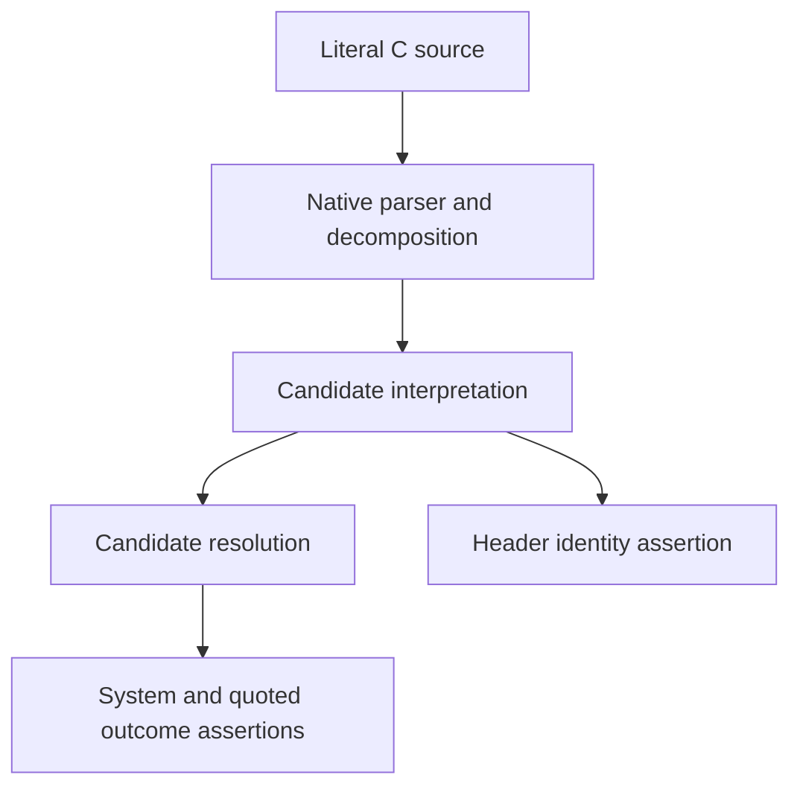

# C Include Benchmark Validity - Plan

## Goal Capsule

- **Objective:** Maintainers can trust the C evaluation task to distinguish correct solutions from broken ones.
- **Means:** Replace the invalid task with a real missing include-provenance feature and validate the grader against independent solutions (KTD1–KTD3).
- **Authority:** The user's repair request and paid-run prohibition govern this plan; repository instructions govern implementation.
- **Execution:** Test-first implementation on an isolated branch. LFG owns review, commits, PR creation and CI follow-through.
- **Stop conditions:** Stop if no genuine base failure can be demonstrated, a valid independent solution cannot satisfy the contract, or verification requires another paid evaluation.

---

## Product Contract

### Summary

Replace the C system-include task with a task that retains literal include records while preventing system headers from binding to repository decoys. Grade the actual parsing and resolution behavior, and prove that the grader accepts different valid implementations.

### Problem Frame

The original oracle fabricates an `isSystem` field absent from the pinned task types. The stable parser already drops system imports, so the original claimed end-to-end resolution bug does not exist at that source pin. A reference patch passing this synthetic oracle does not establish task validity. This made the C task's repeated failures unreliable evidence about agent correctness.

### Requirements

**Task behavior**

- R1. The replacement task retains literal system and quoted includes after interpretation, preserving header identity for downstream consumers.
- R2. With no configured system include roots, system includes must not resolve to unrelated same-named repository headers, while quoted local and relative includes still resolve.
- R3. Computed macro includes remain unsupported and produce no parsed import.
- R4. The hidden grader observes real C parsing, decomposition, interpretation and resolution without requiring a particular marker field or representation.

**Validation and compatibility**

- R5. The untouched pinned source must fail a named behavioral assertion; two independently structured, type-correct repairs must pass both the hidden grader and the task's authored verification.
- R6. Controls must reject dropped-system, dropped-all, identity-losing and decoy-resolving implementations through behavioral assertions rather than setup errors.
- R7. Preserve the four-task protocol and shared stable source/dependency pin; give the changed task a new identity and document that old C solve counts cannot be rescored or compared as equivalent evidence.
- R8. Do not dispatch paid evaluations or change runtime source, workflow provisioning, model settings, artifact privacy or release behavior.

### Scope Boundaries

Changes belong in evaluation task assets, controls, and documentation. Runtime edits exist only inside reference patches applied to disposable fixtures. No release, merge, GitHub comment, new paid run or retrospective rescore is part of this repair.

---

## Planning Contract

### Key Technical Decisions

- KTD1. Replace `inv-bug-c-system-include` with `inv-feature-c-include-provenance` at `c4ecf398de637cf779ab2238e69958cfd5d601ce`. Stable's dropped system import is a genuine missing feature. Historical re-pinning does not expose the alleged original bug; setup injection would also make the prebuilt MCP graph stale.
- KTD2. Parse literal C snippets with the native parser and pass actual interpreted imports into the resolver. Accept bare or delimiter-bearing header targets with preserved identity; inspect no implementation-specific marker. Covers R1–R4.
- KTD3. Maintain flag-based and delimiter-based reference repairs. The flag implementation must narrow extra metadata safely against the immutable stable shared declarations. Both include authored tests and a corrected C conformance fixture.
- KTD4. Expand the existing pinned control archive with tests and TypeScript configuration. Reuse `GITNEXUS_ORACLE_TASK_DEPENDENCIES` and the existing CI-selected control test entry point; exercise the new C controls there so workflow edits are unnecessary.
- KTD5. Keep hidden oracle output private in production. Local trusted control failures may supply test diagnostics; do not introduce transcript or secret-bearing artifact output.

### Assumptions

Retaining system-include provenance is a suitable replacement for the invalid C investigation task. It tests the same parser/resolver seam, matches the later #3341 behavior, and preserves the suite's size. This is a changed benchmark task, not a correction that makes historical scores interchangeable.

### Data Flow

### Evidence

- `eval/workflow_bench/tasks.scenarios.yaml`: immutable task definitions and authored verification.
- `eval/workflow_bench/oracles/inv-bug-c-system-include.oracle.test.ts`: synthetic marker defect.
- `eval/tests/test_oracle_assets.py`: pinned negative/reference controls and independent retry repairs.
- `eval/workflow_bench/release_report.py`: requires one shared source/dependency commit and binds task/oracle contents.
- Commit `86a39202` retains C system includes; initial migration `e412d292` already filtered them.
- Prior local diagnosis used Vitest 5.0.4. Authoritative new validation must use stable's locked toolchain, including Vitest 4.1.11.

---

## Implementation Units

### U1. Replace the task and behavioral oracle

**Goal:** Establish a meaningful C task with an implementation-independent grader.
**Requirements:** R1–R4, R7–R8.
**Dependencies:** None.
**Files:** `eval/workflow_bench/tasks.scenarios.yaml`, renamed C oracle under `eval/workflow_bench/oracles/`, `eval/tests/test_workflow_bench.py`, `eval/tests/test_oracle_assets.py`.
**Approach:** Apply KTD1–KTD2. Update prompt and verification to cover literal retention, conformance and macro exclusion. Use no task setup mutation.
**Execution note:** Demonstrate that untouched stable fails specifically because system include records are absent.
**Test scenarios:**

- System and quoted forms of the same header preserve identity but yield different resolution outcomes.
- Multiple system names with tempting repository decoys resolve to nothing.
- Quoted sibling and relative headers resolve to their actual file.
- Macro includes remain unparsed.

**Verification:** Task selection still returns four pinned tasks; the new oracle fails untouched stable on its intended retention assertion.

### U2. Prove valid repairs and broken controls

**Goal:** Make oracle validity executable under the exact task toolchain.
**Requirements:** R5–R6.
**Dependencies:** U1.
**Files:** `eval/tests/test_oracle_assets.py`, C reference patches under `eval/workflow_bench/oracles/reference/`.
**Approach:** Apply KTD3–KTD4. Run the full authored command for both valid references; preserve original tests/configs and immutable dependency mounts. Keep new controls reachable through CI's existing selected test entry point.
**Test scenarios:**

- Flag and delimiter repairs each pass typecheck, authored tests and oracle.
- Dropped-system and dropped-all variants fail retention/positive assertions.
- Lost header identity and system-decoy resolution variants fail their respective assertions.
- A broken oracle dependency/setup must not count as successful negative-control evidence.
- Existing non-C oracle/reference controls still pass.

**Verification:** Focused control suite succeeds with no skipped C checks under the pinned dependency build.

### U3. Document the changed evidence contract

**Goal:** Prevent reuse of invalid C results as a corrected baseline.
**Requirements:** R7–R8.
**Dependencies:** U1–U2.
**Files:** `eval/workflow_bench/README.md`, this plan.
**Approach:** Explain the new task, representation independence, tested controls and changed task digest. Record prior C solve counts as unreliable without inventing new scores.
**Test expectation:** Documentation review and diff checks; no new runtime test.
**Verification:** Documentation matches task identity, verification commands and observed control results.

---

## Verification Contract

- Build the historical source's locked dependency checkout and set `GITNEXUS_ORACLE_TASK_DEPENDENCIES` to it.
- Run `uv run --locked --extra dev python -m pytest tests/test_oracle_assets.py tests/test_workflow_bench.py tests/test_release_report.py -q` from `eval/`; resolve test filenames from the repository if renamed.
- Run both C reference patches through the manifest's exact authored verification and hidden oracle.
- Run the broader offline evaluation tests appropriate to changed assets and report any environment skips explicitly.
- Run repository-required checks where supported, plus whitespace/diff checks and GitNexus impact/detect-changes when graph tooling is available. Never describe missing graph coverage as a clean graph check.
- No paid session, EC2 evaluation dispatch or release validation that triggers paid measurement.

---

## Definition of Done

The untouched stable source fails for the intended feature gap. Two different repairs pass all C verification, every deliberately broken control fails behaviorally, and existing oracle controls remain valid. The task has a new identity and digest with documented baseline incompatibility. Abandoned experiments are absent from the branch diff. The reviewed changes are committed and published in an open PR with validation evidence and any remaining limitations.
