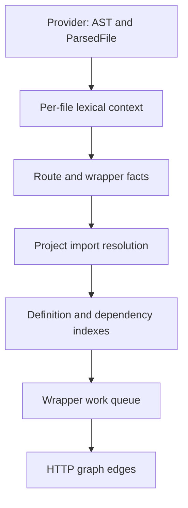

# Preserve lexical binding ownership and HTTP provenance

## Goal Capsule

**Objective:** GitNexus users receive HTTP routes, fetch consumers and member targets that respect the declarations their code actually refers to.

**Means:** Declaration-based lexical ownership and binding-based HTTP provenance (KTD1–KTD4).

**Authority:** The user request and issue #3630, including both revision-5 plan comments, govern behavior. The user's linear-scaling requirement supersedes the comment's suggestion to leave the repeated wrapper closure scan unchanged.

**Execution profile:** Implement and verify all units, with regression-first coverage and rebuilt workers. Apply SOLID, KISS, DRY, YAGNI and clean code; keep language policy in providers.

**Tail ownership:** LFG owns simplification, code review, fixes, shipping and CI. Create the PR through the authenticated GitHub browser; do not merge it.

**Stop conditions:** A genuine access blocker or evidence that the required behavior cannot be achieved within the stated scope must be reported with preserved work. Routine implementation decisions remain autonomous.

---

## Product Contract

### Summary

Correct assignment ownership, remove compensating text heuristics, and resolve Express and fetch-wrapper provenance using the existing scope model. Preserve declared-type precedence, configured wrappers, unrelated ingestion and other language providers.

### Problem Frame

A closure's inferred constructor fact can currently make it appear to declare an outer variable. HTTP analysis invalidates the wrong binding, rename compensates with a walk-past workaround, and wrapper analysis confuses unrelated same-named values. Repeated scans also make wrapper chains and large files vulnerable to quadratic work.

### Requirements

**Ownership and type information**

- R1. When a provider sets `nameClaimsComplete`, assignment-derived facts cannot establish lexical ownership. Genuine declarations and shadowing retain ownership; providers without that policy retain current behavior.
- R2. Carry the nearest eligible skipped constructor fact only when the owner has no stronger fact. Return the complete selected `TypeRef`, preserving its scope, position and namespace. Keep same-scope tie rules unchanged and never propagate a nested write into an unconditional outer fact.
- R3. Remove the imported-receiver rename walk-past workaround after real indexing/rename coverage proves the core fix suffices.

**HTTP provenance**

- R4. Share lexical ownership, binding IDs, global checks and ambiguity checks between route and wrapper analysis. Invalidate initialized `var` redeclarations of forwarded parameters; keep uninitialized redeclarations. Remove `written` and `shadowedBetween`.
- R5. Bare platform `fetch` and platform-global member access require unshadowed global identity. Unknown injected parameters provide no evidence. Valid platform defaults provide potential evidence; self-referential defaults and shadowed platform globals do not.
- R6. Determine nested callable reachability from evaluated outer code and resolved binding references. Unrooted recursive cycles remain excluded. IIFEs, inline callbacks and directly escaping anonymous values participate. Named stored helpers require a reachable binding reference. Class heritage, computed keys, static fields and static blocks are evaluated independently of class-name references; methods and instance fields remain deferred until a reachable class reference. Supported decorator expression/application/initializer behavior follows the provider dialect.
- R7. Resolve bare callees to declaration/import identity before automatic fallback. Use project import resolution for relative, tsconfig and workspace specifiers. Known local non-wrappers, different resolved targets and ambiguity prevent name fallback. Fallback requires exactly one distinct same-named definition, including non-wrappers in the collision universe, and that definition must be proven. Apply the same rule to forwarding. Preserve existing member-call behavior and explicit configured wrapper-name overrides, including through local parameters.
- R8. Fail closed for collapsed parameter/body environments: if formals contain expressions, including nested defaults or computed pattern keys, a body `var`/function name also declared as a parameter or referenced in a parameter expression is ambiguous. Do not treat declarations in nested functions as outer body declarations. Rest alone is not an expression. Missing `ParsedFile` skips scope-dependent HTTP analysis only and retains existing scope-failure accounting.

**Verification and delivery**

- R9. Compare every `CALLS` edge at call-site/target identity level on the identical TS/JS fixture corpus and pinned rebuilt baseline/candidate builds; inspect every change. Receiver changes must be explained by restored owner declarations. Preserve `METHOD_OVERRIDES` and ancestor dispatch. Keep route/FETCHES, rename, import ownership, inheritance and taint suites green, including the existing seven fetch-base-url-wrapper edges, receiver-resolution and tool-accuracy checks.
- R10. Provide repeatable warmed scaling benchmarks with multiple sizes, repetitions, statistics, semantic fingerprints and explicit linear-factor checks. Include reversed forwarding chains, name collisions, concentrated declarations/reads, nested helper reachability and fresh per-file index construction. Report measured bounds and limitations honestly.
- R11. Update `docs/languages/local-import-scoping.md` for ownership versus facts, type precedence, provenance, ambiguity and automatic cache identities. Rebuild workers before validation; prove cold/warm cache transport. Open a reviewable PR with the validation and benchmark evidence.

### Scope Boundaries

Do not implement full control-flow narrowing, factory-call narrowing, capture-time binding storage, other-language ownership changes, separate parameter environments, SvelteKit fetch injection, or unrelated refactors. Do not manually bump parser cache counters or alter CI/release/security configuration.

### Sources

- [Issue body](https://github.com/abhigyanpatwari/GitNexus/issues/3630).
- [Plan sections 1–10](https://github.com/abhigyanpatwari/GitNexus/issues/3630#issuecomment-6255593894).
- [Plan sections 11–13](https://github.com/abhigyanpatwari/GitNexus/issues/3630#issuecomment-6255594141).
- `docs/languages/local-import-scoping.md`, `MIGRATION.md`, `AGENTS.md`, `GUARDRAILS.md`, `CONTRIBUTING.md`.

---

## Planning Contract

### Key Technical Decisions

- KTD1. **Honor complete declaration claims in shared lookup.** Change `name-claims.ts` without naming languages. Preserve whole facts and their existing strength policy; `scope-extractor.ts` provides the precedence reference.
- KTD2. **One per-file lexical analysis context.** Extract `createLexicalBindings` and pass the existing AST root explicitly alongside `ParsedFile` and line offset. `ParsedFile` does not retain parameter expression syntax, so the extra AST input is necessary for R8 without expanding the persisted scope model. Cache ownership by node/use and index ambiguity once. Avoid repeated linear scope-position scans in affected hot paths.
- KTD3. **Provider-owned wrapper analysis.** Replace the worker's language-name branch with an optional provider hook/context. Build shared context once per file and reuse it for facts/call sites. Keep new serializable identity metadata in parser-owned result shapes so automatic identities invalidate old cache entries.
- KTD4. **Resolve imports before route classification.** Reuse `resolveRouteModuleTargets` in `parse-impl.ts`, including wrapper-only files when loading project configs. Preserve unresolved, blocked and resolved target states. Index all relevant distinct definitions by binding identity and module/name; do not infer uniqueness from seed-only definitions.
- KTD5. **Work queues instead of repeated closure scans.** Build dependency edges once, propagate wrapper status through reverse dependencies, and index reachable callable regions once. Use mutable collision buckets instead of repeated array copying. Scaling checks include fresh context construction and adversarial ordering.
- KTD6. **Pinned semantic comparison plus separate timing.** Retain an untouched checkout/build at the baseline SHA. Export sorted full call-site edges and override edges from real pipelines before/after; exact fingerprints and positive result counts prevent fast empty answers. Follow `bench/go-route-resolution/measure.cjs` for reproducibility, adding mean/median/deviation and at least three workload sizes.

### High-Level Technical Design

### Assumptions and Risks

- The baseline is current `main` with both prerequisite PRs merged. Issue line numbers are navigation hints; current source is authoritative.
- A lookup cache alone does not prove linearity: position-index scans, deep repeated AST traversals and long dependency chains need direct measurement. Optimize only demonstrated hot paths required by R10.
- Runtime allocation and timing vary on this host. Use warmed repeated samples and generous normalized ratio gates; treat timing evidence as empirical, backed by traversal structure and semantic checks.
- No GitNexus MCP or existing checkout index is available. Attempt the documented CLI impact/change commands and record any unavailable graph evidence; source caller tracing supplements unresolved results.
- No new dependency is expected. No behavior of unsupported parameter environments is claimed beyond fail-closed HTTP inference.

---

## Implementation Units

### U1. Declaration ownership and rename

**Goal:** Restore lexical ownership while preserving receiver facts under R1–R3.

**Dependencies:** Baseline capture in U5 before production edits.

**Files:** `gitnexus-shared/src/scope-resolution/name-claims.ts`; `gitnexus/src/core/ingestion/languages/typescript/rename.ts`; `gitnexus/test/unit/scope-resolution/lexical-name-claims.test.ts`; `gitnexus/test/unit/scope-resolution/typescript/lexical-type-ownership.test.ts`; relevant receiver/rename integration fixtures.

**Approach:** Apply KTD1, then remove the workaround once ownership tests pass. Avoid changing method dispatch.

**Test scenarios:**
- Direct and chained constructor writes in closures resolve to outer parameters/module bindings for TS and JS.
- Owner annotations and parameter annotations, including JSDoc, return the complete owner fact; untyped owners retain the nearest eligible carried fact.
- Real local shadowing remains local and incomplete-claims providers retain prior ownership.
- A nested write does not type an outer read; same-scope and closure annotated receivers target `Base.m` with unchanged override edges.
- Existing imported receiver reassignment remains rejected by real rename tests.

**Verification:** Focused ownership and rename tests, full edge comparison and receiver check.

### U2. Shared bindings and Express invalidation

**Goal:** Satisfy R4/R8 using KTD2.

**Dependencies:** U1.

**Files:** `gitnexus/src/core/ingestion/route-extractors/lexical-bindings.ts`; `framework-route-facts.ts` in that directory; `gitnexus/test/unit/framework-route-provenance.test.ts`; `gitnexus/test/unit/group/express-provider-provenance.test.ts`; a focused lexical-helper test if needed.

**Approach:** Extract the existing ownership mechanism, index parameter/body ambiguity from the AST, add initialized-parameter redeclaration invalidation, then remove text guards.

**Test scenarios:**
- Module `let app` reassigned in a closure produces no `/let-closure` route.
- Initialized `var app` overwrites forwarding with and without other defaults; bare `var app` retains forwarding in supported simple-formal cases.
- Nested same-named parameter writes do not invalidate the outer parameter; destructuring writes and block shadowing remain correct.
- Nested destructuring defaults/computed keys trigger ambiguity; rest alone does not; body function declarations count, nested-function declarations do not.

**Verification:** Route provenance/group suites and rebuilt real Express integration.

### U3. Scope-aware wrapper extraction

**Goal:** Satisfy R5/R6/R8 using KTD2/KTD3.

**Dependencies:** U2 helper interface.

**Files:** `gitnexus/src/core/ingestion/route-extractors/fetch-wrapper.ts`; `gitnexus/src/core/ingestion/language-provider.ts`; `gitnexus/src/core/ingestion/languages/typescript.ts`; `gitnexus/src/core/ingestion/workers/parse-worker.ts`; `gitnexus/test/unit/fetch-wrapper-calls.test.ts`; targeted worker/integration fixtures.

**Approach:** Use binding IDs for URL parameters, aliases and nested references. Reuse file-level region indexing; no conflicting/localNames/referenced text sets. Preserve full declaration inventory for U4.

**Test scenarios:**
- All four platform-fetch/default rows from the issue, plus sibling block shadowing and alias shadowing.
- Self-recursive and mutually recursive unused helpers remain excluded; rooted chains/cycles participate.
- IIFE, inline callback, escaping anonymous function, unused named arrow helper and referenced helper are distinguished.
- Class declaration/expression heritage, computed keys, static blocks/static fields participate; methods/instance fields defer until referenced; supported decorators follow evaluation boundaries.
- Missing scope skips wrapper facts/call sites, retains unrelated definitions and reports scope failure; Vue line offsets remain correct.

**Verification:** Data-driven facts tests plus real worker/cache transport and unchanged seven-edge integration fixture.

### U4. Target identity and linear propagation

**Goal:** Satisfy R7/R10 using KTD4/KTD5.

**Dependencies:** U3 serialized identity contract; implementation can prepare independent resolution helpers after that contract is fixed.

**Files:** `gitnexus/src/core/ingestion/pipeline-phases/parse-impl.ts`; `gitnexus/src/core/ingestion/pipeline-phases/routes.ts`; provider-owned wrapper resolver helper if extraction and classification need a focused boundary; `gitnexus/test/unit/fetch-wrapper-calls.test.ts`; `gitnexus/test/integration/resolvers/fetch-wrapper-consumers.test.ts` and fixtures.

**Approach:** Resolve specifiers with the existing project resolver, classify known targets directly, enforce unique fallback across all definitions and propagate through a work queue. Configured names match first.

**Test scenarios:**
- Relative renamed imports, tsconfig path aliases and workspace imports target the actual wrapper.
- A different resolved target, local parameter, nested local or blocked claim cannot inherit same-name wrapper status.
- One wrapper plus one plain non-wrapper and two wrappers both prevent fallback; duplicate captures of one definition do not create false ambiguity.
- Unique unresolved fallback succeeds; forwarding uses the same rule.
- Configured local-parameter calls succeed, identical unconfigured calls decline; member behavior remains covered.
- Reversed long chains terminate with correct results; unrooted cycles remain excluded.

**Verification:** Extraction/classifier tests, pipeline FETCHES fixtures and scaling checks.

### U5. Semantic comparison and scaling evidence

**Goal:** Establish R9/R10 with KTD6.

**Dependencies:** Baseline capture precedes U1; candidate runs follow U1–U4.

**Files:** `gitnexus/bench/lexical-binding-provenance/measure.cjs`; `baseline.json` and `README.md` in that directory; a reusable call-site export/comparison runner there if no existing runner preserves all required identities; targeted comparison fixtures.

**Approach:** Use the identical baseline/candidate fixture corpus and pinned builds. Record all CALLS and METHOD_OVERRIDES edges, classify every delta, and measure fresh-context workloads over N/2N/4N or wider scales with warmups and at least 15 samples. Report environment, min/mean/median/deviation, normalized ratios, exact fingerprints and positive counts. Benchmark extraction separately from wrapper closure. Include aliases, nested helpers, concentrated reads following many completed scopes, collisions and reversed chains. Set a normalized linear-factor ceiling before checking the candidate; investigate any failure rather than widening it to fit.

**Test scenarios:**
- Semantic changes in annotated closure receivers are explained at their exact sites; other call categories remain unchanged.
- Baseline/candidate exports preserve source/target identity and multiplicity; override edge sets remain identical.
- Incorrect empty output fails correctness gates even if fast; reversed order exposes repeated scans.

**Verification:** Reproducible `--check` benchmark and saved edge-diff report in the PR evidence.

### U6. Contract and full validation

**Goal:** Complete R9/R11.

**Dependencies:** U1–U5.

**Files:** `docs/languages/local-import-scoping.md`; benchmark evidence documentation; only justified receiver baseline updates if exact edge review warrants them.

**Approach:** Document analysis policy versus runtime semantics, supported ownership guarantees and fail-closed limits. Replace stale numeric cache gate text with automatic identity references. Run mandatory regression, accuracy and cache gates on rebuilt code.

**Test scenarios:** Existing suites provide behavioral coverage; documentation adds no new executable behavior.

**Verification:** All required commands below pass or any concrete environment failure is isolated against the pinned baseline and explicitly reported.

---

## Verification Contract

Run from `gitnexus/`; use `GITNEXUS_WORKER_READY_TIMEOUT_MS=180000` for worker-based commands on this host.

| Gate | Command or evidence | Units |
| --- | --- | --- |
| Build | `npm run build` before worker verification | All |
| Types | `npx tsc --noEmit` and test typecheck when tests change | All |
| Focused regressions | Ownership, wrapper, route, rename, taint lexical imports and group unit suites | U1–U4 |
| Real integration | `npm run test:integration -- test/integration/resolvers/ test/integration/rename-provider-matrix.test.ts test/integration/local-import-worker-parity.test.ts` | U1–U4 |
| Receiver accuracy | `node --import tsx bench/receiver-resolution/measure.mjs --check` | U1/U5 |
| Tool accuracy | `node --import tsx bench/tool-accuracy/run.ts --check` | U5/U6 |
| Scaling | `node --import tsx bench/lexical-binding-provenance/measure.cjs --check` | U5 |
| Cache identities | `npm test -- test/unit/parse-cache-identity.test.ts test/unit/parse-cache-input-coverage.test.ts` plus cold/warm transport | U3/U6 |
| Full suite | `npm test` as required before commit; bound workers for host resources | All |
| Semantic parity | Sorted call-site/target export diff and unchanged override/ancestor behavior | U1/U5 |

---

## Definition of Done

Every requirement and issue acceptance table is covered, no unjustified call-target difference remains, required accuracy checks and regression suites pass, and scaling is measured with semantic identity guards. The production diff contains no abandoned experiments, unrelated cleanup or text-based scope heuristics. The contract is updated, work is reviewed and committed, and an open PR created through the authenticated browser contains benchmark results and any material validation limitations.

## Execution checkpoint

- U1 committed as `f791aae2`; declaration-ownership regressions and the imported-receiver rename regression pass. The write lookup explicitly preserves source order across deferred scopes so it sees the import before the write's blocker.
- U2 committed as `a18f9faa`; 154 focused tests, production/test types, and scoped lint pass. Deterministic comparison-count regressions justified replacing the position index's expired-prefix scan with a maximum-end tree.
- U3/U4 committed as `685e8189`. Regression-first evidence includes 42 extraction failures and real pipeline false positives/missed imports. The rebuilt pipeline preserves the seven existing base-URL edges, passes six new identity-based edges and configured overrides, and passes cold/warm cache reuse with alias retargeting. All 503 focused tests passed, including a real-worker scope-extraction failure that retains structural ingestion while omitting HTTP facts.
- U5 captured the original baseline before production changes. Formatting the standalone ownership probe required a second fixed corpus; the original remains retained. The final baseline is still immutable `565e50276dc9aa4e3b6e36dfabe8a92571b0d699`, with 432 files, 432 `CALLS`, 11 `METHOD_OVERRIDES`, and corpus fingerprint `88be1faf45e9aec145f9d168b8959d67f31ec3b09b5455e9c8d8b2b1681ade5a`. Clean candidate `685e8189` changes exactly one target: `declaredOwner.writeAndRead` at callsite line 14, column 4 now calls `Base.m` instead of `Foo.m`. The other 431 CALLS and all 11 override edges are unchanged; the exact diff is committed under the benchmark results.
- The quiet baseline scaling run completed with the fixed 5 warmups, 15 samples, and 1.8 normalized ceiling. A loaded candidate diagnostic exposed two native AST costs: parent lookup descends from the root, and indexed child lookup rescans siblings. Three deterministic regressions failed with semantic controls passing (parent work 66,564 and 265,092 versus 4,096; sibling work 69,906 versus 8,192). U2/U3 now record traversal parents and use one bulk child array per node; the three complexity cases and 376 semantic tests pass, as do the build, test typecheck, and scoped lint (warnings only). Earlier broad/full candidate runs were canceled before changing production code; none is reported as complete.
- U6 documentation is updated. Receiver accuracy passes; tool accuracy exactly matches the baseline (29/32 answers, three documented gaps, regression gate passes).
- Review and simplification fixes are committed as `67c268e88`, `6f28dd6c7`, `a8bbc00ec`, `fe67b0856`, `205787b2c` and `47d09da4a`: wrapped assignment targets are writes, wrappers resolve through overloads, declarator lists, barrels, HOCs, CommonJS exports, object keys and fetch packages, and per-file HTTP contexts are released after use. `c41ad6ea9` replaces recursion in the new traversals with explicit stacks.
- Profiling the 512-unit wrapper arm showed native node construction (`namedChildren`, `childForFieldName`, `id`) dominating context construction. `7fcf3506c` limits the lexical-binding walk to functions whose formals contain an expression; `6061ca71b` collects wrapper evidence in one tree-cursor walk that materializes only inspected nodes and keys declarations by start offset. On the 512-unit wrapper workload, context construction fell from 58 to 48 ms.
- Review of `61de364ff` found that star exports reaching two export names of one declaration (`export { request, request as send }` behind two barrels) were counted as conflicting, which blocked the import and dropped its FETCHES edge. `4d62bd045` keys star-export candidates by the declaration each name refers to; distinct declarations stay ambiguous. A unit diamond and a real-parser fixture pair cover both cases; with the fix reverted only the diamond edge disappears.
- A multi-lane review of `5c179994c` (review 5575463241) found two recall regressions and several smaller gaps; `3c00b9f32` and `d3c357276` fix them. CommonJS wrappers captured as their assignment produce facts again. Name-only fallback considers only definitions that can be the target (module-level exports for an unresolvable import, top-level functions for an undeclared global). Only possible wrappers and module-level functions are emitted, and the index is built only with routes and candidate calls. Rebound bindings prove no wrapper across files; `(<T>x) = …` is a write; calls inside recovered syntax and instance-field initializers resolve; local exports make star-export conflicts visible; resolved barrel frames are shared; HTTP hooks are guarded per file and failed files still record their function names; an undeclared constructor write keeps its type for reads in the writing scope. Each behavior row fails on the previous source. The receiver baseline counts one new dropped write from the added CommonJS fixture (`9c4821106`).
- A behavior-preserving simplification pass (`3db8657ba`) shares the CommonJS `module`/`exports` checks, derives `LEXICAL_FUNCTION_TYPES` from the TypeScript `FUNCTION_NODE_TYPES`, reads each node's type once in the route-facts loop, and returns the latest-starting scope from the position index before the max-end search when it already contains the point. Focused suites (5019 tests), build, typechecks and lint pass; the resolver integration files that timed out at 30 s on the 9p checkout pass with a 120 s limit.
- Review fixes in `c263c4f72` retain fetch evidence from destructuring defaults (shorthand, renamed, array and local forms), count each binding initialization once, and record parenthesized default exports. JS/TS/TSX regression rows fail against the previous source, and two fixture consumers cover imported wrappers. The commit also clarifies failed-extraction fallback records and the collapsed parameter/body environment test boundary. All 73 CI checks pass for this revision; the refreshed receiver check matches the existing baseline.
- Final semantic comparison at `c263c4f72` (export fingerprint `4db24f57…`, clean tree, unchanged since `6061ca71b`) keeps the single expected CALLS change; the other 431 CALLS and all 11 override edges match the baseline export `3e00ca5b…`. Both exports use the same frozen 432-file corpus (`88be1faf…`).
- Final scaling at `c263c4f72` against baseline `565e50276` ran back to back on CPU 23; the host's 1-minute load, sampled every 30 s in an uncommitted log, had a median of 1.50 and peaked at 4.53. The largest candidate factor is 1.245 (rounded), below the 1.8 ceiling. The baseline fails six of nine arms: `position-index`, `position-deep-completed`, `nested-helpers`, `nested-helper-chain`, `reverse-chain` and `name-collisions`. Workload fingerprints match except `name-collisions`, where the baseline's false positive is recorded as `known-baseline-failure`. For the three arms that were already linear, candidate median times relative to baseline at the largest input are 1.07x spread aliases, 1.00x completed scopes and 0.99x wrapper aliases (between 1.01x and 1.24x across earlier pairs; run-to-run noise on this host is about 0.1x).
- The full suite passed in CI at `61de364ff` (1269 files passed and 12 skipped; 27194 tests passed, 83 skipped, none failed) and again at `5c179994c` (73 checks green). A local full run on the 9p checkout was stopped after four hours in the serial database lane, where real-analysis tests hit their timeouts; it is not recorded as a pass. At `528ea1478`, focused suites (5019 tests), HTTP integration (56), build, test typecheck, lint and formatting pass; receiver accuracy matches the updated baseline and tool accuracy matches (29/32).
- Graph impact/change checks remain unavailable: neither repository-wide indexing attempt published an index. Source caller tracing supplements this unknown result; no clean or low-risk graph result is claimed.
