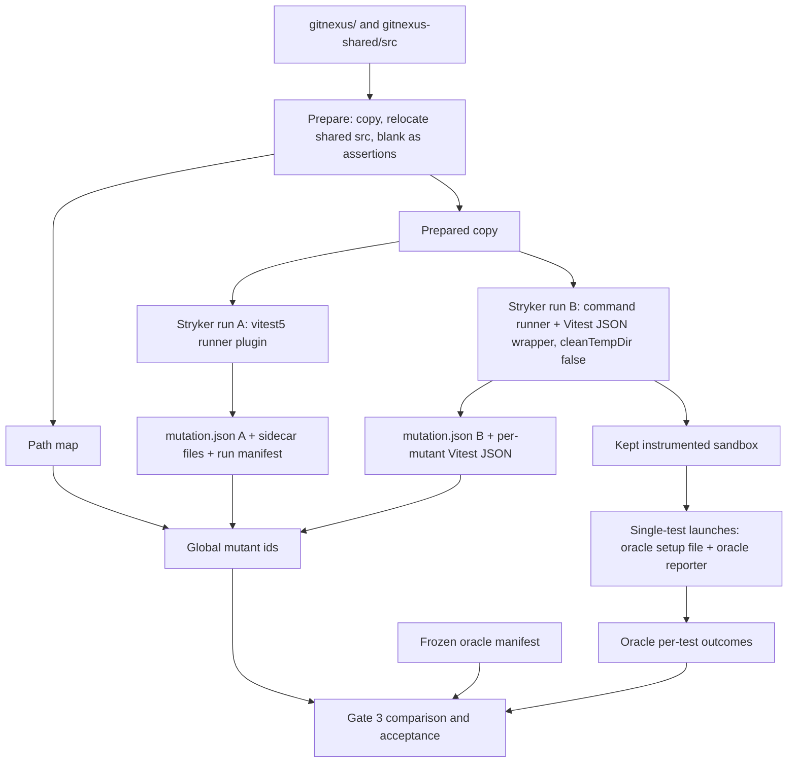
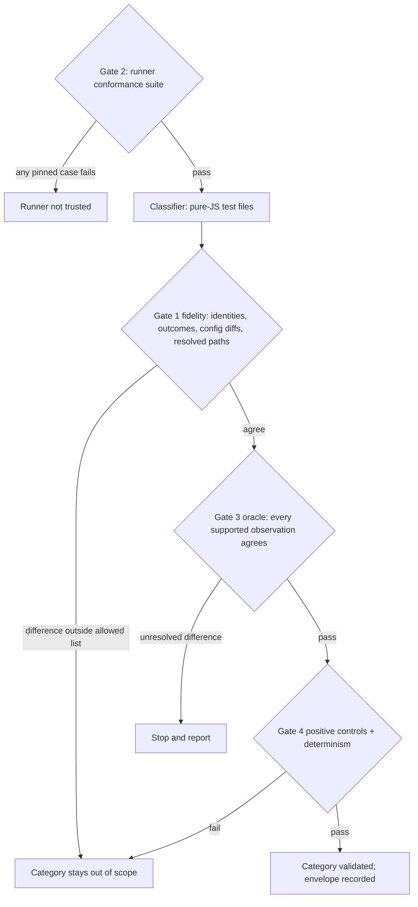

# Stryker Vitest 5 Runner, Phase 0 Pure-JS Slice - Plan

## Goal Capsule

- **Objective:** maintainers can run Stryker mutation testing on `gitnexus/` pure-JS unit tests under the repo's own Vitest 5, and trust each per-test kill inside the validated envelope because four validation gates passed. Gate 3's evidence is a frozen, stratified sample, so its claim is a bounded difference rate per scope, not a check of every mutant. This is the precondition for every strong verdict in the Test Scenario Map (see origin: `docs/plans/2026-10-23-test-scenario-map-design.md` §5.4a).
- **Means:** a repo-local Stryker test-runner plugin for Vitest 5 (KTD1), a prepared-copy step that makes type-asserted code mutable (KTD7, KTD8), and an independent Vitest 5 cross-check oracle with its own Stryker run (KTD11, KTD18).
- **Authority:** this plan's R-IDs and KTDs, then the origin design (§5.4, §5.4a, §9 Phase 0), then repo rules in `AGENTS.md`, `GUARDRAILS.md`, `TESTING.md`.
- **Stop conditions:** stop and report if the Vitest 5 runner cannot reach per-test kill attribution on the pure-JS slice, or if gate 3 leaves an unresolved difference. An exclusion must name the runner mechanism behind the difference and remove every pure-JS test that shows that trait, not only the sampled tests; after any fix or exclusion, gate 3 re-freezes with a new seed. Never weaken a gate to pass it.
- **Execution profile:** tooling work in `gitnexus/tools/mutation/`, fixtures under `gitnexus/test/fixtures/mutation-*`, unit tests, one CI workflow, and supporting edits to `gitnexus/package.json`, `gitnexus/package-lock.json`, `gitnexus/tsconfig.test.json`, ignore and lint configs, `TESTING.md` and the plan and design docs. No production code under `gitnexus/src` changes. No test under `gitnexus/test/unit` or `gitnexus/test/integration` is edited or deleted.
- **Tail ownership:** the runner, oracle manifests and CI workflow are owned by this PR (#3686). Phase 1 (Layers 1-3 reporting) consumes them.

---

## Product Contract

### Summary

Build a Stryker 10 test-runner plugin that works with Vitest 5.0.x. Validate it on the pure-JS test category through the four gates in the origin design: execution-path fidelity, a conformance suite, a Vitest 5 cross-check oracle, and positive controls with determinism. Include the prepared-copy step that makes `as`-asserted code mutable and resolves `gitnexus-shared` to source. Benchmark the oracle's cost.

### Problem Frame

Stryker's official `@stryker-mutator/vitest-runner` 10.0.0 runs 0 tests per mutant under Vitest 5, so no mutant is ever killed. Root cause, confirmed in source: Vitest 5 matches `testNamePattern` against `task.fullTestName`, joined with `' > '`, while the runner builds space-joined names. Every test inside a `describe` is filtered out. Upstream merged a fix (StrykerJS PR #6214, 2026-10-23) but has not released it; `latest` is still 10.0.0. Without a working, validated runner there is no mutation evidence, and the Test Scenario Map cannot issue any strong verdict.

### Key Decisions

- **Vitest 5 only, for the runner and its oracle** (session-settled: user-directed — chosen over a Vitest 4 copy harness and Vitest 4 spike results as oracle: the repo uses Vitest 5). Governs R1, R8, R13.
- **Build the runner in this effort and run mutation on the repo itself** (session-settled: user-directed — chosen over extending the scratch Vitest 4 harness project: the user asked for a Vitest 5 runner). Governs R1, R2, R3.
- **Scope is `gitnexus/` plus `gitnexus-shared/src` as a CLI test dependency** (session-settled: user-directed — chosen over including `gitnexus-web/`: web is deferred). Governs R5, R10.
- **Reports only; CI stays advisory** (session-settled: user-directed — chosen over automatic deletion or blocking CI: the user chose comment-only). Governs R12.
- **Phase 0 validates the pure-JS category only** (session-settled: user-approved — chosen over also validating native-backed and fixture-reading categories in Phase 0: Codex round 7 showed Phase 0 could not meet its gates at that scope). Governs R6, R9, R10.
- **Strictness over recall: anything unvalidated is out of scope or weak, never strong** (session-settled: user-approved — chosen over facet or path agreement alone as strong evidence: the top anti-goal is calling distinct scenarios the same). Governs R3, R8.

### Requirements

**Runner**

- R1. Stryker runs mutation on `gitnexus/` tests under Vitest 5.0.x with per-test coverage, `disableBail`, static mutants, hit limits and timeouts.
- R2. Every mutant run records an outcome class per test from the KTD17 table: assertion, runtime, hook, collection, timeout, infrastructure, inconclusive or invalid.
- R3. Test identities are stable between the dry run and every mutant run, including `it.each`/`test.for` rows. A run that executes zero tests, or collects a different test set, is invalid.

**Prepared sources**

- R4. Code inside TypeScript `as` assertions, including `as const` tables, is mutated, and every mutant's identity sits on the original source span.
- R5. `gitnexus-shared` resolves to source in the mutation configuration, and its mutants map back to `gitnexus-shared/src` paths.

**Validation gates (origin §5.4a)**

- R6. Gate 1: a normal Vitest 5 run and the runner's unmutated run agree on the pure-JS category, and the validated envelope is recorded.
- R7. Gate 2: a committed conformance suite pins runner behaviour for the cases in U4.
- R8. Gate 3: a frozen Vitest 5 cross-check oracle, independent of the runner, agrees with the runner on every supported observation.
- R9. Gate 4: planted positive controls behave as expected, and two runs with different scheduling give identical kill sets.
- R10. A static classifier decides which test files belong to the pure-JS category.

**Operations**

- R11. The oracle's fresh-process cost is measured and recorded.
- R12. A path-gated CI workflow runs the conformance suite when the runner, Vitest, Stryker or the lockfile change. The oracle runs on demand.
- R13. The runner refuses to run on a Vitest version outside the supported minor.
- R14. Residual improvements over upstream StrykerJS are written up in `gitnexus/tools/mutation/UPSTREAM.md`, not opened upstream, in this run.

### Success Criteria

- The pure-JS category passes gates 1-4 with zero unresolved differences.
- On the three KTD11 scopes, the runner's per-test outcomes match the oracle on every sampled mutant, and every required stratum (KTD11) is represented in the frozen sample.
- The oracle benchmark, run by the `workflow_dispatch` job on `ubuntu-latest` (4 vCPU), reports per-launch cost and a projected full-sample wall clock that fits one 6-hour job.

### Scope Boundaries

- Out: Layers 1-3 reporting, the value-flow check, the kill-validity protocol and the scheduled job (origin §9 Phase 1).
- Out: native-backed, fixture-reading, LadybugDB and worker-backed categories (origin §9 Phases 2-3).
- Out: `gitnexus-web/` and Python tests.
- Out: any edit to existing tests or production code.

#### Deferred to Follow-Up Work

- TypeScript `enum` members are never mutated: the instrumenter skips `TSEnumDeclaration`, and enums emit runtime code, so they cannot be blanked. Record as a known blind spot; revisit in Phase 1.
- Opening the upstream StrykerJS PR or issues (R14 prepares notes only).
- A Dependabot ignore rule for the Vitest minor. The runtime guard (KTD2) and the lockfile CI trigger cover Phase 0.

---

## Planning Contract

### Key Technical Decisions

- KTD1. **Own runner plugin, written in TypeScript, not a vendored copy of the upstream runner.** The upstream fix (#6214) covers only the separator. This plan also needs failure classes, a shared run manifest, task-id selection, no related mode and the repo's own pool, which change most of the upstream file. A fresh implementation avoids vendoring Apache-2.0 code into a PolyForm-licensed repo. Drop it once an upstream release passes the same four gates (origin §5.4a Maintenance). No upstream release can pass gates 2 and 3 until upstream exposes per-test failure classes, so until then the plugin is a standing commitment. (session-settled: user-directed — chosen over extending the scratch Vitest 4 harness project: the user asked for a Vitest 5 runner.) Conflict call-out: origin §9 Phase 0 says "open the upstream PR"; upstream already merged the root-cause fix, so R14 narrows this to residual-delta notes.
- KTD2. **Version guard.** At init the runner reads the Vitest version resolved from the project root and refuses anything outside `5.0.x`. A second Vitest copy resolved from the plugin's own location is an error, because `inject` then returns undefined. Results produced on a Vitest or Stryker version not recorded in the gate 1 envelope are unvalidated until gates 2 and 3 re-pass on that version. (session-settled: user-directed — chosen over a Vitest 4 harness: the repo uses Vitest 5.)
- KTD3. **Test identity.** The Stryker test id is `<relative file>#<fullTestName>`. Parse ids on the first `#`, because titles contain `#` (for example `(#2415)`). Tests that share a full name (duplicate titles, or `it.each` rows whose titles truncate at 40 characters) get a `:<line>:<column>` suffix. Rows of one `it.each`/`test.for` call share the call-site location, so a remaining collision adds the row's ordinal within that call (`:<line>:<column>:<row>`). Rows that needed the ordinal are not oracle-validated (origin §5.4a gate 3). Each id maps to its Vitest task id in the run manifest (KTD16). Per-test coverage keys use exactly these ids.
- KTD4. **Mutant runs select tests by Vitest task id.** For each file, build one test specification carrying the task ids of the filtered tests, and run the specifications directly. Never use related mode or name patterns. Task ids are positional and stay stable for runtime mutants, because any hit during collection makes a mutant static. The setup file marks the end of collection in its file-level `beforeAll`. A hit with no current test after that point is a hook hit and is recorded as per-test coverage for every test of the suite whose hook ran. Only load-time and collection-time hits stay static. Static mutants run exactly the manifest's full test set, never the config's whole include. With forks and default isolation, each file gets a fresh module graph and the setup file runs before the test file is imported, so `reloadEnvironment: true` needs no extra reload logic. The Stryker `testFiles` option is forbidden: with it, static mutants receive file paths as their filter and runtime activation, and become false survivors. The runner rejects any filter entry that is not a manifest test id.
- KTD5. **Isolation.** Keep the configured pool (`forks`) instead of forcing threads. Each run starts fresh workers. Each run, including every oracle process (U12, U13), uses its own Vitest `cacheDir` inside the sandbox, never the shared `node_modules/.vite`. The runner deletes `__STRYKER_ACTIVE_MUTANT__` from its own environment and its workers' environment. It never serialises the Vitest config.
- KTD6. **Failure classes travel in sidecar files.** Stryker's result type has no field for them. The runner takes an absolute sidecar directory as a plugin option, declared in an exported validation schema. Each mutant run writes one file per local mutant id, attempt and worker (`STRYKER_MUTATOR_WORKER`), written to a temporary name and then renamed. The dry run writes a record too. A missing record means timeout or unknown, because Stryker kills a timed-out process and retries crashed runs. Records use the classes in KTD17.
- KTD7. **Prepared copy blanks `as` assertions with equal-length spaces.** The instrumenter skips every `TSAsExpression` subtree (`tsTypeAnnotationNodeTypes`), not only `as const`; there are 317 `as const` nodes in `gitnexus/src` alone. Replace the ` as <type>` text with spaces of the same length, keeping newlines, so every line and column is unchanged and the span map is an identity on columns. The check is AST equality: the blanked file's AST must equal the original AST with every `TSAsExpression` unwrapped. "Still parses" is not enough, because ASI before `(`, `[` or a template literal, precedence (`a + b as T * c`) and a parenthesised `(x) as T` can parse to a different tree. After instrumentation, no `TSAsExpression` may remain in mutate-scope files. `satisfies` and the non-null `!` are not on the skip list and stay. Set Stryker `disableTypeChecks: false`, because its default prepends `// @ts-nocheck` and shifts every test line by one. This extends origin §5.4, which named only table-level `as const`; the mechanism and the span-map check are the same.
- KTD8. **`gitnexus-shared/src` is relocated inside the prepared `gitnexus/` tree.** Stryker cannot mutate files outside its working directory. The relocation path never contains `node_modules`. The mutation config derives its regex aliases from the `gitnexus-shared` package `exports` (today `.` and `./test-helpers`, which cover all 811 imports) and computes them relative to the config file, so they resolve inside whichever sandbox runs. `gitnexus-shared/src` uses only package-relative imports. A path map translates relocated paths back to `gitnexus-shared/src/...`.
- KTD9. **Mutation Vitest config.** A committed `vitest.mutation.config.ts` reuses the root test settings of `gitnexus/vitest.config.ts`, replaces its projects with one `mutation` project whose include list comes from the run's scope, adds the KTD8 aliases, and sets `dangerouslyIgnoreUnhandledErrors: false`. Every difference from the base config is on gate 1's allowed list (U6).
- KTD10. **Tooling lives in `gitnexus/tools/mutation/`.** `gitnexus/scripts/` ships in the npm package (`files` includes `scripts`), so it is the wrong home. Entry points run with `node --import tsx`, exposed as `test:mutation:*` npm scripts. Stryker's test-runner child processes receive only `testRunnerNodeArgs`, so the generated Stryker config sets `testRunnerNodeArgs: ["--import", "tsx"]`. Never use `NODE_OPTIONS`, which leaks into Vitest fork workers. Tests for pure functions live in `gitnexus/test/unit/mutation/`.
- KTD11. **Oracle scopes.** Three pure-JS scopes: `src/core/ingestion/type-extractors/shared.ts` (143 tests, static mutants, no hooks), `gitnexus-shared/src/lbug/schema-constants.ts` via `test/unit/schema.test.ts` (`as const` tables, the alias, one `it.each`), and one hook-bearing pure-JS scope chosen with the classifier (U5). Freezing counts every stratum across the three scopes combined. Within one scope, a stratum is required only when that scope's tests contain the construct (`beforeAll` hooks, `it.each`/`test.for`). An empty required stratum fails freezing unless the affected tests are marked not oracle-validated. This augments origin §5.4a gate 3, which named only `shared.ts`, because that scope exercises neither the pre-step, the alias, `beforeAll` nor `it.each`.
- KTD12. **Frozen manifests use content hashes.** Each manifest records content hashes of the full static import closure of the scope's test files (from the U5 walk), `gitnexus/vitest.config.ts`, the mutation config and the prepare tool, plus the operator set, the Stryker and Vitest versions, the Node major version, test ids and global mutant ids. A hash or version mismatch fails with "re-freeze required", and a documented re-freeze command exists. Content hashes survive squash-merges and shallow CI checkouts, which git SHAs do not.
- KTD13. **Normalisations allowed by gate 3.** Exactly four: the timeout rows of KTD17 are one class, NoCoverage and survived are one class (the raw Stryker status is kept for the report), title escaping, and path separators. Everything else must agree (origin §5.4a gate 3 acceptance).
- KTD14. **Conformance and oracle are tools plus a path-gated workflow, not tests in the main suite.** They run Stryker and many Vitest processes, which would slow every CI shard. The conformance fixture lives under `gitnexus/test/fixtures/` with `*.case.ts` files, so neither the default project, the test-completeness gate nor the PR-time dupe scanner collects it.
- KTD15. **The oracle installs its own probes and classifier.** An oracle setup file confirms the installed mutant id before any test-file import, records hits separately from activation, and sorts hits into the same three buckets as the runner: load and collection, hook, and per-test. An oracle reporter records the executed test identity and outcome class with the oracle's own failure classifier. Each launch has a wall-clock limit and a process-group kill. Code under `oracle/` never imports code under `runner/`; a unit test enforces it.
- KTD16. **Run directory and run manifest.** Each Stryker run gets an absolute run directory. Only one pool process runs the dry run; the others, and replacements started after crashes, timeouts or `maxTestRunnerReuse`, only call `init` and `mutantRun`. So the dry-run process writes a run manifest atomically: test files, Stryker id to Vitest task id and location, and the expected test set per file. Every runner process loads it before its first mutant run and refuses to run without it.
- KTD17. **One outcome-class table for runner and oracle.** Stryker's status is Killed for every killed row below, so Stryker's own report stays correct. The kill sets used by gates 3 and 4, the success criteria and Phase 1 count only `killed-by-test` rows with class assertion, as origin §2 requires.

  | Observation                                                            | Class                                   | Runner reports to Stryker               |
  | ---------------------------------------------------------------------- | --------------------------------------- | --------------------------------------- |
  | Test fails with `AssertionError`                                       | killed-by-test, assertion               | Killed                                  |
  | Test or hook fails with Vitest's own `testTimeout`/`hookTimeout` error | timeout                                 | Timeout                                 |
  | Test fails with another error                                          | killed-by-test, runtime                 | Killed                                  |
  | `beforeEach`/`afterEach` fails for a test                              | killed-by-test, hook                    | Killed                                  |
  | `beforeAll` fails; suite tests skipped with a suite error              | killed-outside-test, hook               | Killed, attributed to the suite's tests |
  | `afterAll` fails; tests stay passing                                   | killed-outside-test, hook               | Killed, no test attribution             |
  | Test file fails to import or collect                                   | killed-outside-test, collection         | Killed, no test attribution             |
  | Unhandled error during the run                                         | infrastructure                          | Error (inconclusive)                    |
  | A selected test has `retry` above zero                                 | inconclusive                            | Error, sidecar records the reason       |
  | Hit limit, Stryker timer or oracle wall clock                          | timeout                                 | Timeout                                 |
  | Zero tests, or a test set different from the manifest                  | invalid                                 | Error, sidecar records the reason       |
  | No selected test hits the mutant                                       | survived (NoCoverage is the same class) | Survived or NoCoverage                  |

  The command runner sees only an exit code, so U13 wraps its command to write Vitest JSON per active mutant. The oracle then classifies its own runs into the same table.

- KTD18. **The oracle runs its own Stryker run.** One Stryker run cannot use both `vitest5` and `command`. The oracle's run uses `testRunner: command` with `cleanTempDir: false`. Its single-test launches run in that kept, instrumented sandbox. Local mutant ids of both runs map to global ids through U2. The runner and the oracle share Stryker core (planning and instrumentation), the prepare step and the mutation config. They share no runner code. The oracle derives its own test inventory with a Vitest list run in the kept sandbox and compares it with the runner's run manifest. The mutant inventories of runs A and B must be identical sets of global ids. Any inventory difference blocks gate 3 before outcomes are compared.
- KTD19. **Independence is enforced, not assumed.** In both runs, every production module must resolve inside the active sandbox; U6 checks it. Gate 4 plants controls in relocated `gitnexus-shared` code and in one `as const` table, so a mis-pointed alias shows up as a failed control instead of two runs agreeing that every shared mutant survived. Gate 1 also records the modules each pure-JS test loads at runtime; a native binding, worker or `child_process` load fails gate 1, so a classifier mistake cannot shrink the category silently.

### High-Level Technical Design

Components and data flow. Two Stryker runs share the prepared copy, Stryker core and the mutation config; they share no runner code (KTD18).



Validation gates. Gate 2 validates the runner itself; gates 1, 3 and 4 validate one category. A category is out of scope until all pass.



Mutant run inside the runner, directional only:

```text
mutantRun(activeMutant, testFilter?, hitLimit, mutantActivation):
  manifest = load run manifest from the run directory; refuse if absent
  reject filter entries that are not manifest test ids
  specs = per-file specs with the Vitest task ids of testFilter,
          or the manifest's full test set for a static mutant
  provide(mode=mutant, activeMutant, mutantActivation, hitLimit)   # fresh forks
  run specs; collect tasks for these modules only
  classify every observation with the KTD17 table
  write the sidecar file for (mutant, attempt, worker), then rename
  return Killed, Survived, Timeout or Error per KTD17
```

### Output Structure

```text
gitnexus/tools/mutation/
  runner/            Stryker plugin: plugin entry, setup file, ids, run manifest, classification, sidecar
  prepare/           prepared copy, as-blanking, shared relocation, path map, mutant identity, span-map check
  driver/            scope file to Stryker config, Stryker run, normalised results
  classify/          pure-JS category classifier
  fidelity/          gate 1 comparison and envelope record
  conformance/       gate 2 driver
  oracle/            command-runner wrapper, single-test launcher, freeze, compare; oracle setup file and reporter
  controls/          gate 4 planted controls and determinism run
  bench/             oracle cost benchmark
  UPSTREAM.md        probe findings and residual deltas against upstream
  vitest.mutation.config.ts
gitnexus/test/fixtures/mutation-conformance/   fixture project (*.case.ts) and expected.json
gitnexus/test/fixtures/mutation-oracle/        frozen oracle manifests and the gate 1 envelope record
gitnexus/test/fixtures/mutation-controls/      planted.json (gate 4 controls)
gitnexus/test/unit/mutation/                   unit tests for pure functions
.github/workflows/mutation-runner-validation.yml
```

### Assumptions

- Vitest 5.0.x keeps `fullTestName`, per-specification test ids, task `meta` propagation and `afterAll((ctx, suite))` as read in 5.0.5. These are marked experimental; KTD2's guard limits exposure, and U11 confirms them before anything is built.
- `test/unit/schema.test.ts` is pure JS by the classifier's rules. The spike ran it in a pure-JS scratch project; U5's acceptance test confirms it.
- A hook-bearing pure-JS scope exists among unit tests. If U5 finds none, the `beforeAll` stratum is covered only by the conformance fixture, and real tests with `beforeAll` stay not oracle-validated.
- The oracle's full sample fits one 6-hour `workflow_dispatch` job on `ubuntu-latest`. It is about 14,300 single-test launches for `shared.ts` alone (100 mutants times 143 tests, origin §5.4a), plus 100 sampled mutants times the test count of each other KTD11 scope, plus strata top-ups, plus one command-runner pass per mutant. If U12's projection exceeds the job limit, sampling changes go back to the maintainer as a design change.

### Risks and Dependencies

| Risk                                                                                                                                                       | Mitigation                                                                                                                                                                        |
| ---------------------------------------------------------------------------------------------------------------------------------------------------------- | --------------------------------------------------------------------------------------------------------------------------------------------------------------------------------- |
| Vitest marks `state.getFiles`, task `meta` and specification APIs experimental; a minor release can change them.                                           | KTD2 version guard; the conformance workflow runs on every lockfile change (U9).                                                                                                  |
| Dependabot floats `vitest ^5.0.0`; a lockfile-only bump to 5.1 disables the runner.                                                                        | The guard fails loudly with the supported range. Re-validate through the four gates, then widen the range.                                                                        |
| Stryker 10.0.1+ ships the upstream fix and changes replacement printing, so global mutant ids shift.                                                       | Exact pins (U3); manifests record the Stryker version and fail with "re-freeze required" (KTD12).                                                                                 |
| Blanking `as` assertions exposes code the instrumenter never mutated before; some mutants may produce invalid code, and many tables become static mutants. | The prepare step checks AST equality (KTD7), and U12 counts static mutants. Compile-error mutants are recorded by Stryker as `CompileError` and never count as kills (origin §2). |
| The oracle's full sample may be too slow for CI.                                                                                                           | U12 benchmarks before U7's full freeze. The oracle stays `workflow_dispatch`-only until a budget is set (origin §5.4a).                                                           |
| Fork pool plus parallel Stryker workers oversubscribes 4 vCPU.                                                                                             | `maxWorkers` per Vitest run is on the allowed-difference list (U6). Stryker concurrency is set per run and recorded in the envelope.                                              |
| PR #3686 grows from an advisory scanner into tooling.                                                                                                      | All Phase 0 code sits in `gitnexus/tools/mutation/`, `gitnexus/test/unit/mutation/`, fixtures and one workflow. Nothing in `gitnexus/src` changes.                                |

### System-Wide Impact

- **npm package:** `gitnexus/tools/` is not in `files`, so nothing ships. `@stryker-mutator/core` and `@stryker-mutator/api` are devDependencies only.
- **CI:** one new advisory workflow. It is outside `ci-status.needs` and does not run on PRs that touch none of its paths.
- **Main test suite:** the conformance fixtures use `*.case.ts` under `test/fixtures/`, so the `default` project, the test-completeness gate and the PR-time dupe scanner ignore them (KTD14). New unit tests in `test/unit/mutation/` join the normal shards.
- **Repo hygiene:** `.gitignore`, `.prettierignore` and ESLint ignores gain the prepared-copy directory, `.stryker-tmp/` and mutation reports (U1).

### Sources and Research

- Root cause and runner internals: `@stryker-mutator/vitest-runner` 10.0.0 `dist/src/vitest-test-runner.js` (`run` builds space-joined names); Vitest 5.0.5 `dist/task-utils.js` (`fullTestName` match), `chunks/cli-api.*.js` (`parseFilter`, JSON reporter). Vitest 5 migration guide: "`testNamePattern` Matches the `>`-Joined Full Name".
- Upstream: StrykerJS PR #6214 (separator fix, merged, unreleased), #6246 (end anchoring), #6236 (forced threads pool), #6256 (NoCoverage reported as Survived).
- Stryker internals: `core/dist/src/mutants/mutant-test-planner.js` (static vs runtime activation, `reloadEnvironment`), `core/dist/src/test-runner/command-test-runner.js` (exit-code status, `__STRYKER_ACTIVE_MUTANT__`), `instrumenter/dist/src/util/syntax-helpers.js` (`tsTypeAnnotationNodeTypes` skip list), `instrumenter/dist/src/disable-type-checks.js` (`// @ts-nocheck` prepend), `core/dist/src/utils/object-utils.js` (`toSchemaLocation`, 1-based, end exclusive).
- Repo: `gitnexus/vitest.config.ts` (projects, `pool: 'forks'`, `includeTaskLocation`, `dangerouslyIgnoreUnhandledErrors`), `gitnexus/scripts/test-completeness.ts` (test key and every-file gate), `gitnexus/test/unit/test-completeness.test.ts` (subprocess Vitest pattern), `.github/workflows/impact-pdg-mutation-report.yml` (scheduled tool-workflow pattern), `gitnexus-shared/package.json` (dist exports).
- Spike prior art (scratch, not committed): `gitnexus/vitest.stryker-bake.config.ts`, `/tmp/test-audit/v4proj/vitest.confirm.config.ts` (regex aliases), `/tmp/test-audit/spike5/row-delete.mjs`.

---

## Implementation Units

| U-ID | Title                                     | Key files                                                        | Depends on     |
| ---- | ----------------------------------------- | ---------------------------------------------------------------- | -------------- |
| U11  | Go/no-go probe                            | `gitnexus/tools/mutation/UPSTREAM.md`                            | none           |
| U1   | Prepared copy, path map, mutation config  | `gitnexus/tools/mutation/prepare/`, `vitest.mutation.config.ts`  | U11            |
| U3   | Vitest 5 runner plugin                    | `gitnexus/tools/mutation/runner/`                                | U11, U1        |
| U2   | Global mutant identity, span-map check    | `gitnexus/tools/mutation/prepare/mutant-identity.ts`             | U1, U3         |
| U10  | Scope driver                              | `gitnexus/tools/mutation/driver/`                                | U1, U2, U3     |
| U4   | Conformance suite (gate 2)                | `gitnexus/test/fixtures/mutation-conformance/`, `conformance/`   | U10            |
| U5   | Pure-JS classifier                        | `gitnexus/tools/mutation/classify/`                              | none           |
| U6   | Gate 1 fidelity and envelope              | `gitnexus/tools/mutation/fidelity/`                              | U5, U10        |
| U13  | Oracle command-runner run and wrapper     | `gitnexus/tools/mutation/oracle/command-*`                       | U10            |
| U12  | Oracle single-test launcher and benchmark | `gitnexus/tools/mutation/oracle/launch-*`, `bench/`              | U13            |
| U7   | Oracle freeze and compare (gate 3)        | `gitnexus/tools/mutation/oracle/freeze.ts`, `compare.ts`         | U5, U12, U13   |
| U8   | Gate 4 controls and determinism           | `gitnexus/tools/mutation/controls/`                              | U7             |
| U9   | CI workflow and docs                      | `.github/workflows/mutation-runner-validation.yml`, `TESTING.md` | U4, U6, U7, U8 |

### U11. Go/no-go probe

**Goal:** confirm the root cause and the Vitest 5 and Stryker behaviours the plan depends on, before anything is built. This is the plan's first stop condition.

**Requirements:** R1, R14; KTD1, KTD4, KTD10.

**Dependencies:** none.

**Files:**

- `gitnexus/tools/mutation/UPSTREAM.md` (create: probe findings, one line each, with the Vitest and Stryker versions)

**Approach:** probe in a scratch location outside the repo, on the `shared.ts` scope (no `as const`, so no prepare step is needed). Record each answer:

1. In Vitest 5.0.5, `-t 'Describe test'` runs 0 tests and `-t 'Describe > test'` runs them.
2. A test specification with per-spec test ids runs exactly those tests.
3. An unfiltered run with a mutant active at module load executes tests and can fail them.
4. A TypeScript plugin loads in Stryker's child processes with `testRunnerNodeArgs: ["--import", "tsx"]`.
5. Task `meta` written in a setup file reaches the main process, and `afterAll((ctx, suite))` receives the suite.
6. During a suite's `beforeAll`, no current test is set, and a file-level setup `beforeAll` runs before it.

**Test expectation:** none -- throwaway probe; its findings are recorded in `UPSTREAM.md` and no probe code is committed.

**Verification:** all six answers are recorded. If any is negative, stop and report before U1.

### U1. Prepared copy, path map and mutation config

**Goal:** produce a prepared copy of `gitnexus/` in which `as` assertions are blank and `gitnexus-shared/src` is relocated, plus the mutation Vitest config that runs in it.

**Requirements:** R4, R5; KTD7, KTD8, KTD9, KTD10.

**Dependencies:** U11.

**Files:**

- `gitnexus/tools/mutation/prepare/prepare.ts` (create)
- `gitnexus/tools/mutation/prepare/blank-assertions.ts` (create)
- `gitnexus/tools/mutation/prepare/path-map.ts` (create)
- `gitnexus/tools/mutation/vitest.mutation.config.ts` (create)
- `gitnexus/package.json` (modify: `test:mutation:prepare` script)
- `.gitignore`, `.prettierignore`, `eslint.config.*` (modify: ignore the prepared-copy directory, `.stryker-tmp/`, mutation run directories and reports)
- `gitnexus/tsconfig.test.json` (modify: include `tools/**/*` so entry points no test imports are typechecked)
- `gitnexus/test/unit/mutation/blank-assertions.test.ts` (create)
- `gitnexus/test/unit/mutation/path-map.test.ts` (create)

**Approach:**

1. Copy the `gitnexus/` sources into a prepared directory outside the checkout, symlinking `node_modules`. Leave out `vendor/` (native prebuilds, about 224 MB), `dist/` and other build output; the pure-JS slice does not load them.
2. Copy `gitnexus-shared/src` into the prepared tree at a fixed relative location without `node_modules` in its path, and record the path map (KTD8).
3. For each `.ts` file in the mutate scope, blank every `TSAsExpression` per KTD7 and run the AST-equality check.
4. The mutation config derives root test settings from `vitest.config.ts`, derives aliases from the `gitnexus-shared` package `exports`, and takes its include list from a scope file written by the caller.

**Patterns to follow:** `gitnexus/scripts/test-dupes.ts` (exported pure functions plus a main guard); `/tmp/test-audit/v4proj/vitest.confirm.config.ts` (regex aliases).

**Test scenarios:**

- `const T = ['a', 'b'] as const;` blanks to the same length with `]` and `;` at unchanged columns.
- `] as const satisfies Record<string, number>` keeps `satisfies Record<string, number>` and blanks only `as const`.
- Nested `x as unknown as T` blanks both assertions.
- A multi-line type in `as { a: string;\n b: number }` keeps its newline, and later lines keep their line numbers.
- `(a as T).b` and `() => x as T` pass the AST-equality check.
- A synthetic `a + b as T * c` fails the AST-equality check, and the file is reported instead of written.
- A synthetic case where blanking would leave a line starting with `(` after an expression without a semicolon fails the AST-equality check.
- A file with no assertions is byte-identical after the step.
- The path map translates a relocated path back to `gitnexus-shared/src/lbug/schema-constants.ts` and leaves `gitnexus/src/...` paths unchanged.
- A path outside both roots is rejected, not passed through.
- Aliases are generated for every key in the `gitnexus-shared` `exports` map and nothing else.

**Verification:** the prepared copy runs `test/unit/schema.test.ts` and the two `shared.ts` test files green under `vitest.mutation.config.ts`, and every module loaded from `gitnexus-shared` resolves inside the relocated copy.

### U3. Vitest 5 runner plugin

**Goal:** a Stryker `vitest5` test runner that gives correct per-test coverage, kills and failure classes under Vitest 5.0.x.

**Requirements:** R1, R2, R3, R13; KTD1-KTD6, KTD16, KTD17.

**Dependencies:** U11, U1.

**Files:**

- `gitnexus/tools/mutation/runner/plugin.ts` (create: plugin declaration, options schema, runner class)
- `gitnexus/tools/mutation/runner/setup.ts` (create: worker setup file for `__stryker__` globals, coverage, hit counts, static vs runtime activation)
- `gitnexus/tools/mutation/runner/test-ids.ts` (create)
- `gitnexus/tools/mutation/runner/run-manifest.ts` (create)
- `gitnexus/tools/mutation/runner/classify-outcome.ts` (create)
- `gitnexus/tools/mutation/runner/sidecar.ts` (create)
- `gitnexus/tools/mutation/runner/version-guard.ts` (create)
- `gitnexus/package.json`, `gitnexus/package-lock.json` (modify: exact pins of `@stryker-mutator/core` and `@stryker-mutator/api` 10.0.0)
- `gitnexus/test/unit/mutation/test-ids.test.ts` (create)
- `gitnexus/test/unit/mutation/run-manifest.test.ts` (create)
- `gitnexus/test/unit/mutation/classify-outcome.test.ts` (create)
- `gitnexus/test/unit/mutation/sidecar.test.ts` (create)
- `gitnexus/test/unit/mutation/version-guard.test.ts` (create)

**Approach:**

1. Dry run: run the scope's files, record per-test coverage keyed by KTD3 ids in `afterAll` metadata, write the run manifest (KTD16) and a dry-run sidecar record, and report one result per test.
2. Mutant run: follow the KTD4 selection, KTD5 isolation, KTD6 sidecar and KTD17 classes.
3. Report Timeout when the summed hit count reaches the hit limit, including when production code swallows the hit-limit error.

**Patterns to follow:** the upstream runner's structure for provide/inject and setup-file injection, re-implemented per KTD1; `gitnexus/scripts/test-completeness.ts` for test keys.

**Test scenarios:**

- An id for `describe A > it b (#2415)` round-trips, and parsing splits on the first `#` only.
- A title containing `' > '` produces an id that still round-trips.
- Two tests with the same full name get location-suffixed ids. Two rows with identical name and location are flagged not oracle-validated.
- A run manifest written by one process loads in another and maps every Stryker id to one Vitest task id.
- A mutant run without a run manifest refuses to run with a clear error.
- A filter containing a file path instead of a test id is rejected.
- Each KTD17 row classifies as stated, from synthetic task results: `AssertionError`, `TypeError`, a failing `beforeEach`, a `beforeAll` suite error with skipped tests, a failing `afterAll` with passing tests, a file with zero tasks and an import error, an unhandled error, a hit-limit stop.
- Sidecar files from two workers for the same mutant and attempt do not overwrite each other, and a half-written file is never visible under the final name.
- A hit recorded after the file-level setup `beforeAll` with no current test is attributed to every test of the suite whose hook ran. A hit during collection stays static.
- Rows of one `it.each` call with identical truncated names get distinct ids by row ordinal and are flagged not oracle-validated.
- The guard accepts 5.0.5, rejects 5.1.0 and 4.1.12, and rejects a second Vitest copy resolved from the plugin location.

**Verification:** the unit tests pass, and the plugin loads in a Stryker child process. The end-to-end kill check runs in U10, which owns the generated Stryker config.

### U2. Global mutant identity and span-map check

**Goal:** give every mutant a global identity on original source spans, and prove the span map is correct for every mutant.

**Requirements:** R4, R5; KTD7, KTD12.

**Dependencies:** U1, U3 (a real `mutation.json` for verification).

**Files:**

- `gitnexus/tools/mutation/prepare/mutant-identity.ts` (create)
- `gitnexus/tools/mutation/prepare/span-map-check.ts` (create)
- `gitnexus/test/unit/mutation/mutant-identity.test.ts` (create)
- `gitnexus/test/unit/mutation/span-map-check.test.ts` (create)

**Approach:**

1. Read Stryker's `mutation.json` (`files[path].mutants[].location`, 1-based, end exclusive).
2. Identity is original path (via the path map), content hash of the original file, span, mutator name and replacement (origin §2 mutant identity, with a content hash per KTD12). It also returns the local id map for one run.
3. The check applies each replacement at the same span in the original file and compares with the prepared file's mutated text, masking blanked ranges.

**Test scenarios:**

- Two mutants on the same span with different replacements get different identities.
- The same mutant read from two runs, with different local ids, gets the same global identity.
- A mutant inside a blanked-assertion line maps to the same line and column in the original.
- A replacement whose original span text differs from the prepared span text, outside blanked ranges, fails the check with the mutant's identity in the message.
- 1-based end-exclusive locations convert correctly at line start and line end.

**Verification:** the check passes for every mutant of the three oracle scopes (KTD11).

### U10. Scope driver

**Goal:** one entry point that turns a scope file into a prepared copy, a generated Stryker config, a Stryker run and normalised results, for U4, U6, U7, U8 and U13.

**Requirements:** R1, R4, R5; KTD4, KTD6, KTD10, KTD16, KTD18.

**Dependencies:** U1, U2, U3.

**Files:**

- `gitnexus/tools/mutation/driver/run-scope.ts` (create)
- `gitnexus/tools/mutation/driver/stryker-config.ts` (create)
- `gitnexus/package.json` (modify: `test:mutation:run` script)
- `gitnexus/test/unit/mutation/stryker-config.test.ts` (create)

**Approach:**

1. A scope file names test files and mutate globs, which may include relocated `gitnexus-shared` paths.
2. The generated Stryker config sets: `appendPlugins`, the test runner (`vitest5` or `command`), `coverageAnalysis: "perTest"`, `disableBail: true`, `disableTypeChecks: false`, a non-existent `tsconfigFile`, `testRunnerNodeArgs`, the run directory, the sidecar directory, `cleanTempDir` and `ignorePatterns` that keep `vendor/` and build output out of the sandbox. It never sets `testFiles`.
3. Results are normalised through U2: global mutant ids, statuses, killers, and sidecar classes joined per mutant.

**Test scenarios:**

- A scope with a relocated shared path produces mutate globs inside the prepared tree.
- The `command` variant sets `cleanTempDir: false`. The `vitest5` variant sets the run and sidecar directories as absolute paths.
- `testFiles` never appears in a generated config.
- Normalisation joins a sidecar record to its mutant through the local id map, and flags a `killedBy` entry with no sidecar record.

**Verification:** `test:mutation:run` on the `shared.ts` scope produces non-empty per-test kill sets, no mutant run executes zero tests, and the normalised results carry global ids and sidecar classes for every mutant.

### U4. Conformance fixture project and conformance check (gate 2)

**Goal:** pin runner behaviour on a small fixture project, so regressions in the runner, Vitest or Stryker show up as concrete failures.

**Requirements:** R7, R2, R3; KTD6, KTD14, KTD16, KTD17.

**Dependencies:** U10.

**Files:**

- `gitnexus/test/fixtures/mutation-conformance/` (create: tiny production modules, `*.case.ts` test files, own Vitest config)
- `gitnexus/tools/mutation/conformance/run-conformance.ts` (create)
- `gitnexus/test/fixtures/mutation-conformance/expected.json` (create: pinned per-test coverage, kills and outcome classes; under `test/fixtures/` so tool-written JSON is outside `format:check`)
- `gitnexus/package.json` (modify: `test:mutation:conformance` script)
- `gitnexus/test/unit/mutation/conformance-compare.test.ts` (create: comparison logic only)

**Approach:** the driver runs the fixture project through U10, reads normalised results and compares them with `expected.json`. Every case below is a planted mutant or test with a pinned expectation. The suite runs twice: at Stryker concurrency 2 with `maxTestRunnerReuse: 1`, and at concurrency 1 with Stryker's default reuse, so one runner process handles many mutants.

**Test scenarios (pinned cases):**

- A static mutant in a module-level table is killed with the module re-imported fresh.
- A mutant hit while tests are collected (in a `describe` body, or in a production-computed `it.each` table) is recorded as static. A changed test set under that mutant is invalid, not a non-kill.
- A mutant executed only in a suite's `beforeAll` is attributed to every test of that suite.
- Under `disableBail`, two tests kill the same mutant and both are reported.
- An `it.each` table whose row titles truncate to the same name keeps distinct ids by row ordinal, and those rows are flagged not oracle-validated.
- A mutant that throws a `TypeError` is Killed in Stryker's report and runtime in the sidecar.
- A failing `beforeAll` is killed-outside-test, hook, attributed to the suite's tests.
- A failing `afterAll` leaves its tests passing and is killed-outside-test, hook.
- A static mutant that makes a test file fail to import is killed-outside-test, collection, never invalid and never Survived.
- An infinite loop inside a production `try/catch` that swallows the hit-limit error is a timeout through the hit count.
- An unhandled rejection during a mutant run is infrastructure.
- A test with `retry: 1` is inconclusive.
- Exporting `__STRYKER_ACTIVE_MUTANT__` in the parent environment changes no result.
- A mutant covered by no test has the raw Stryker status NoCoverage and the normalised class survived.
- A test failing with Vitest's own `testTimeout` error is class timeout.
- One runner process handles two consecutive mutants, and the second run shows no state from the first.
- A mutant run that selects zero tests is invalid.
- Mutants handled by processes that never ran the dry run still select the right tests through the run manifest.

**Verification:** `test:mutation:conformance` passes, and changing any pinned expectation makes it fail with the case named.

### U5. Pure-JS category classifier

**Goal:** decide which `gitnexus/test/unit` files belong to the pure-JS category.

**Requirements:** R10; KTD11.

**Dependencies:** none.

**Files:**

- `gitnexus/tools/mutation/classify/classify.ts` (create)
- `gitnexus/test/unit/mutation/classify.test.ts` (create)

**Approach:**

1. Walk each test file's import closure: static imports, plus `import()`, `require()` and `createRequire` calls whose specifier is a string literal or a `const` bound to one. Resolve relative imports and `gitnexus-shared` specifiers.
2. Reject a file whose closure reaches a native package (tree-sitter grammars, `@ladybugdb/core`, onnxruntime, any `.node` binding), a worker-spawning module, or `child_process`.
3. Reject a test that reads files as text from `src/`, from `test/fixtures/`, or from a path outside `gitnexus/` (for example `../../../gitnexus-shared/src`). Production modules that import `fs` do not cause rejection by themselves.
4. Reject a file whose closure contains a dynamic import, `require` or `createRequire` call with a specifier that cannot be resolved this way (reason: "unresolvable dynamic import").
5. Emit the accepted list and a reason for every rejection.
6. Report which accepted files have `beforeAll` hooks, for KTD11's third scope.

**Test scenarios:**

- `test/unit/shared-type-extractors.test.ts`, `test/unit/extract-element-type-from-string.test.ts` and `test/unit/schema.test.ts` are accepted.
- `test/unit/receiver-twin-list-drift.test.ts` is rejected with reason "reads source outside gitnexus/".
- `test/unit/type-env.test.ts` is rejected with reason "native package: tree-sitter".
- A synthetic test that reads `src/x.ts` as text is rejected.
- A synthetic test whose production closure imports `fs` but reads no files in the test is accepted.
- `test/unit/node-module-compat.test.ts` is rejected: it reaches `node:child_process` through `await import(...)` of `src/core/embeddings/runtime-install.ts`.
- A module loaded through `createRequire` that resolves to a native package causes rejection.
- A dynamic import with a computed, non-constant specifier causes rejection with reason "unresolvable dynamic import".

**Verification:** the accepted list is identical across two runs, and every rejection carries a reason.

### U6. Gate 1 execution-path fidelity and envelope

**Goal:** prove that the runner's unmutated run behaves like a normal Vitest 5 run on the pure-JS category, and record the validated envelope.

**Requirements:** R6; KTD9, KTD19.

**Dependencies:** U5, U10.

**Files:**

- `gitnexus/tools/mutation/fidelity/fidelity.ts` (create)
- `gitnexus/tools/mutation/fidelity/allowed-config-diffs.ts` (create)
- `gitnexus/test/unit/mutation/fidelity-compare.test.ts` (create)

**Approach:**

1. Rebuild `gitnexus-shared/dist`, then run the pure-JS list with the base config.
2. Run the same list through the runner's unmutated dry run via U10.
3. Compare test identities as `[file, titles, line, column]`, outcomes, effective config and resolved production module paths.
4. Allowed config differences: `setupFiles`, `maxWorkers`, `maxConcurrency`, `bail`, coverage, the KTD8 aliases, `dangerouslyIgnoreUnhandledErrors`, `cacheDir`, `NODE_ENV`/`VITEST`, `disableTypeChecks`, the project name, the include and exclude lists, the projects array, `sequence.groupOrder`, and `root` compared after mapping sandbox paths to checkout paths.
5. Path rule (KTD19): every production module of the Stryker run resolves inside the active sandbox. `gitnexus-shared/dist` paths in the base run map to relocated `src` paths.
6. Runtime load check (KTD19): in the base run, record the modules each pure-JS test loads, and fail on any native binding, worker or `child_process` load.
7. Write the envelope record to `gitnexus/test/fixtures/mutation-oracle/envelope.json`: Vitest and Stryker versions, Stryker concurrency and runner reuse, config, Node version, OS, platform-dependent skips, environment variables read at load (for example `GITNEXUS_EMBEDDING_DIMS`).

**Test scenarios:**

- Identical identity lists with one line shifted by one fail with the shifted test named.
- A config difference outside the allowed list fails. An allowed difference passes and is listed in the envelope.
- A Stryker run that loads a module from the prepared copy or the original checkout, rather than the sandbox, fails the path rule.
- A test passing in one run and skipped in the other fails.
- A pure-JS test that loads `node:child_process` at runtime fails the runtime load check.
- The envelope record lists the Vitest and Stryker versions of the run.

**Verification:** gate 1 passes on the pure-JS list, and the envelope record is written.

### U13. Oracle command-runner run and wrapper

**Goal:** the oracle's own Stryker run, which gives a per-mutant outcome class for every mutant and keeps the instrumented sandbox for single-test launches.

**Requirements:** R8; KTD17, KTD18.

**Dependencies:** U10.

**Files:**

- `gitnexus/tools/mutation/oracle/command-wrapper.ts` (create: runs Vitest with a JSON reporter and writes the report under the active mutant id)
- `gitnexus/tools/mutation/oracle/command-run.ts` (create)
- `gitnexus/tools/mutation/oracle/oracle-classify.ts` (create: the oracle's own KTD17 classifier)
- `gitnexus/test/unit/mutation/oracle-classify.test.ts` (create)

**Approach:**

1. Run the scope through U10 with the `command` runner and `cleanTempDir: false`. The command is the wrapper.
2. The wrapper writes one Vitest JSON report per active mutant, so zero-test runs, infrastructure failures and kills outside tests are distinguishable from test kills.
3. Classify every mutant with the oracle's own classifier, and record the kept sandbox path.

**Test scenarios:**

- A JSON report with one failing test and an `AssertionError` stack classifies as killed-by-test, assertion.
- A JSON report with a file-level error and no tests classifies as killed-outside-test, collection.
- A mutant with Stryker status Timeout and no report classifies as timeout, read from `mutation.json`.
- A missing report for a mutant with a non-zero exit and no Timeout status classifies as infrastructure.
- A report with zero executed tests classifies as invalid.

**Verification:** every mutant in the `shared.ts` scope has an oracle class, and the kept sandbox exists after the run.

### U12. Oracle single-test launcher and benchmark

**Goal:** run one test with one mutant in a fresh process inside the kept sandbox, and measure what the oracle costs.

**Requirements:** R8, R11; KTD13, KTD15.

**Dependencies:** U13.

**Files:**

- `gitnexus/tools/mutation/oracle/launch-single.ts` (create)
- `gitnexus/tools/mutation/oracle/oracle-setup.ts` (create)
- `gitnexus/tools/mutation/oracle/oracle-reporter.ts` (create)
- `gitnexus/tools/mutation/bench/oracle-cost.ts` (create)
- `gitnexus/package.json` (modify: `test:mutation:bench` script)
- `gitnexus/test/unit/mutation/launch-single.test.ts` (create: observation validity rules)
- `gitnexus/test/unit/mutation/oracle-boundary.test.ts` (create: no import from `runner/` under `oracle/`)

**Approach:**

1. Select the test by `<file>:<line>` plus an escaped, anchored `-t`, with the mutant installed through the environment before any import.
2. A launch is valid only when exactly one test executed with the intended identity and the installed mutant id matches.
3. Enforce a wall-clock limit per launch with a process-group kill, set above the base config's `testTimeout` plus `hookTimeout` so a hang surfaces as Vitest's own timeout first. Both are class timeout (KTD17).
4. The benchmark times launches on a small sample, counts static mutants after blanking, times the command-runner pass, and projects the three-scope full-sample wall clock on 4 vCPU against the 6-hour job limit.

**Test scenarios:**

- A launch that executes zero tests, or two tests, is an invalid observation.
- A passing launch that never hits the mutant is a valid non-covering observation.
- A launch whose installed mutant id differs from the intended one is invalid.
- A launch killed by the wall-clock limit is a timeout observation.
- The cost projection from a fixed list of timings is deterministic.
- A module under `oracle/` importing from `runner/` fails the boundary test.

**Verification:** the benchmark report lists per-launch cost, static-mutant count, command-runner cost and the projected full-sample wall clock.

### U7. Oracle freeze and compare (gate 3)

**Goal:** freeze expected outcomes for the three oracle scopes and compare the runner with them.

**Requirements:** R8; KTD11, KTD12, KTD13, KTD17.

**Dependencies:** U5, U12, U13.

**Files:**

- `gitnexus/tools/mutation/oracle/freeze.ts` (create)
- `gitnexus/tools/mutation/oracle/compare.ts` (create)
- `gitnexus/test/fixtures/mutation-oracle/*.json` (create: one frozen manifest per scope)
- `gitnexus/package.json` (modify: `test:mutation:oracle` and `test:mutation:oracle:freeze` scripts)
- `gitnexus/test/unit/mutation/oracle-compare.test.ts` (create)
- `gitnexus/test/unit/mutation/oracle-sample.test.ts` (create)

**Approach:**

1. Freeze: select the three scopes, sample 100 mutants per scope with a recorded seed, and top up the strata: static/module-load, `beforeAll`, several killers, survivors, NoCoverage, `it.each`. Count every stratum, and write the manifest per KTD12.
2. Baseline: every selected test passes alone with no mutant, and the oracle's own test inventory matches the runner's run manifest (KTD18).
3. Per-mutant classes come from U13. Per-test outcomes for sampled mutants come from U12 launches.
4. Compare with the runner's normalised results from U10. Every supported observation must agree, under KTD13's normalisations only.

**Execution note:** run U12's benchmark before the full freeze, so the cost is known first.

**Test scenarios:**

- The same seed gives the same sample, and a different seed changes it.
- Strata are counted across the three scopes. The `shared.ts` scope alone, with no hooks and no `it.each`, freezes without a `beforeAll` or `it.each` stratum.
- A scope whose tests contain `beforeAll` hooks but whose sample has none fails freezing unless those tests are marked not oracle-validated.
- A test present in the oracle's own inventory but missing from the runner's run manifest blocks gate 3 before outcomes are compared.
- A global mutant id present in run A but not run B blocks gate 3.
- Runner Timeout against an oracle wall-clock kill is accepted as one class.
- Runner NoCoverage against oracle survived is accepted as one class, and the raw status is kept in the report.
- Runner killed-by-test assertion against oracle runtime blocks, even with a recorded cause.
- A manifest whose content hashes or versions no longer match fails with "re-freeze required".

**Verification:** the oracle passes on all three scopes with zero unresolved differences, and the manifests are committed.

### U8. Gate 4 positive controls and determinism

**Goal:** finish the pure-JS validation with planted positive controls and a determinism check.

**Requirements:** R9; KTD19.

**Dependencies:** U7.

**Files:**

- `gitnexus/tools/mutation/controls/run-controls.ts` (create)
- `gitnexus/test/fixtures/mutation-controls/planted.json` (create: frozen global mutant ids with expected killers and expected non-killers)
- `gitnexus/package.json` (modify: `test:mutation:controls` script)
- `gitnexus/test/unit/mutation/controls.test.ts` (create)

**Approach:**

1. Controls are selected from the run's own Stryker mutants by global id; no source is edited. Freezing picks them, records their expected killers and non-killers, and regenerates them on re-freeze. At least one control sits in relocated `gitnexus-shared` code and one in an `as const` table (KTD19).
2. Each control is killed by the tests that depend on it and survives under tests that do not touch it.
3. Determinism: profile A runs at Stryker concurrency 1 with default runner reuse; profile B runs at concurrency 3 with `maxTestRunnerReuse: 1`. Kill sets, keyed by global mutant id and test id, must be identical.

**Test scenarios:**

- A planted mutant killed by a test outside its expected killers fails the controls check.
- A planted mutant that survives its expected killer fails the controls check.
- Two kill-set maps that differ in one test fail the determinism comparison with the mutant and test named.

**Verification:** gate 4 passes on the pure-JS category, including the shared-code and `as const` controls.

### U9. CI workflow and documentation

**Goal:** run the conformance suite automatically on relevant changes, and document the tooling and the Phase 0 findings.

**Requirements:** R12, R14; KTD14.

**Dependencies:** U4, U6, U7, U8.

**Files:**

- `.github/workflows/mutation-runner-validation.yml` (create)
- `TESTING.md` (modify: mutation tooling section)
- `docs/plans/2026-10-23-test-scenario-map-design.md` (add to git with force, since `docs/` is gitignored; update §5.4, §5.4a, §7 with Phase 0 findings: `as` assertions, `disableTypeChecks`, upstream #6214, oracle scopes, the second Stryker run, benchmark numbers)
- `docs/plans/2026-10-23-1823-feat-stryker-vitest5-runner-phase0-plan.md` (add to git with force)
- `gitnexus/tools/mutation/UPSTREAM.md` (modify: residual deltas against upstream, for a later upstream PR)

**Approach:**

1. Workflow triggers: `pull_request` path-gated on `gitnexus/tools/mutation/**`, `gitnexus/test/fixtures/mutation-*/**`, `gitnexus/package.json`, `gitnexus/package-lock.json` and `gitnexus/vitest.config.ts`, running the conformance suite. `workflow_dispatch` also runs gates 1, 3 and 4 and the oracle benchmark.
2. Workflow conventions: top-level `concurrency` block, SHA-pinned actions, `persist-credentials: false`, `permissions: contents: read`, advisory (`continue-on-error: true`), outside `ci-status.needs`.

**Patterns to follow:** `.github/workflows/impact-pdg-mutation-report.yml` (tool workflow with dispatch, setup action, artifact upload); the `test-dupes` job in `.github/workflows/ci.yml` (advisory job conventions).

**Test expectation:** none -- CI configuration and documentation; verified by the workflow linter and a dispatch run.

**Verification:** the workflow passes `check-workflow-concurrency.py`, a PR touching `gitnexus/tools/mutation/**` triggers it, and the design doc reflects Phase 0 findings.

---

## Verification Contract

| Check                                                   | Command (from `gitnexus/` unless noted)                                                           | Applies to           |
| ------------------------------------------------------- | ------------------------------------------------------------------------------------------------- | -------------------- |
| Unit tests for tooling                                  | `npx vitest run test/unit/mutation`                                                               | U1-U8, U10, U12, U13 |
| Existing dupe-scanner tests still pass                  | `npx vitest run test/unit/test-dupes.test.ts`                                                     | all                  |
| Typecheck tests and the tools they import               | `npm run typecheck:tests`                                                                         | all                  |
| Lint and format (repo root)                             | `npm run lint` and `npm run format:check`                                                         | all                  |
| Prepared copy runs the oracle scopes green              | `npm run test:mutation:prepare`, then the scopes under `tools/mutation/vitest.mutation.config.ts` | U1                   |
| Runner kills on `shared.ts`                             | `npm run test:mutation:run` on the `shared.ts` scope                                              | U3, U10              |
| Gate 2                                                  | `npm run test:mutation:conformance`                                                               | U4                   |
| Oracle benchmark                                        | `npm run test:mutation:bench`                                                                     | U12                  |
| Gate 3                                                  | `npm run test:mutation:oracle`                                                                    | U7                   |
| Gate 4                                                  | `npm run test:mutation:controls`                                                                  | U8                   |
| Workflow concurrency rule (repo root)                   | `python3 .github/scripts/check-workflow-concurrency.py`                                           | U9                   |
| GitNexus change analysis before each commit (repo root) | `node .gitnexus/run.cjs detect-changes --scope all --repo .`                                      | all                  |

---

## Definition of Done

- Gates 1-4 pass on the pure-JS category, and the envelope record and frozen oracle manifests are committed.
- The runner produces non-empty per-test kill sets on `shared.ts` that match the oracle.
- The oracle benchmark numbers are recorded in the design doc.
- The conformance workflow runs on a PR touching `gitnexus/tools/mutation/**`.
- No existing test or production file under `gitnexus/src`, `gitnexus/test/unit` or `gitnexus/test/integration` changed.
- The untracked spike files (`gitnexus/spike-input-facet.mts`, `gitnexus/test/spike-coverage.setup.ts`, `gitnexus/vitest.spike-cov.config.ts`, `gitnexus/vitest.stryker-bake.config.ts`) are not committed.
- Abandoned-attempt code and debug probes are removed from the diff.
- `CHANGELOG.md` is unchanged.
