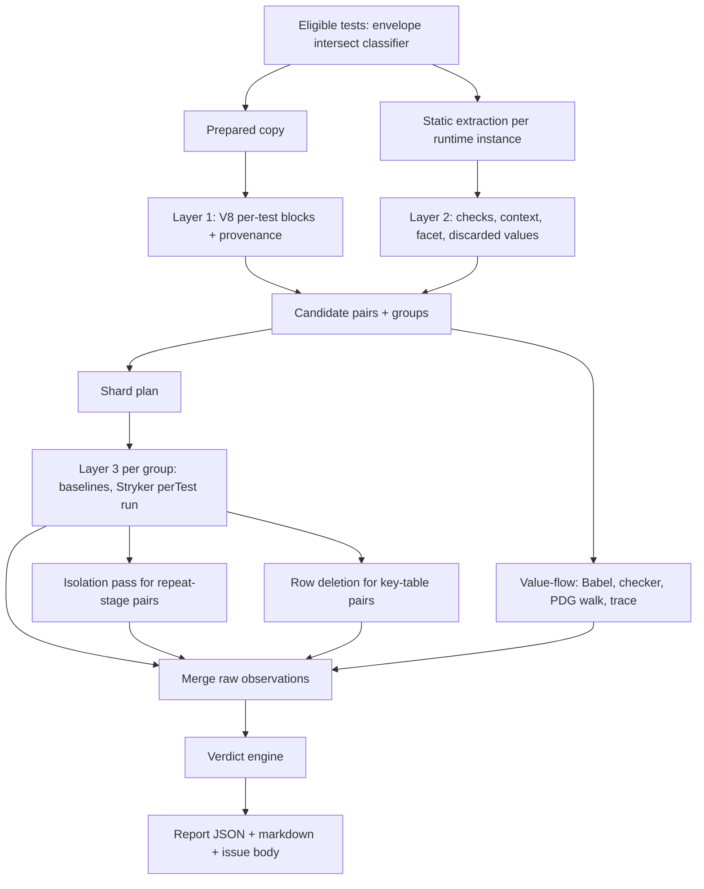
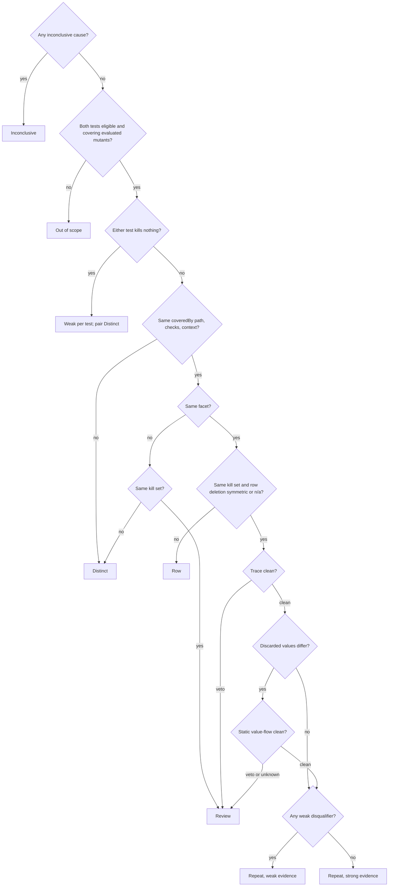
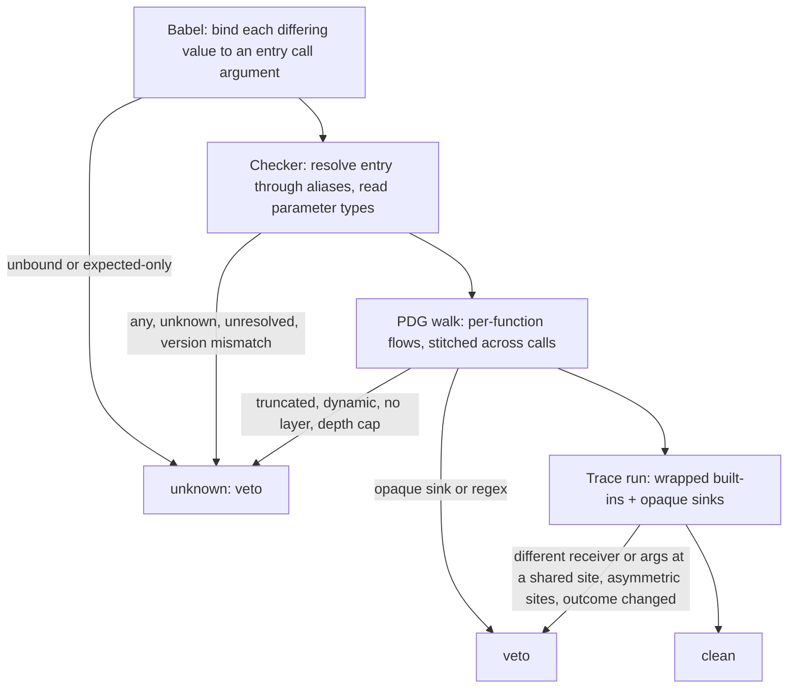
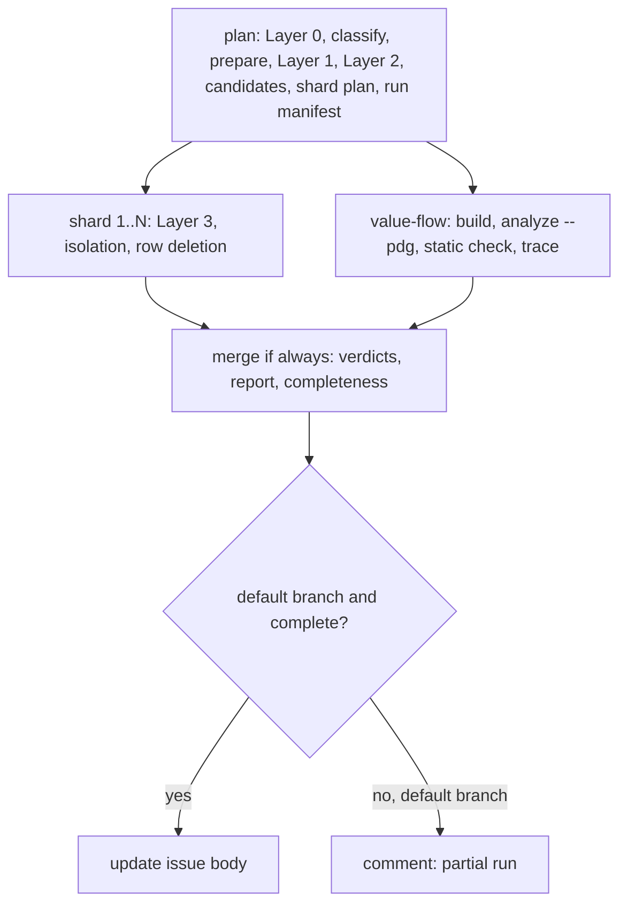

# Test Scenario Map, Phase 1 Pure-JS Report - Plan

## Goal Capsule

- **Objective:** maintainers get a weekly report on the validated pure-JS unit tests of `gitnexus/`. It lists tests that repeat a scenario, tests that kill no evaluated mutant, and per-file gaps. No strong repeat candidate merges two distinct scenarios without a flag, and the report never claims more than its evidence supports.
- **Means:** a four-layer pipeline in a new `gitnexus/tools/scenario-map/` (KTD1). It runs on the Phase 0 vitest5 runner, extended for single-test selection (KTD2). A fail-closed value-flow veto (KTD11) and a pure verdict engine (KTD12) sit on top.
- **Authority:** this plan's R-IDs and KTDs, then the origin design (`docs/plans/2026-10-23-test-scenario-map-design.md` §2, §5, §6, §7, §9 Phase 1), then the Phase 0 plan's KTDs for runner behaviour (`docs/plans/2026-10-23-1823-feat-stryker-vitest5-runner-phase0-plan.md`), then `AGENTS.md`, `GUARDRAILS.md`, `TESTING.md`.
- **Stop conditions:** stop and report in any of these cases:
  - A runner extension breaks gate 2, 3 or 4 and cannot be fixed without weakening the gate.
  - The controls fixture ends any adversarial pair as a repeat candidate.
  - The eligible category cannot fit the 6 h job through sharding. Report the measured costs instead of narrowing the scope silently.
  Never relax a strictness rule to make a pair strong.
- **Execution profile:**
  - New tool code under `gitnexus/tools/scenario-map/`, with unit tests under `gitnexus/test/unit/scenario-map/`.
  - A controls fixture under `gitnexus/test/fixtures/mutation-scenario-map/`.
  - New pinned cases in `gitnexus/test/fixtures/mutation-conformance/`.
  - Extensions to `gitnexus/tools/mutation/{runner,driver}` and `gitnexus/tools/test-dupes/test-dupes.ts`.
  - The `test:scenario-map` script in `gitnexus/package.json`.
  - One new workflow and one job in an existing workflow, plus docs.
  - No change under `gitnexus/src`.
  - No edit to any existing test of production code. The tooling's own tests (`gitnexus/test/unit/mutation/`, `gitnexus/test/unit/test-dupes.test.ts`) may gain cases.
- **Tail ownership:** PR #3686 (branch `feat/test-dupe-detector`) owns all of it. Phase 2 (the other test categories) consumes it.

---

## Product Contract

### Summary

Build the Phase 1 pipeline of the Test Scenario Map for the pure-JS unit category that Phase 0 validated:
- Layer 1: per-test V8 coverage retrieval.
- Layer 2: checks, context and input facet.
- Layer 3: per-test mutation evidence with the kill-validity protocol and the row-deletion operator.
- The value-flow check, the verdict engine, the report and one tracking issue.
- A weekly CI job.
The tool reports. It never changes a test.

### Problem Frame

Phase 0 made per-test kill evidence trustworthy on Vitest 5, but nothing turns that evidence into findings yet. Layer 0 (`test-dupes`) runs on every PR. It misses real repeats and cannot tell distinct scenarios apart. The spikes showed the layered method works: 57 confirmed pairs, 23/23 distinct scenarios recognised on an untouched holdout. But they ran as scratch scripts over Vitest 4 copies with hard-coded `/tmp` inputs. Without a repeatable pipeline the suite keeps its repeated scenarios, and nobody can tell which tests protect nothing.

### Key Decisions

- **Vitest 5 only** (session-settled: user-directed — chosen over a Vitest 4 harness or a cross-version oracle: the repo runs Vitest 5). Governs R6, R17.
- **Scope is the CLI package `gitnexus/`, with `gitnexus-shared/src` as a mutated dependency** (session-settled: user-directed — chosen over including `gitnexus-web/`: the maintainer deferred it). Governs R1.
- **The tool reports only, and CI is advisory** (session-settled: user-approved — chosen over automatic deletion or folding, or a blocking gate: losing protection is the top anti-goal). Governs R14, R15.
- **Phase 1 lands on PR #3686** (session-settled: user-directed — chosen over a new branch or a stacked PR: the user asked for it on this PR). Governs R15.
- **Similarity is retrieval only; the verdict path is mutant-granular `coveredBy`** (session-settled: user-approved — chosen over V8 coverage similarity as verdict evidence: measured run-to-run drift would produce false repeats). Governs R3, R10.
- **One artifact plus one tracking issue** (session-settled: user-approved — chosen over per-finding issues or PR comments: noise is an anti-goal). Governs R12, R13.
- **Only the pure-JS category validated in Phase 0 is eligible** (session-settled: user-approved — chosen over running native-backed, fixture-reading, LadybugDB or integration tests now: they have not passed the four gates). Governs R1.
- **Embeddings, vitest-dedup and jscpd stay out** (session-settled: user-approved — chosen over embedding similarity: AUC 0.69, and 0 of 16 sampled high-similarity pairs were redundant). Governs R3.

### Requirements

**Scope and identity**

- R1. Eligible tests are the files in the Phase 0 envelope (`gitnexus/test/fixtures/mutation-oracle/envelope.json`, `accepted.files`) that the current classifier still accepts. Every other test is Out of scope. The report lists the delta: newly accepted files not yet validated, and envelope files now rejected.
- R2. Every test instance has an execution identity and a continuity anchor (design §2, §5.5). A static-to-runtime join that is not one-to-one makes the test unsupported for strong evidence.

**Layer 1: candidate retrieval**

- R3. Per-test V8 block coverage, attributed per design §5.2, yields candidate pairs. A pair is a candidate at Jaccard ≥ 0.99, or when both tests have identical checks and context. Connected components schedule Layer 3 and never decide a verdict.
- R4. Each test records execution provenance: executed files, native-package entry points, worker spawns, and concurrent mode. Strong-eligible provenance follows design §2.

**Layer 2: checks, context, facet**

- R5. Each test instance records checks, context and input facet per design §2 and §5.3. These are computed per runtime instance (an `it.each`/`test.for` row, a loop iteration), and the discarded values are kept per position. An unresolved input or an unsupported assertion form blocks strong evidence. For two instances with equal facets, any body difference that is neither a facet part nor a recorded discarded value marks both instances unresolved.

**Layer 3: mutation evidence**

- R6. Per-test kill sets over the evaluated universe come from the Phase 0 runner with `perTest`, `disableBail` and static mutants included. Only the outcome class `killed-by-test:assertion` counts as a kill.
- R7. Kill validity follows design §5.4:
  - two passing baselines with identical identities;
  - agreement across every attempt;
  - the full isolation pass for strong evidence.
  A timeout, runtime, hook or infrastructure outcome on a mutant relevant to a pair makes the pair Inconclusive.
- R8. The row-deletion operator classifies a pair as symmetric, asymmetric, not applicable or inconclusive (design §5.4).

**Value flow**

- R9. A pair whose discarded values differ must pass the value-flow check (design §5.3a). A veto or an unknown sends the pair to Review and never yields a repeat verdict.

**Verdicts**

- R10. The verdict engine applies design §2 with its precedence. It gives exactly one verdict per pair, plus the rule or disqualifiers that decided it. It reports Weak tests, the Subsumed property and gaps, using the scoped wording of design §5.4.
- R11. Shards merge raw test–mutant observations by global identity. Verdicts, weak tests, gaps and subsumption are recomputed from the merged observations. A pair whose tests never ran together in one Layer 3 run is Inconclusive with the reason "not scheduled".

**Report and CI**

- R12. The report is one JSON artifact plus a markdown rendering. It carries:
  - every verdict's evidence;
  - the run's provenance and limits;
  - a seeded spot audit of 10 strong candidates;
  - new, changed and resolved items against the last complete run.
- R13. One tracking issue holds strong repeat candidates, weak tests and per-file gaps. Only complete runs from the default branch update it in place.
- R14. A weekly and manually dispatched GitHub Actions job runs Layers 0–3 on the eligible tests. Through sharding, it fits `ubuntu-latest` limits. It never blocks a merge.
- R15. The tool never edits, deletes or folds a test. A `// dupe-ok: <reason>` comment on either member of a pair records a human keep (design §5.5).
- R16. A local CLI produces the same report as CI.

**Runner integrity**

- R17. After the Phase 0 runner extensions, gates 1, 2, 3 and 4 still pass.

### Success Criteria

- On the controls fixture, every pure-JS adversarial pair of the design §8 set ends in Review or Distinct, and every positive control stays eligible for strong evidence. The verbatim duplicate becomes a strong repeat candidate, and the object-key pair becomes a Row. The native-parsed and worker-only adversarial pairs wait for the phases that make those categories eligible (design §9 Phases 2–3).
- A complete local run over the eligible category writes the report with no unexplained error. Its Inconclusive count and causes are recorded in the PR.
- Gates 1, 2, 3 and 4 pass after the runner extensions.
- The new workflow passes actionlint, zizmor and the repo's concurrency check.

### Scope Boundaries

- Native-backed, fixture-reading, LadybugDB and worker-backed test categories are out of scope until they pass the Phase 0 gates (design §9 Phases 2–3).
- `gitnexus-web/` and the Python `eval/` tests are out of scope.
- No precision claim. The report says that strong-repeat precision is not yet measured (design §8).

#### Deferred to Follow-Up Work

- The removal check for cleanup PRs (design §6, "Cleanup PR" row).
- Design §8 labeled-data commit, independent adjudication, prospective holdouts and the paired precision check.
- A result cache keyed on the design §7 inputs. Phase 1 records those inputs as provenance only (KTD15).
- An optional whole-suite mutation run with static mutants.
- Equivalence rules that lift a value-flow veto. The list starts empty (design §5.3a).
- Upstreaming the runner's `testIds` scope extension to StrykerJS. Add it to `gitnexus/tools/mutation/UPSTREAM.md` only.

---

## Planning Contract

### Key Technical Decisions

- KTD1. **New tool package `gitnexus/tools/scenario-map/`, one CLI with stages.**
  - The CLI imports Phase 0 modules from `gitnexus/tools/mutation/` and adds no new dependency. Already installed: Babel 8 parser/types/traverse, TypeScript 7.0.2 `typescript/unstable/sync`, the tree-sitter loader in `gitnexus/src/core/tree-sitter/parser-loader.ts`, the Vitest node API, and Stryker 10.
  - Stages: `plan`, `shard`, `value-flow`, `merge`, `all`, `controls`. They map one-to-one onto CI jobs, so a local `all` run and CI produce the same report (R16).
- KTD2. **Mutation evidence runs through the Phase 0 vitest5 runner, with three extensions** (session-settled: user-approved — chosen over the stock `@stryker-mutator/vitest-runner`: it runs 0 tests per mutant on Vitest 5). The extensions:
  1. An optional `testIds` key in the driver scope (`driver/stryker-config.ts`), passed to the plugin as a `vitest5.testIds` runner option in the generated Stryker config. The dry run first collects the scope files, assigns Phase 0 ids with `assignTestIds`, and maps the requested ids to Vitest task ids. It then runs one `createSpecification(file, { testIds })` per file and checks the executed set against the request.
  2. Per-test outcome classes from every sidecar attempt in `results.json`.
  3. A per-test marker for mutants attributed through a suite hook.

  The extensions never touch gate 3's hashed inputs (`tools/mutation/scope-file.ts`, `tools/mutation/vitest.mutation.config.ts`, `tools/mutation/prepare/*`). A change there forces a re-freeze of all three oracle manifests, which took about 6 h.
  Baselines, row deletion and the trace run use plain Vitest 5 through `createVitest` and `tools/mutation/vitest.mutation.config.ts`, as in `tools/mutation/fidelity/fidelity.ts`.
  **Conflict call-out:** the brief says mutation runs through the Phase 0 runner. Row deletion cannot, because Stryker applies only its own mutators. It runs on plain Vitest 5 in a throwaway copy of the prepared tree, which still honours Vitest 5 only. The isolation pass also needs extension 1 before it can select single tests.
- KTD3. **Identities.**
  - The execution identity is the Phase 0 test id (`tools/mutation/runner/test-ids.ts`) plus the manifest location plus the row ordinal.
  - The continuity anchor (design §5.5) comes from static extraction: file, describe path, title, a row fingerprint over the row's values, and a body fingerprint. A body fingerprint matches a moved test only when it is unique. Identical bodies are exactly the repeats and the rows of one `it.each`.
- KTD4. **Layer 1 runs in a prepared copy under the mutation config.** That way `gitnexus-shared` executes from source and every path maps back through `tools/mutation/prepare/path-map.ts`.
  - The coverage hook ports `gitnexus/test/spike-coverage.setup.ts` to the runner's hook pattern: file-level `aroundAll` with the `{}` parameter, and `TestRunner.getCurrentTest()`.
  - It records the task id, full name and location so that `assignTestIds` produces Phase 0 ids.
  - Block ids are keyed by repo path.
- KTD5. **Candidate retrieval uses exact Jaccard with size and prefix filters**, plus buckets of identical checks-and-context hashes.
  - A pair whose V8 block sets are not identical caps at weak. This is stricter than the design, and it can only demote.
  - It closes the hole where one test reaches extra mutant-free code that the 0.99 tolerance hides.
- KTD6. **Layer 2 reuses Layer 0's AST walk.**
  - `tools/test-dupes/test-dupes.ts` exports its case extraction, context closure and `dupe-ok` lookup. Layer 0's PR output must not change.
  - Checks support a documented matcher list in `tools/scenario-map/facet/checks.ts`. Any other form is unsupported.
  - The input facet ports `gitnexus/spike-input-facet.mts`. It covers rules 1–8, with rule 6 (source order) taken from the spike's `analyze-slice.mjs`. It adds numeric literals, per-instance evaluation of `each` tables and static loops, discarded values per position, and an `unresolved` marker.
  - A numeric literal within ±1 of a production numeric constant stays exact. Stryker has no numeric-literal mutator, so a boundary value such as `LIMIT + 1` would otherwise collapse with an interior value. Constants come from the test's executed production files and its static import closure, because a constants-only module runs only during the discarded module load. Statically evaluable initialisers such as `2 * 1024` count, through Babel's `evaluate()`.
  - Residual-difference guard (R5): for two instances with equal facets, diff the instance body ASTs. Any differing node that is neither a facet part nor a recorded discarded value marks both instances unresolved. This catches pairs that differ only in an enum member, a regex, a boolean or `null`, or an operator.
- KTD7. **The mutate scope of a candidate group is whole production files.**
  - Production files are defined once, in `tools/scenario-map/types.ts`, as path-map-mapped files outside test files. That means `gitnexus/src/`, relocated `gitnexus-shared/src/` and, for an extra root, its `src/` subtree. The Layer 1 block filter, provenance, the mutate scope and the trace frame filter all use this one definition.
  - The mutate scope is every production file in either test's V8 provenance or static import closure, with no line ranges.
  - An excluded file is any executed repo file under `gitnexus/` that is neither a test file (`test/**`, `*.case.ts`) nor mutated, such as `tools/` or `scripts/` code. It caps the test at weak (design §5.4 worker threads).
  - The mutated universe is never truncated silently.
- KTD8. **Kill validity mechanics.**
  - Two plain Vitest 5 baseline runs of the group's tests must pass with identical identities, and so must Stryker's dry run. Otherwise the group is Inconclusive.
  - Observations come from every sidecar attempt, not the latest. Any class disagreement between attempts or runs is inconclusive.
  - A missing result is unknown, never a non-kill (design §5.4).
  - Every generated Stryker config must carry `perTest` coverage, `disableBail` and static mutants. The run fails before mutating if one is missing.
  - A test with no assertion kills but some runtime, hook or timeout kills is per-test Inconclusive, never Weak.
- KTD9. **The full isolation pass runs per pair, with alone runs shared.**
  - It applies to each pair that reaches the repeat stage. That means one Stryker run with `testIds` set to both tests, and one run per test alone.
  - Mutate is restricted to the pair's covered universe: Stryker ranges, then filtered by global id.
  - `--max-test-runner-reuse 1` gives each mutant a fresh process with modules reset (design §5.4).
  - Coverage and outcome class per test and mutant must agree across the main, together and alone runs.
  - A pair whose path or kills touch a hook-attributed mutant caps at weak. The cap holds until a gate 3 scope with a non-empty hook stratum passes; today that stratum is empty in all three scopes.
- KTD10. **Row deletion.**
  - Supported tables follow design §5.4. For each of the two differing keys in turn, the key is spliced out of the source text in a throwaway copy of the prepared tree.
  - A control run comes first: both tests must pass, and V8 or `evaluatedModules` must show that the edited file was loaded.
  - Outcomes are classified with `tools/mutation/runner/classify-outcome.ts`.
  - Each edited run uses a fresh Vitest instance, because a reused instance serves cached transforms and would turn a no-op deletion into a false "neither fails".
  - The global id comes from `formatGlobalId`, with mutator name `RowDeletion` and an empty replacement.
- KTD11. **Value-flow check** (session-settled: user-directed — chosen over a blanket rule that sends every value-differing pair to Review or ignores the discarded values: the user asked for real semantic information). The four sources of design §5.3a must all come back clean. Local deltas:
  - **Test side (Babel).** A differing expected value with no differing bound input is unknown.
  - **Checker (TypeScript).** The checker takes its tsconfig path as an input: `tsconfig.test.json` by default, the fixture's own tsconfig for `controls`. It refuses to run unless `typescript` resolves to exactly 7.0.2. A version mismatch marks the whole run degraded, like a missing PDG layer, because Dependabot can bump the lockfile. Any other API failure is unknown for that pair.
  - **PDG.** The layer comes from `gitnexus analyze --pdg`, run with the checkout's own build. If it is missing or unreadable, the run is marked degraded, and every value-differing pair is vetoed with the reason "no PDG layer". Every degraded flag appears in the report's completeness block and in the issue header.
  - **Trace.** It records the receiver (`this`) as well as the arguments of every wrapped call. It vetoes when the receiver or any argument differs at a shared call site, and on asymmetric sets or counts of opaque call sites. Production frames are recognised through the KTD7 definition. The trace runs for every facet-equal candidate pair, not only value-differing ones. This is a cheap backstop for differences that the facet cannot see.

  **Conflict call-out:** GitNexus `pdg_query` flows are intra-procedural (`gitnexus/src/mcp/tools.ts`, `_pdgQueryImpl` in `gitnexus/src/mcp/local/local-backend.ts`). Its output also loses the exact def/use lines, caps every file-wide query at 200 edges, and never exposes `CALL_SUMMARY`. No edge maps an argument to a parameter. Step 3 therefore stitches the walk itself:
  1. It reads REACHING_DEF and `CALL_SUMMARY` edges through LocalBackend's `cypher` tool, scoped to the function's `BasicBlock:<file>:<fnLine>:` id prefix. It decodes the def/use line pairs with `decodeReachingDefReason`.
  2. It classifies each use at the consuming expression. Any opaque or unknown use in a statement vetoes the whole statement.
  3. A new binding derived from the value (`const { ratio } = opts`, `this.x = v`) is walked under its own name, or marked unknown.
  4. Repo code is a clean sink only inside the pair's mutated production files (KTD7).
  5. The checker resolves each callee, and the argument position in the production AST gives the parameter. `CALL_SUMMARY` covers return values.
  6. Truncation of the per-function query, ambiguity or a depth cap is unknown.

  The check stays fail-closed.
- KTD12. **The verdict engine is a pure function over merged observations.**
  - It applies the value-flow veto as a gate before any repeat category, because design §2 ranks Repeat (weak) above Review.
  - It carries a `VERDICT_ENGINE_VERSION` constant into the evidence hash.
  - It reads unscheduled pairs as Inconclusive.
- KTD13. **Report identity.**
  - The universe identifier of a pair is a hash of the sorted mutant fingerprints of its common universe. Regrouping alone does not resurface a pair.
  - The evidence hash follows design §5.5.
  - The baseline is a dedicated artifact, `scenario-map-baseline`. The merge job uploads it only for complete default-branch runs, with `retention-days: 90`. The next merge job takes the newest artifact of that name through the Actions artifacts REST API, excluding its own run. A run that finds none shows a "first run, no baseline" banner. A baseline with a different report schema version shows an "incompatible baseline" banner, and no delta is computed.
  - The issue body records the run id it came from. An upsert skips the update when the issue already records a newer run.
  - The spot audit picks 10 strong candidates with a recorded seed.
- KTD14. **CI topology.** A new workflow, `.github/workflows/test-scenario-map.yml`, runs on a weekly cron and on dispatch. One workflow-wide concurrency group with `cancel-in-progress: false` serialises weekly and manual runs. Jobs:
  1. `plan`: Layer 0 scan over the eligible files, classify, prepare, Layers 1–2, candidates, shard plan and the run manifest.
  2. Mutation shards: a matrix with `fail-fast: false`.
  3. `value-flow`, in parallel with the shards: static check and trace run for the facet-equal candidate pairs.
  4. `merge`, with `if: always()`.
  5. `upsert-issue`: default branch only, complete runs only. A partial run adds a comment and leaves the body alone.

  Every job is `continue-on-error`, with a timeout and SHA-pinned actions. Artifact names carry the run attempt.
  The run manifest from `plan` holds the eligible tests, their ids and the prepared inputs' content hashes. Each shard and the `value-flow` job verify their own prepared copy against it. A mismatch makes that job's results invalid, and its groups' pairs Inconclusive.
  The controls run is a PR job in `.github/workflows/mutation-runner-validation.yml`, with `build: 'true'`. It is path-gated on `gitnexus/tools/scenario-map/**`, `gitnexus/tools/mutation/**`, `gitnexus/tools/test-dupes/**` and the fixture. The workflow's paths are workflow-level, so scenario-map changes also run the gate 2 conformance jobs, which is an accepted extra cost.
- KTD15. **No result cache in Phase 1.** The report records the design §7 cache-key inputs as run provenance, so a later cache has its keys.
- KTD16. **Runner extensions re-run gates 1, 2, 3 and 4.** Gate 1 covers the changed dry run. Gate 2 gains pinned cases for `testIds` selection, per-test classes across attempts, and the hook marker.
- KTD17. **Shard planning is deterministic.**
  - A candidate group is never split across shards, so every pair runs in one run.
  - Groups are bin-packed by estimated cost, ordered by group id. The estimate is a fixed per-run overhead, plus mutated file bytes times group tests, plus an isolation term: candidate pairs × covered mutants × 3 runs at the measured fresh-process cost.
  - A group whose estimate exceeds one shard's budget is not run. Its pairs are Inconclusive with reason `group-over-budget`, and the report lists the group.
  - A shard starts a group only when its estimate fits the remaining time before a 300-minute deadline. A group it never ran leaves its pairs Inconclusive (not scheduled, R11).
  - Each finished group's observations are written to the work directory at once and uploaded with `if: always()`.

### High-Level Technical Design

Pipeline data flow:



Verdict decision for one pair (design §2 precedence, KTD12 veto gate):



Directional data sketch of one raw observation, the unit that shards merge (R11):

```text
Observation {
  run: { kind: main | together | alone-A | alone-B, group, shard, attempt }
  test: executionId, mutant: globalId, mutantFingerprint
  covered: boolean, hookAttributed: boolean, static: boolean
  outcome: OutcomeClass   // from runner/classify-outcome.ts
  valid: boolean, reason?
}
```

Value-flow check for one value-differing pair (KTD11). The trace step also runs alone for facet-equal pairs whose discarded values are equal:



CI job topology (KTD14):



### Output Structure

```text
gitnexus/tools/scenario-map/
  scenario-map.ts            CLI and stage orchestration
  types.ts                   shared record types and schema version
  inventory/                 eligible set, static case extraction, identity join, anchors
  coverage/                  Layer 1 setup file, coverage run, candidate retrieval
  facet/                     checks, context, input facet, production tables
  mutation/                  shard plan, group runs, observations, isolation, row deletion, plain Vitest runs
  value-flow/                Babel binding, checker, PDG walk, trace setup and run, wrapped built-ins
  verdict/                   verdict engine
  report/                    JSON, markdown, issue body, baseline diff, spot audit
gitnexus/test/unit/scenario-map/       unit tests per module
gitnexus/test/fixtures/mutation-scenario-map/   controls fixture project and expected verdicts
.github/workflows/test-scenario-map.yml
```

### Assumptions

These are unconfirmed bets made in pipeline mode.

- The weekly cron runs Monday 04:17 UTC, outside the busy CI hours.
- The tracking issue is never closed automatically. It is found by label in any state and updated in place. A complete run with no findings says so in the body.
- `gitnexus analyze --pdg` on this repo fits a 4 vCPU job well under its timeout. Measure it in U10. If it does not fit, the run is marked degraded under KTD11.
- Eight mutation shards are enough for the eligible category. U7 measures the cost and adjusts the count.
- The ±1 numeric-constant rule and residual-difference guard (KTD6), the block-identity cap (KTD5), the excluded-file definition (KTD7), the hook-stratum cap (KTD9) and the trace on every facet-equal pair (KTD11) are additions that only demote. They are not in the design text; U16 records them there.
- Running `together` per pair, with `alone` runs shared across pairs, satisfies design §5.4's isolation pass.

### Risks and Dependencies

| Risk | Mitigation |
| --- | --- |
| Whole-file mutate scopes (KTD7) make static mutants expensive: each one re-runs every selected test | Selecting group tests with `testIds` bounds the run; U7 measures per-group cost. Narrowing a scope only adds weak caps, never false strong results |
| The TypeScript unstable API changes | Exact version guard; any failure is unknown (KTD11) |
| The PDG layer is slow or missing in CI | Degraded run with an explicit veto reason; never silent (KTD11) |
| A high Inconclusive rate leaves few strong verdicts | Report the rate and causes; this is the intended price of the top anti-goal |
| Runner extensions regress Phase 0 evidence | Gates 1, 2, 3 and 4 re-run (KTD16, R17); gate 3's hashed inputs stay untouched (KTD2) |
| The issue body exceeds GitHub's 65,536-character limit | Truncate at 60,000 characters in a fixed order, with counts and a run link (U13) |
| A candidate group chains into a component too large for one shard | `group-over-budget` Inconclusive with the group listed (KTD17); the largest group size is measured in U4 |
| Wrapping string built-ins slows string-heavy tests into trace timeouts | A changed outcome under tracing is Inconclusive, never clean; U11 measures the overhead on the eligible category |
| A dispatch from a feature branch overwrites main's findings | Issue upsert only from the default branch (KTD14) |
| Scheduled and dispatch workflows cannot run from this PR branch before merge | The local `all` run and the PR-gated controls job carry the proof; the first scheduled run follows the merge |

### System-Wide Impact

- **Phase 0 runner and gates:** U1 changes `tools/mutation/driver/stryker-config.ts`, `runner/plugin.ts`, `runner/coverage-attribution.ts`, `runner/setup.ts`, `runner/protocol.ts`, `runner/sidecar.ts` and `driver/normalise-results.ts`. These are the gate 1–4 surfaces, re-validated by KTD16.
- **Layer 0 PR job:** U2 changes only exports of `tools/test-dupes/test-dupes.ts`. Its findings on the repo must stay byte-identical.
- **CI load:** one weekly job of up to about 6 h wall time across shards, plus a short path-gated PR job.
- **Contributors:** the tracking issue changes no workflow. A human keep is still a `// dupe-ok:` comment.

### Sources and Research

- Phase 0 outputs:
  - `results.json` schema: `gitnexus/tools/mutation/driver/normalise-results.ts` (`RunResults`, `NormalisedMutant`, `NormalisedTest`).
  - Outcome classes: `gitnexus/tools/mutation/runner/classify-outcome.ts`.
  - Scope keys, which reject unknown keys today: `gitnexus/tools/mutation/driver/stryker-config.ts`.
  - Dry-run spec globbing: `runner/plugin.ts`.
  - Hook-hit folding: `runner/coverage-attribution.ts` (`attributeHookHits`).
- Per-test selection pattern: `project.createSpecification(file, { testIds })` in `runner/plugin.ts` mutant runs, documented in `gitnexus/tools/mutation/UPSTREAM.md`.
- Plain Vitest 5 runs: `createVitest` plus `runTestSpecifications` in `gitnexus/tools/mutation/fidelity/fidelity.ts`.
- Identity helpers:
  - `gitnexus/tools/mutation/prepare/mutant-identity.ts` (`formatGlobalId`, `contentHash`);
  - `prepare/path-map.ts` (`toRepoPath`, `toPreparedPath`, `buildPathMap`, which accepts only `gitnexus/test/fixtures/mutation-<name>/` extra roots).
- Spikes to port, which hard-code `/tmp` and Vitest 4 paths:
  - `gitnexus/test/spike-coverage.setup.ts`;
  - `gitnexus/spike-input-facet.mts`;
  - `/tmp/test-audit/spike5/analyze-slice.mjs` (grouping, subsumption, rows);
  - `/tmp/test-audit/spike5/row-delete.mjs` (object tables only, regenerates files: do not port as-is).
- PDG access:
  - `LocalBackend.callTool('pdg_query', …)`, with the script pattern in `gitnexus/bench/impact-pdg/real-code.mjs`.
  - Layer status: `pdgLayerStatus` in `gitnexus/src/mcp/local/pdg-impact.ts`.
  - There is no CLI equivalent. No local index has a PDG layer today.
- TypeScript checker: the probe at `/tmp/test-audit/tsprobe/probe2.mjs`. `getAliasedSymbol` and `getResolvedSignature` exist in the API typings but were not probed.
- Issue upsert template: `.github/workflows/tree-sitter-upgrade-readiness.yml` (`actions/github-script`, a separate `issues: write` job).
- Advisory workflow shape: `.github/workflows/mutation-runner-validation.yml`. Nightly `--pdg` precedent: `.github/workflows/impact-pdg-mutation-report.yml`.
- External research was skipped. Local patterns are strong: Phase 0 tooling, the spikes and the probes.

---

## Implementation Units

| U-ID | Title | Key files | Depends on |
| --- | --- | --- | --- |
| U1 | Runner single-test selection and per-test classes | `tools/mutation/driver/stryker-config.ts`, `runner/plugin.ts`, `runner/coverage-attribution.ts`, `runner/protocol.ts`, `runner/sidecar.ts`, `driver/normalise-results.ts` | none |
| U2 | Layer 0 extraction API | `tools/test-dupes/test-dupes.ts` | none |
| U3 | Inventory, identity and anchors | `tools/scenario-map/inventory/*`, `tools/scenario-map/types.ts` | U2 |
| U17 | Controls fixture project | `test/fixtures/mutation-scenario-map/*` | none |
| U5 | Layer 2 checks and context | `tools/scenario-map/facet/checks.ts`, `facet/context.ts` | U2, U3 |
| U4 | Layer 1 coverage and candidate retrieval | `tools/scenario-map/coverage/*` | U3, U5 |
| U6 | Layer 2 input facet | `tools/scenario-map/facet/input-facet.ts`, `facet/tables.ts` | U3, U4 |
| U7 | Layer 3 group runs and observations | `tools/scenario-map/mutation/*` | U1, U3, U4, U17 |
| U8 | Full isolation pass | `tools/scenario-map/mutation/isolation.ts` | U1, U5, U6, U7, U17 |
| U9 | Row-deletion operator | `tools/scenario-map/mutation/row-deletion.ts` | U6, U7, U17 |
| U10 | Value-flow static check | `tools/scenario-map/value-flow/{bind,checker,pdg-walk,sinks}.ts` | U5, U6, U17 |
| U11 | Value-flow trace run | `tools/scenario-map/value-flow/{trace.setup,trace,builtins}.ts` | U4, U10, U17 |
| U12 | Verdict engine | `tools/scenario-map/verdict/verdict.ts` | U5–U11 |
| U13 | Report and issue body | `tools/scenario-map/report/*` | U12 |
| U14 | CLI orchestration and controls run | `tools/scenario-map/scenario-map.ts` | U1–U13, U17 |
| U15 | Scheduled workflow and PR controls job | `.github/workflows/test-scenario-map.yml`, `mutation-runner-validation.yml` | U14 |
| U16 | Documentation and design corrections | design doc, `TESTING.md`, `UPSTREAM.md` | U14 |

All `tools/` and `test/` paths are under `gitnexus/`.

### U1. Runner single-test selection and per-test classes

- **Goal:** the Phase 0 runner can run a chosen subset of tests, and `results.json` carries every per-test class and the hook marker that Phase 1 needs.
- **Requirements:** R6, R7, R17. KTD2, KTD9, KTD16.
- **Dependencies:** none.
- **Files:**
  - Modify:
    - `gitnexus/tools/mutation/driver/stryker-config.ts`
    - `gitnexus/tools/mutation/runner/plugin.ts`
    - `gitnexus/tools/mutation/runner/coverage-attribution.ts`
    - `gitnexus/tools/mutation/runner/setup.ts`
    - `gitnexus/tools/mutation/runner/protocol.ts` (`FileMeta` carries hook-attributed tests per mutant)
    - `gitnexus/tools/mutation/runner/sidecar.ts` (the dry-run record carries them; bump `SIDECAR_SCHEMA_VERSION`)
    - `gitnexus/tools/mutation/driver/normalise-results.ts`
    - `gitnexus/tools/mutation/UPSTREAM.md`
  - Never modify: `gitnexus/tools/mutation/scope-file.ts`, `gitnexus/tools/mutation/vitest.mutation.config.ts`, `gitnexus/tools/mutation/prepare/*` (gate 3 hashed inputs, KTD2).
  - Fixture: `gitnexus/test/fixtures/mutation-conformance/` (new `*.case.ts` and `expected.json` entries).
  - Tests:
    - `gitnexus/test/unit/mutation/stryker-config.test.ts`
    - `gitnexus/test/unit/mutation/normalise-results.test.ts`
    - `gitnexus/test/unit/mutation/coverage-attribution.test.ts`
- **Approach:**
  1. Accept an optional `testIds` array in the driver scope. Each id must be a Phase 0 test id of one of the scope's `testFiles`. Pass it to the plugin as the `vitest5.testIds` runner option (KTD2).
  2. In the dry run, collect the scope files, assign ids with `assignTestIds`, map the requested ids to task ids, run one specification per file, and check the executed set equals the request.
  3. Keep the raw hook bucket in the per-file metadata, next to the attributed per-test coverage. Persist it through `FileMeta` and the dry-run sidecar record. Expose `hookAttributedTests` per mutant.
  4. In normalisation, keep every sidecar attempt's per-test rows as `perTest: { testId, outcome, attempt }[]`. Mark a mutant `attemptsDisagree` when attempts differ.
  5. Bump the results `schemaVersion`, and keep gate 3 compare reading the fields it uses today.
- **Execution note:** run GitNexus impact analysis on `parseDriverScope`, `attributeHookHits`, `normaliseResults`, the `FileMeta` and sidecar record types, and the plugin's dry-run method before editing. These are gate surfaces.
- **Patterns to follow:**
  - The mutant-run specification building in `runner/plugin.ts`.
  - The scope validation in `stryker-config.ts`.
  - The conformance case style in `gitnexus/test/fixtures/mutation-conformance/`.
- **Test scenarios:**
  - A scope file with `testIds` naming two of five tests in one file: the parsed scope keeps them; the generated dry-run selection contains exactly those two.
  - A `testIds` entry not in any scope file: the parser fails with a message naming the id.
  - An empty `testIds` array: rejected, so that "all tests" never happens by accident.
  - Normalising a mutant with two sidecar attempts, `killed-by-test:assertion` then `killed-by-test:runtime` for the same test: both rows are kept, and `attemptsDisagree` is true.
  - Normalising a mutant whose coverage came only from a `beforeAll` hit: `hookAttributedTests` lists every test of that suite.
  - New conformance case: a dry run with `testIds` set to one of two tests reports coverage and outcomes for that test only.
  - New conformance case: a mutant hit in `beforeAll` carries the hook marker for each test below the suite.
  - A `testIds` entry naming a test the collection did not find: the dry run fails before any mutant run, naming the id.
  - Covers R17: gate 3 compare on fresh runner runs of the three oracle scopes still passes with 0 differences, with no re-freeze required.
- **Verification:** unit tests pass; gate 1 passes over the pure-JS category with 0 differences; gate 2 passes with the new pinned cases; gate 3 compare passes on all three scopes; gate 4 passes.

### U2. Layer 0 extraction API

- **Goal:** Phase 1 reuses Layer 0's case extraction, context closure and `dupe-ok` lookup without changing Layer 0's findings.
- **Requirements:** R5, R15. KTD6.
- **Dependencies:** none.
- **Files:**
  - Modify: `gitnexus/tools/test-dupes/test-dupes.ts`.
  - Test: `gitnexus/test/unit/test-dupes.test.ts`.
- **Approach:**
  1. Export the case extraction, frame building, context closure and the `suppressed` lookup.
  2. Add a per-case record with file, line, describe path, title, context hash, body text, `each` table node and enclosing loop head. Today's `recordCase` folds context into one hash; keep that hash for Layer 0 and expose the parts.
  3. Change no detection rule.
- **Execution note:** run impact analysis on `extract`, `buildFrame`, `closure` and `scan` before editing. `recordCase` is nested in `extract` and covered by its analysis. Capture `npm run test:dupes -- --all --json <file>` before and after, with the same set of test files on disk, and require the two files to be identical.
- **Patterns to follow:** the existing exported `scan` and `orphanBenchGates` signatures and their tests.
- **Test scenarios:**
  - Extracting a file with a nested describe and two tests returns two records. Each has the full describe path, the title, the declaration line and distinct context hashes when the `beforeEach` differs.
  - A test with `// dupe-ok: reason` on the line above is reported as suppressed with that reason.
  - An `it.each` call returns one record, with the table node and the title template.
  - Layer 0 scan output on the existing test fixtures is unchanged.
- **Verification:** the `test-dupes` unit tests pass, and the `--all` scan JSON is byte-identical before and after.

### U3. Inventory, identity and anchors

- **Goal:** one inventory of eligible test instances, with execution identities joined one-to-one to the static records, and continuity anchors.
- **Requirements:** R1, R2, R15. KTD3.
- **Dependencies:** U2.
- **Files:**
  - Create:
    - `gitnexus/tools/scenario-map/inventory/eligible.ts`
    - `gitnexus/tools/scenario-map/inventory/cases.ts`
    - `gitnexus/tools/scenario-map/inventory/identity.ts`
    - `gitnexus/tools/scenario-map/types.ts`
  - Tests:
    - `gitnexus/test/unit/scenario-map/eligible.test.ts`
    - `gitnexus/test/unit/scenario-map/cases.test.ts`
    - `gitnexus/test/unit/scenario-map/identity.test.ts`
- **Approach:**
  1. The eligible set is the envelope's accepted files intersected with a fresh `classify()` run. The delta goes into the inventory (R1). In `controls` mode, the fixture's test files are enrolled instead, and its `src/` modules are production files through `extraRoots` (KTD7). Normal runs always apply R1.
  2. Static cases expand `it.each`/`test.each`/`test.for` tables and `for…of` loops over literal arrays into one instance per row, with the row's bound values. A table that cannot be evaluated statically gives instances marked `unresolved` (design §5.3).
  3. The join takes the runtime records from Layer 1 (task id, full name, location, row order within a location) through `assignTestIds`. It matches them to static instances by file, location and row order. Any count mismatch makes every instance at that location unsupported.
  4. Anchors per KTD3.
- **Patterns to follow:** `classify()` in `gitnexus/tools/mutation/classify/classify.ts`; `assignTestIds` in `runner/test-ids.ts`.
- **Test scenarios:**
  - The envelope lists files A, B and C, and the classifier now accepts A, C and D: eligible is A and C; the delta lists D as not validated and B as rejected.
  - An `it.each([[1, 2], [3, 4]])` test expands to two instances, with bound values `[1, 2]` and `[3, 4]` and row ordinals 0 and 1.
  - An `it.each(buildRows())` test gives instances marked `unresolved`.
  - Three runtime rows at one location against two static instances: all three are unsupported, with reason `join-mismatch`.
  - Two tests with identical bodies in different files: the body fingerprints are equal and the anchors stay distinct by file. A moved test with a unique body keeps its anchor.
  - `controls` mode with the fixture root: the fixture's case files are eligible, and the envelope is not consulted.
  - The production-file predicate: `gitnexus/src/a.ts` and relocated `gitnexus-shared/src/b.ts` are production; `gitnexus/tools/x.ts`, `gitnexus/test/unit/y.test.ts` and a fixture `*.case.ts` are not; a fixture `src/` module is production only in `controls` mode.
- **Verification:** unit tests pass; an inventory run over the repo's eligible files completes and reports the join-mismatch count.

### U17. Controls fixture project

- **Goal:** a committed fixture project holds one pair per pure-JS adversarial and positive-control case, with expected verdicts written before any run, so U7–U11 can verify against it.
- **Requirements:** Success Criteria. KTD7.
- **Dependencies:** none.
- **Files:**
  - Create: `gitnexus/test/fixtures/mutation-scenario-map/` with `src/` production modules, `*.case.ts` tests, `vitest.config.ts`, `tsconfig.json` (extends `gitnexus/tsconfig.test.json` and includes the fixture's `src/` and `*.case.ts`), and `expected.json`.
- **Approach:**
  1. The fixture holds one pair per design §8 pure-JS adversarial and positive-control case:
     - `Math.round` 2.4/2.5;
     - `parseInt` radix;
     - `localeCompare`;
     - Unicode `normalize`;
     - `Date` boundaries;
     - regex alternatives;
     - numeric boundary ±1, with the constant in a separate constants-only module;
     - expected-only difference;
     - derived value reaching `toFixed`;
     - an enum-member-only difference;
     - an order-dependent pair;
     - an object-key row;
     - a verbatim duplicate;
     - `add(1, 2)` against `add(5, 5)`;
     - membership in a supported `Set` table.
  2. `expected.json` maps each pair to its verdict: every adversarial pair Review or Distinct, the order-dependent pair Inconclusive, the object-key pair Row, the duplicate and positive controls strong repeats.
  3. No repo Vitest project collects the fixture, as with `mutation-conformance`.
- **Execution note:** write `expected.json` from the design's stated outcomes, not from observed output.
- **Patterns to follow:** `gitnexus/test/fixtures/mutation-conformance/` (own `vitest.config.ts` project, `*.case.ts`, `expected.json`).
- **Test scenarios:** Test expectation: none -- fixture data. U14's `controls` stage exercises it end to end.
- **Verification:** the fixture's own Vitest project passes unmutated; its tsconfig type-checks; the main suite does not collect it.

### U5. Layer 2 checks and context

- **Goal:** checks and context per test instance, with unsupported forms marked.
- **Requirements:** R5. KTD6.
- **Dependencies:** U2, U3.
- **Files:**
  - Create:
    - `gitnexus/tools/scenario-map/facet/checks.ts`
    - `gitnexus/tools/scenario-map/facet/context.ts`
  - Tests:
    - `gitnexus/test/unit/scenario-map/checks.test.ts`
    - `gitnexus/test/unit/scenario-map/context.test.ts`
- **Approach:**
  1. Checks are the shape of each `expect(subject)[.not|.resolves|.rejects].matcher(args)` with literals abstracted. Selector literals inside the subject call stay exact (design §2).
  2. Snapshot assertions hash the inline snapshot text or the `.snap` entry.
  3. The supported matcher list is a documented constant. Anything else is `unsupported`: `assert.*`, custom matchers, `expect` inside helpers not inlined in the body.
  4. Context is the Layer 0 closure: hooks, `vi.mock`/`vi.spyOn`/`vi.stubEnv`, env writes, wrapper-call arguments. It is compared by exact hash.
- **Patterns to follow:** `assertionSignatures`, `closure` and `buildFrame` in `tools/test-dupes/test-dupes.ts`.
- **Test scenarios:**
  - `expect(fn('a')).toBe(1)` and `expect(fn('b')).toBe(2)`: same checks shape.
  - `expect(getNodesByLabel(r, 'Function')).toHaveLength(1)` and the same call with `'Class'`: different checks, because the selector literal stays exact.
  - `expect(x).not.toBe(1)` and `expect(x).toBe(1)`: different checks.
  - `toMatchInlineSnapshot` with different snapshot text: different checks.
  - A body using `assert.equal`: marked unsupported, with the form named.
  - Two tests that differ only in an `afterEach` body: different context.
- **Verification:** unit tests pass; the supported matcher list appears in the module header and in `TESTING.md` (U16).

### U4. Layer 1 coverage and candidate retrieval

- **Goal:** per-test V8 blocks and provenance for every eligible test, then candidate pairs and groups.
- **Requirements:** R3, R4. KTD4, KTD5.
- **Dependencies:** U3, U5 (checks-and-context hashes for the second candidate source).
- **Files:**
  - Create:
    - `gitnexus/tools/scenario-map/coverage/coverage.setup.ts`
    - `gitnexus/tools/scenario-map/coverage/run-coverage.ts`
    - `gitnexus/tools/scenario-map/coverage/candidates.ts`
  - Tests:
    - `gitnexus/test/unit/scenario-map/candidates.test.ts`
    - `gitnexus/test/unit/scenario-map/coverage-records.test.ts`
- **Approach:**
  1. Prepare a copy with `prepare()` and run the eligible files with `createVitest` under the mutation config. Prepend the coverage setup file.
  2. Attribute per design §5.2. A root `beforeAll` discards module-load coverage. A suite's `beforeAll` delta is taken at its first `beforeEach`. Mark `concurrent` tests.
  3. Keep the blocks of production files (KTD7), translated to repo paths.
  4. Provenance lists every executed script URL, flags known native-package entry points, and records worker spawns through wrapped `worker_threads.Worker` and `child_process` spawn functions.
  5. Candidates come from exact Jaccard ≥ 0.99 with a size-ratio filter and a rare-block prefix filter, plus pairs sharing a checks-and-context hash from U5. Groups are connected components with a deterministic group id.
  6. Record the largest group's size and test count for KTD17.
- **Patterns to follow:**
  - The hook pattern in `gitnexus/tools/mutation/runner/setup.ts` and `fidelity/recorder.setup.ts`.
  - The spike `gitnexus/test/spike-coverage.setup.ts`.
- **Test scenarios:**
  - Jaccard of two block sets that differ by 1 in 200: a candidate at the 0.99 threshold.
  - Two sets that differ by 3 in 200: not a candidate.
  - Two tests with Jaccard 0.5 but an identical checks-and-context hash: a candidate.
  - Pairs A–B and B–C with A–C below threshold: one group of three containing exactly two candidate pairs.
  - A coverage record from a `concurrent` test: its provenance is unknown, and its pairs are flagged path-unattributable.
  - A record whose executed URLs include `node_modules/tree-sitter`: native-package entry flagged.
  - Integration: run the hook on the controls fixture. A test whose `beforeAll` calls production code shows that code in its suite blocks, not in module-load blocks.
- **Verification:** unit tests pass; a coverage run over the eligible files finishes. Record its wall time and candidate counts in the PR.

### U6. Layer 2 input facet

- **Goal:** an input facet per test instance, with discarded values per position and unresolved inputs marked.
- **Requirements:** R5, R9. KTD6.
- **Dependencies:** U3, U4.
- **Files:**
  - Create:
    - `gitnexus/tools/scenario-map/facet/input-facet.ts`
    - `gitnexus/tools/scenario-map/facet/tables.ts`
    - `gitnexus/tools/scenario-map/facet/source-shape.ts`
  - Tests:
    - `gitnexus/test/unit/scenario-map/input-facet.test.ts`
    - `gitnexus/test/unit/scenario-map/tables.test.ts`
- **Approach:**
  1. Port the spike's rules 1–8 (design §5.3). Production tables come from the test's executed files (U4), then its 2-hop import closure, then property columns. Tables are never pooled.
  2. Add rule 6 (source order of literal shapes and builder-call names) and numeric literals.
  3. Add the ±1 numeric-constant rule (KTD6), with constants from executed production files and the static import closure.
  4. Keep each discarded concrete value per position, with its source location, for U10.
  5. Add the residual-difference guard (KTD6) over each facet-equal candidate pair.
  6. Remove every hard-coded path from the spike. The spike file stays untracked and out of the commit.
- **Patterns to follow:** `gitnexus/spike-input-facet.mts` (`syntaxProfile`, `declaredIn`, `shapeOf`, `tableOf`, `fixturesOfTest`); `createParserForLanguage` from `gitnexus/src/core/tree-sitter/parser-loader.ts`.
- **Test scenarios:**
  - Two tests feeding `'Function'` and `'Class'`, both members of one production string-array table: equal facets, and discarded values `['Function']` and `['Class']` at position 0.
  - Two tests feeding inline Rust and inline Go source: different facets.
  - Two tests feeding inline TypeScript that differs only in a local variable name: equal facets.
  - `parse(101)` and `parse(150)` against a production `LIMIT = 100`: different facets, because 101 stays exact under the ±1 rule.
  - `parse(150)` and `parse(170)` against the same constant: equal facets.
  - `LIMIT = 100` declared in a separate constants-only module that the test never executes per test: `parse(101)` and `parse(150)` still get different facets.
  - `LIMIT = 2 * 50`: the folded constant 100 applies, and `parse(101)` stays exact.
  - Two tests that differ only in an enum-member argument (`NodeLabel.Function` against `NodeLabel.Method`) outside the expect subject: equal facets, both instances unresolved by the residual-difference guard.
  - Two tests that differ only in a regex-literal argument: both instances unresolved.
  - Two textually identical test bodies: no residual difference, nothing marked unresolved.
  - A literal `0` against a literal `5`: different facets (boundary shape).
  - A fixture lookup the rules cannot resolve: the facet is marked unresolved.
  - Literal order `[a, b]` against `[b, a]` with different shapes: different facets.
  - Reproduce the spike's untouched holdout-4: 23/23 distinct pairs keep different facets. Holdout data comes from `/tmp/test-audit/spike3` if present. This is a one-off local check, not a committed test.
- **Verification:** unit tests pass; a facet run over the eligible files completes and reports the unresolved count.

### U7. Layer 3 group runs and observations

- **Goal:** per candidate group, valid baselines, one runner run over the group's tests, and raw observations ready to merge across shards.
- **Requirements:** R6, R7, R11. KTD7, KTD8, KTD14, KTD17.
- **Dependencies:** U1, U3, U4, U17.
- **Files:**
  - Create:
    - `gitnexus/tools/scenario-map/mutation/plan-shards.ts`
    - `gitnexus/tools/scenario-map/mutation/vitest-run.ts`
    - `gitnexus/tools/scenario-map/mutation/run-group.ts`
    - `gitnexus/tools/scenario-map/mutation/observations.ts`
  - Tests:
    - `gitnexus/test/unit/scenario-map/plan-shards.test.ts`
    - `gitnexus/test/unit/scenario-map/observations.test.ts`
- **Approach:**
  1. The mutate scope follows KTD7. Static closure files come from the classifier's closure output.
  2. `vitest-run.ts` runs given test ids in a given prepared tree, with a fresh `createVitest` instance per call. Baselines, row deletion and the trace run share it.
  3. A shard first verifies its prepared copy against the run manifest (KTD14).
  4. A group run is two baselines, then `runScope` with `testFiles`, `testIds` and the whole-file `mutate` list. Before mutating, it checks that the generated config carries `perTest`, `disableBail` and static mutants (KTD8). Then it extracts observations from every per-test row (U1).
  5. A raw observation is keyed by group, run kind, attempt, test execution id and global mutant id. Two observations of one test and mutant in one run lineage with different classes become inconclusive (design §5.4). Observations from different groups stay separate.
  6. A pair is compared only inside one group run's common universe (R11). A covered mutant with no observation for one test is unknown, never a non-kill.
  7. Each finished group's observations are written out at once (KTD17).
- **Patterns to follow:** `runScope` in `gitnexus/tools/mutation/driver/run-scope.ts`; `RunResults` in `driver/normalise-results.ts`.
- **Test scenarios:**
  - Shard planning over five groups with costs 10, 9, 5, 3 and 1 into two shards: deterministic assignment, identical across two calls, and no group split across shards.
  - A group whose estimate exceeds one shard's budget: not assigned; its pairs are Inconclusive with reason `group-over-budget`.
  - A shard with 20 minutes left and a next group estimated at 30 minutes: the group is not started; its pairs are `not-scheduled`.
  - A shard result that omits group G: every pair in G is Inconclusive with reason `not-scheduled`.
  - A shard whose prepared-copy hashes differ from the run manifest: its results are invalid, and its groups' pairs are Inconclusive.
  - A generated Stryker config without `disableBail`: the group run fails before mutating.
  - Test A has an observation for covered mutant M and test B has none: M is unknown for the pair, and the kill sets are not compared as equal.
  - Baselines with different identity sets: the group is Inconclusive with reason `baseline-unstable`, and no observations are emitted.
  - Baseline 2 has a failing test: the group is Inconclusive.
  - Merging two observations of test T and mutant M from two attempts, `killed-by-test:assertion` and `survived`: one inconclusive observation.
  - Mutant M evaluated in group X (killed by T1) and in group Y (survived T2): both observations are kept, and each pair compares only within its own group.
  - A test executed `src/a.ts` while the mutate list lacks it: the test is marked `excluded-file`.
- **Verification:** unit tests pass; one group run on the controls fixture produces observations for every test and mutant pair in its universe.

### U8. Full isolation pass

- **Goal:** strong evidence requires that per-test outcomes agree when the pair runs together and when each test runs alone, each mutant in a fresh process.
- **Requirements:** R7. KTD9.
- **Dependencies:** U1, U5, U6, U7, U17.
- **Files:**
  - Create: `gitnexus/tools/scenario-map/mutation/isolation.ts`.
  - Test: `gitnexus/test/unit/scenario-map/isolation.test.ts`.
- **Approach:**
  1. Select pairs with the same `coveredBy` path, checks, context, facet and kill set from the main run.
  2. Build the covered universe of each pair, and the Stryker ranges for its mutants.
  3. Run `together` once per pair. Run `alone` once per test, over the union of its pairs' universes.
  4. Compare per test and mutant: covered flag and outcome class across main, together and alone. Any difference makes the pair Inconclusive with reason `isolation-disagrees`.
  5. A hook-attributed mutant in the pair's path or kills caps the pair at weak (KTD9).
- **Patterns to follow:** gate 3 per-test comparison in `gitnexus/tools/mutation/oracle/compare.ts`.
- **Test scenarios:**
  - A pair whose main, together and alone observations all agree: isolation `agrees`.
  - Test A kills M in main and together, but survives M alone: Inconclusive, `isolation-disagrees`, naming M.
  - Coverage of M by B appears in main but not alone: Inconclusive.
  - A pair that never reached the repeat stage: no isolation run is scheduled.
  - Pairs A–B and A–C: `alone(A)` is scheduled once, over the union universe.
  - A pair touching a hook-attributed mutant: capped at weak with disqualifier `hook-stratum-unvalidated`.
- **Verification:** unit tests pass; on the controls fixture, the order-dependent control pair ends Inconclusive.

### U9. Row-deletion operator

- **Goal:** pairs whose differing literals are keys of one supported production table get a symmetric, asymmetric, not-applicable or inconclusive outcome.
- **Requirements:** R8. KTD10.
- **Dependencies:** U6, U7, U17.
- **Files:**
  - Create: `gitnexus/tools/scenario-map/mutation/row-deletion.ts`.
  - Test: `gitnexus/test/unit/scenario-map/row-deletion.test.ts`.
- **Approach:**
  1. Find the table from U6's table index.
  2. Reject unsupported constructs: spreads, computed keys, `Object.assign`, writes into the table, getters, proxies, duplicate keys. The outcome is `inconclusive`, with the construct named.
  3. Splice one key's property or entry text, including its trailing comma. Never regenerate the file.
  4. Run the control, then one run per deleted key, through `vitest-run.ts` in a throwaway copy. Restore the file after each run.
- **Patterns to follow:**
  - The identity build in `prepare/mutant-identity.ts`.
  - The spike `/tmp/test-audit/spike5/row-delete.mjs` for the table search only.
- **Test scenarios:**
  - An object table `{ a: 1, b: 2, c: 3 }`, with tests reading `a` and `b`: two deletions planned, with global ids that carry mutator `RowDeletion`.
  - A `new Set(['x', 'y'])` table: deleting `'x'` splices only that element, and the file still parses.
  - A table with a spread: `inconclusive`, reason `unsupported-table: spread`.
  - Differing literals in no common table: `not-applicable`.
  - Classification: only test A fails when `a` is deleted, giving `asymmetric`. Both fail, or neither fails, giving `symmetric`. A runtime error gives `inconclusive`.
  - The control run has a failing test: `inconclusive`, reason `control-failed`.
  - The control run never loads the edited file: `inconclusive`, reason `edit-not-loaded`.
  - Two deletion runs in a row: each uses a new Vitest instance, so the second run sees the second edit, not a cached transform.
- **Verification:** unit tests pass; on the controls fixture, the object-key pair ends as Row.

### U10. Value-flow static check

- **Goal:** for each value-differing pair, the test-side binding, checker resolution and PDG walk give a clean, veto or unknown result with reasons.
- **Requirements:** R9. KTD11.
- **Dependencies:** U5, U6, U17.
- **Files:**
  - Create:
    - `gitnexus/tools/scenario-map/value-flow/bind.ts`
    - `gitnexus/tools/scenario-map/value-flow/checker.ts`
    - `gitnexus/tools/scenario-map/value-flow/pdg-walk.ts`
    - `gitnexus/tools/scenario-map/value-flow/sinks.ts`
  - Tests:
    - `gitnexus/test/unit/scenario-map/bind.test.ts`
    - `gitnexus/test/unit/scenario-map/sinks.test.ts`
    - `gitnexus/test/unit/scenario-map/pdg-walk.test.ts`
- **Approach:**
  1. `bind.ts` maps each differing discarded value to an entry call argument, fixture field or table key, with Babel and `@babel/traverse` scope bindings. An expected-only difference is unknown (KTD11).
  2. `checker.ts` opens the given tsconfig (KTD11) through `typescript/unstable/sync`, checks the version, and resolves each entry through `getAliasedSymbol` to its declaration path. It records parameter types and literal-union members. A version mismatch marks the run degraded.
  3. `pdg-walk.ts` reads REACHING_DEF and `CALL_SUMMARY` edges through LocalBackend's `cypher` tool, scoped to the function's block-id prefix, and decodes them with `decodeReachingDefReason`. It applies the KTD11 walk rules. A repo callee recurses with the parameter at the argument's position. Depth is capped at 4, and the cap is unknown.
  4. `pdgLayerStatus` gates the walk: a missing layer marks the run degraded (KTD11).
  5. `sinks.ts` holds the pure classification, the statement rule and the storage/table-read exemptions, so it is unit-testable without a PDG.
  6. The static check covers every facet-equal candidate pair whose discarded values differ. It runs in the `value-flow` job, in parallel with the shards (KTD14).
- **Execution note:** measure `gitnexus analyze --pdg` on the repo at the checkout's build, and record wall time and peak memory in the PR before sizing the CI job.
- **Patterns to follow:**
  - `gitnexus/bench/impact-pdg/real-code.mjs` (backend construction under tsx).
  - The probe `/tmp/test-audit/tsprobe/probe2.mjs`.
  - Write output with `writeSync(1, …)`, because LadybugDB captures stdout (`gitnexus/src/cli/tool.ts`).
- **Test scenarios:**
  - Covers design §8 adversarial "Math.round": the differing values reach `Math.round`, declared in `lib.es5.d.ts`. The result is `veto`, sink `opaque: Math.round`.
  - Values reach `a + b` inside a repo function only: `clean`, sink `repo-code`.
  - A value stored with `Map.set` and read back with `Map.get` into a repo comparison: `clean`, classified as storage and table read.
  - A value used in `new RegExp(v)` or `v.match(...)`: `veto`, regex.
  - Only the expected values differ (`toContain('X')` against `toContain('Y')`) and the inputs are equal: `unknown`, reason `expected-only`.
  - The entry parameter is typed `any`: `unknown`.
  - The PDG returns `truncated: true`: `unknown`.
  - Recursion depth 5: `unknown`, reason `depth-cap`.
  - `if (path.extname(v) === '.ts')`: `veto`, because the opaque `path.extname` use vetoes the whole statement even though the comparison is repo code.
  - `const { ratio } = opts` followed by `Math.round(ratio)`: `veto`, because the derived binding is walked under its own name.
  - The value reaches a repo function in `gitnexus/tools/`, outside the pair's mutated files: `unknown`, not `clean`.
  - The value is returned unchanged and the caller compares it: `CALL_SUMMARY` continues the walk in the caller.
  - The checker reports TypeScript 7.0.3: the run is degraded, and every value-differing pair is `unknown` with reason `checker-version`.
  - `pdgLayerStatus` returns `no-layer`: the run is degraded, and every value-differing pair is vetoed with reason `no-pdg-layer`.
- **Verification:** unit tests pass; on the controls fixture, indexed with `--pdg` and checked with the fixture's tsconfig, each adversarial value pair gets the expected veto or clean result.

### U11. Value-flow trace run

- **Goal:** one traced run per candidate group catches differing data that reaches opaque built-ins, including derived values and flows that static analysis missed.
- **Requirements:** R9. KTD11.
- **Dependencies:** U4, U10, U17.
- **Files:**
  - Create:
    - `gitnexus/tools/scenario-map/value-flow/builtins.ts`
    - `gitnexus/tools/scenario-map/value-flow/trace.setup.ts`
    - `gitnexus/tools/scenario-map/value-flow/trace.ts`
  - Test: `gitnexus/test/unit/scenario-map/trace.test.ts`.
- **Approach:**
  1. `builtins.ts` is the documented wrap list (design §11): `Math`, string transforms and comparisons, `RegExp` methods, number parsing and formatting, `JSON`, `Intl`, `Date` and sort comparators. Add every opaque sink that U10 found. Storage and table reads stay unwrapped.
  2. The setup file wraps each listed built-in, prototype methods included. It records call site, receiver, arguments and count, per current test, only for production frames (KTD7).
  3. The trace run uses `vitest-run.ts` with the tests of every facet-equal candidate pair (KTD11). A test whose outcome differs from the baseline under tracing makes its pairs Inconclusive.
  4. Measure the trace overhead on the eligible category and record it in the PR.
- **Patterns to follow:** the setup-file prepend in `runner/plugin.ts`; `TestRunner.getCurrentTest()` attribution in `runner/setup.ts`.
- **Test scenarios:**
  - Two traces reach `Math.round` at `src/x.ts:12`, with arguments `2.4` and `2.5`: `veto`.
  - Same site with equal arguments: `clean`.
  - `(x * 10).toFixed(1)` reached with receivers 24 and 25 and equal arguments: `veto`, reason `receiver-differs`.
  - Two facet-equal pairs with equal discarded values and identical traces: `clean`.
  - Test A calls `toFixed` at a site that test B never reaches: `veto`, reason `asymmetric-sites`.
  - Same site, A calls it twice and B once: `veto`, reason `asymmetric-counts`.
  - A call from a `node_modules` frame only: ignored.
  - A test passes at baseline and fails under tracing: the pair is Inconclusive, reason `trace-changed-outcome`.
  - `Map.prototype.set` calls are never recorded.
- **Verification:** unit tests pass; on the controls fixture, the derived-value control (`x * 10` reaching `toFixed`) is vetoed.

### U12. Verdict engine

- **Goal:** one verdict per pair, and per-test Weak, Inconclusive and Subsumed properties, from merged observations and the Layer 1/2 and value-flow evidence.
- **Requirements:** R10, R11, R15. KTD5, KTD8, KTD9, KTD12.
- **Dependencies:** U5–U11.
- **Files:**
  - Create: `gitnexus/tools/scenario-map/verdict/verdict.ts`.
  - Test: `gitnexus/test/unit/scenario-map/verdict.test.ts`.
- **Approach:**
  1. Encode design §2 precedence as an ordered list of rules. Each rule returns a verdict or passes. The first decisive rule names itself, and every weak disqualifier is listed.
  2. Weak disqualifiers: provenance not strong-eligible, an unresolved facet input, inconclusive row deletion, an unsupported construct, isolation not run, a test not oracle-validated, non-identical V8 blocks (KTD5), an excluded file (KTD7), a hook stratum (KTD9).
  3. Subsumption holds only when B was evaluated on every mutant in A's universe within one group run. Otherwise it is unknown.
  4. Gaps are recomputed per production file from all observations. A mutant is killed if any assertion kill exists for it; it is "survived the selected tests" when covered somewhere and never killed; it is "uncovered by selected tests" otherwise.
  5. A `dupe-ok` comment on either member moves the pair to a kept list and keeps its evidence.
- **Patterns to follow:** the grouping and subsumption logic in `/tmp/test-audit/spike5/analyze-slice.mjs`.
- **Test scenarios:**
  - Covers design §8 positive control: `add(1, 2)` against `add(5, 5)` with identical path, checks, context, facet and kills, clean value flow, isolation agreeing, and all strong conditions met: Repeat (strong evidence).
  - The same pair with isolation not run: Repeat (weak evidence), disqualifier `isolation-not-run`.
  - Same facet, kill sets differing by one mutant: Row.
  - Same facet and kills, row deletion `asymmetric`: Row.
  - Same kills, different facet: Review.
  - Same facet and kills, value-flow veto: Review, never a repeat.
  - Same facet and kills, equal discarded values, trace veto (asymmetric sites): Review.
  - Same facet and kills, equal discarded values, clean trace: the static value-flow check is not required, and the pair can be a strong repeat.
  - A test that executed `gitnexus/tools/x.ts`: the pair caps at weak, disqualifier `excluded-file`.
  - Both kill sets empty: never a repeat; each test is Weak.
  - Test A has no assertion kills but has a runtime kill: per-test Inconclusive, not Weak.
  - A timeout on a mutant covered by B: the pair is Inconclusive.
  - The pair is `not-scheduled`: Inconclusive.
  - A's kills are a strict subset of B's, and B was evaluated on all of A's universe: A is Subsumed. When B misses one mutant: subsumption unknown.
  - Mutant M survives group X and is killed in group Y: the gap list counts M as killed.
  - A pair with `dupe-ok` on test B: listed as kept, absent from the findings.
  - Running the engine twice on the same input gives byte-identical output.
- **Verification:** unit tests pass with one test per precedence rule and per disqualifier.

### U13. Report and issue body

- **Goal:** the JSON artifact, its markdown rendering and the issue body, with continuity and week-over-week change.
- **Requirements:** R12, R13. KTD13, KTD15.
- **Dependencies:** U12.
- **Files:**
  - Create:
    - `gitnexus/tools/scenario-map/report/report.ts`
    - `gitnexus/tools/scenario-map/report/markdown.ts`
    - `gitnexus/tools/scenario-map/report/issue-body.ts`
    - `gitnexus/tools/scenario-map/report/baseline.ts`
  - Tests:
    - `gitnexus/test/unit/scenario-map/report.test.ts`
    - `gitnexus/test/unit/scenario-map/issue-body.test.ts`
    - `gitnexus/test/unit/scenario-map/baseline.test.ts`
- **Approach:**
  1. The JSON carries `schemaVersion`, run provenance (KTD15 inputs, seed, engine version), completeness (shards complete, degraded flags), eligibility delta, the Layer 0 findings over the eligible files, every verdict with its evidence, per-test properties, gaps, spot audit and change status.
  2. The mutant fingerprint is file, operator, replacement and normalised enclosing statement (design §5.5).
  3. `baseline.ts` compares against a previous report: new, changed (evidence hash differs), unchanged, resolved. With no baseline, a "first run" banner appears. With a different schema version, an "incompatible baseline" banner appears and no delta is computed (KTD13).
  4. The issue body has a header: run link and run id marker, completeness, every degraded flag, "N of M eligible tests evaluated", and a precision-not-measured statement. Then come strong repeats, weak tests and gaps. It is truncated at 60,000 characters with counts.
- **Patterns to follow:** the upsert body shape in `.github/workflows/tree-sitter-upgrade-readiness.yml`; the markdown rendering in `tools/test-dupes/test-dupes.ts`.
- **Test scenarios:**
  - A previous report has pair P with evidence hash h1, and the current report has P with h1: unchanged, absent from "new or changed".
  - Same P with h2: changed.
  - P only in previous: counted as resolved.
  - No previous report: every item is new, and the banner reads "first run, no baseline".
  - A previous report with an older schema version: the "incompatible baseline" banner, and no new/changed/resolved counts.
  - A run degraded by `no-pdg-layer`: the issue header names the flag.
  - The issue body carries a run id marker that a later upsert can compare.
  - A verdict-engine version bump alone changes every evidence hash.
  - A regrouping that leaves a pair's common universe unchanged keeps its evidence hash.
  - The spot audit with seed `s1` picks the same 10 strong candidates on two runs. With fewer than 10 strong candidates, it picks all of them.
  - An issue body with 5,000 gap rows: truncated below 60,000 characters, keeping all strong repeats first, then weak tests, and ending with a count line.
  - A complete run with no findings: the body states "no strong repeat candidates, weak tests or gaps found".
- **Verification:** unit tests pass; the markdown rendered from the controls run reads correctly.

### U14. CLI orchestration and controls run

- **Goal:** one CLI runs every stage locally or as CI jobs, and the controls run proves the pipeline end to end.
- **Requirements:** R14, R16; Success Criteria. KTD1, KTD17.
- **Dependencies:** U1–U13, U17.
- **Files:**
  - Create: `gitnexus/tools/scenario-map/scenario-map.ts`.
  - Modify: `gitnexus/package.json` (script `test:scenario-map`).
  - Test: `gitnexus/test/unit/scenario-map/cli.test.ts`.
- **Approach:**
  1. Stages per KTD1. Each stage reads and writes JSON files in a work directory, so CI jobs exchange them as artifacts.
  2. The `plan` stage also runs the Layer 0 scan over the eligible files and writes the run manifest (KTD14).
  3. `controls` runs every stage on the U17 fixture through `extraRoots`, with the fixture's tsconfig for the checker, and compares the verdicts with `expected.json`. Its exit codes: 0 holds, 1 differs, 2 usage.
  4. The fixture's PDG index follows `gitnexus/bench/impact-pdg/measure.mjs`: copy the fixture to a temp directory and run `node dist/cli/index.js analyze <copy> --pdg --skip-git --index-only` under a temporary `GITNEXUS_HOME`. It needs `dist/` built, and leaves the developer's `~/.gitnexus` untouched.
- **Patterns to follow:** `gitnexus/tools/mutation/conformance/run-conformance.ts` (fixture project, compare-only mode, exit codes); `gitnexus/bench/impact-pdg/measure.mjs` (fixture PDG index); the npm script form in `gitnexus/package.json`.
- **Test scenarios:**
  - Parsing `shard --index 2 --of 8 --work dir` gives the stage options.
  - `--index 9 --of 8`: usage error, exit 2.
  - `merge` with a missing shard result: the run is marked partial, and that shard's pairs are Inconclusive.
  - Covers the Success Criteria: the `controls` stage on the fixture matches `expected.json`. Every adversarial pair is Review or Distinct; the duplicate is a strong repeat; the object-key pair is a Row; the order-dependent pair is Inconclusive.
  - `controls` without a built `dist/`: exits 2 with a message naming the build step, rather than running degraded.
- **Verification:** `controls` exits 0. A local `all` run over the eligible category completes. Its counts, Inconclusive causes and wall time are recorded in the PR.

### U15. Scheduled workflow and PR controls job

- **Goal:** a weekly advisory job produces the artifact and updates the tracking issue, and PRs touching the tooling run the controls.
- **Requirements:** R13, R14. KTD14, KTD17.
- **Dependencies:** U14.
- **Files:**
  - Create: `.github/workflows/test-scenario-map.yml`.
  - Modify: `.github/workflows/mutation-runner-validation.yml` (`scenario-map-controls` job with `build: 'true'`; paths per KTD14).
- **Approach:**
  1. Triggers: `schedule` (Assumptions) and `workflow_dispatch`, with inputs `shards` and `seed`.
  2. Top level: `contents: read`, one workflow-wide concurrency group with `cancel-in-progress: false` (KTD14), and `defaults.run` in `gitnexus`. Every job has `timeout-minutes` and `continue-on-error: true`, and uses `./.github/actions/setup-gitnexus`.
  3. Jobs per KTD14. `value-flow` uses `build: 'true'`, because `analyze --pdg` spawns workers from `dist/`.
  4. Merge fetches the newest `scenario-map-baseline` artifact through the Actions artifacts REST API, under `actions: read`. It uploads a new one only for complete default-branch runs, with `retention-days: 90` (KTD13).
  5. Upsert runs `actions/github-script` with `issues: write`. It finds the issue by label in any state, skips when the issue records a newer run id, and passes the body as a file.
  6. Artifact names carry `github.run_attempt`. Shard artifacts upload with `if: always()`.
- **Execution note:** this is CI configuration. Verify with actionlint, zizmor and `python3 .github/scripts/check-workflow-concurrency.py`; the job cannot be dispatched before the merge.
- **Patterns to follow:**
  - `.github/workflows/tree-sitter-upgrade-readiness.yml` (upsert job).
  - `.github/workflows/mutation-runner-validation.yml` (pinned SHAs, artifacts, advisory jobs).
  - `.github/workflows/impact-pdg-mutation-report.yml` (`--pdg` with a build).
- **Test scenarios:** Test expectation: none -- workflow configuration. Its logic lives in U13 and U14, which carry the tests; workflow lint covers the YAML.
- **Verification:** actionlint, zizmor (high severity) and the concurrency check pass; the PR's controls job runs green.

### U16. Documentation and design corrections

- **Goal:** the design, the testing guide and the upstream notes match what Phase 1 built.
- **Requirements:** R12, R16, R17.
- **Dependencies:** U14.
- **Files:**
  - Modify:
    - `docs/plans/2026-10-23-test-scenario-map-design.md`
    - `TESTING.md`
    - `gitnexus/tools/mutation/UPSTREAM.md`
- **Approach:** in the design:
  - correct §5.3a step 3 (intra-procedural PDG, stitched walk; KTD11);
  - correct §5.4 (row deletion and the isolation pass on plain Vitest 5 and `testIds`; KTD2, KTD9);
  - record the demote-only additions (KTD5 block identity, KTD6 ±1 rule and residual-difference guard, KTD7 excluded files, KTD9 hook cap, KTD11 trace on every facet-equal pair);
  - record the schema-constants re-freeze already committed on this branch (merging `main` changed the scope's import closure; re-frozen with seed `u7-gate3-2`, gate 3 passing on all three scopes);
  - add the Phase 1 results: the full-run counts, Inconclusive causes and costs from U14.

  In `TESTING.md`: the `test:scenario-map` stages, the supported matcher list, the wrapped built-ins list, the controls fixture. In `UPSTREAM.md`: the `testIds` scope delta.
- **Test scenarios:** Test expectation: none -- documentation only.
- **Verification:** the docs name only files and flags that exist; prettier check passes.

---

## Verification Contract

Commands run from `gitnexus/` unless noted.

| Check | Command | When |
| --- | --- | --- |
| Types | `npm run typecheck:tests` | every unit |
| Unit tests | `npx vitest run test/unit/scenario-map test/unit/mutation test/unit/test-dupes.test.ts` | every unit |
| Lint and format | `npx eslint tools/scenario-map tools/mutation tools/test-dupes test/unit/scenario-map` and `npx prettier --check` on changed files (repo root config) | every unit |
| Layer 0 unchanged | `npm run test:dupes -- --all --json <file>` before and after, same test files on disk, files identical | U2 |
| Gate 1 | `npm run test:mutation:fidelity` | U1 |
| Gate 2 | `npm run test:mutation:conformance` | U1 |
| Gate 3 | fresh runner runs of the three oracle scopes, then `npm run test:mutation:oracle -- --scope <manifest>,<results>` ×3 | U1 |
| Gate 4 | `npm run test:mutation:controls` | U1 |
| Controls end to end | `npm run test:scenario-map -- controls` | U14 onward |
| Full local run | `npm run test:scenario-map -- all --work <dir>` | U14 |
| Workflow lint | `actionlint`, `zizmor` and `python3 .github/scripts/check-workflow-concurrency.py` (repo root) | U15 |
| Graph safety | GitNexus `impact` before editing existing symbols; `node .gitnexus/run.cjs detect-changes --scope all --repo .` before each commit (repo root) | U1, U2, every commit |

The full unit suite (`npm run test:unit`) runs before the PR is pushed. The known load flake in `test/unit/cli-index-help.test.ts` is rerun alone before it is treated as a failure.

---

## Definition of Done

- Every unit's Verification holds, and every command in the Verification Contract passes.
- Gates 1, 2, 3 and 4 pass after U1 (R17), with no oracle re-freeze caused by U1.
- `controls` matches `expected.json`, and one full local run over the eligible category completes. Its counts, Inconclusive causes and costs are in the PR description and in design §9.
- No file under `gitnexus/src` changes. No existing test of production code is edited; only the tooling's own tests gain cases.
- The spike files (`gitnexus/spike-input-facet.mts`, `gitnexus/test/spike-coverage.setup.ts`, `gitnexus/vitest.spike-cov.config.ts`, `gitnexus/vitest.stryker-bake.config.ts`) stay uncommitted.
- No `any` in new code. No `if` inside test bodies; table cases use `it.each` with unique titles. Every sampled choice uses a recorded seed.
- Abandoned-attempt code, debug output and scratch scripts are removed from the diff.
