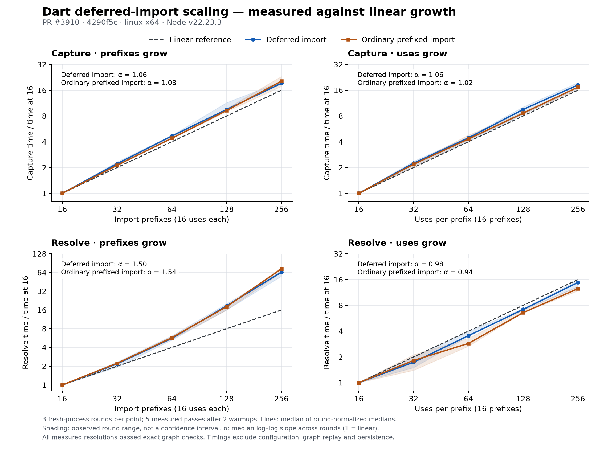

# Dart deferred import scaling

This benchmark checks the graph produced by Dart deferred imports and measures capture and scope resolution separately. Over the retained 16–256 sweep, capture and resolution with increasing uses are approximately linear. Resolution with increasing prefixes is superlinear for both deferred and ordinary prefixed imports.



## Measured scaling

The fitted exponent describes `time ∝ size^exponent`; 1.00 is linear. Each value is the median of three round-specific log–log fits using the median of five measured passes at each size.

| Input grows            | Phase      | Deferred exponent | Ordinary prefixed exponent | Deferred time growth for 16× input |
| ---------------------- | ---------- | ----------------: | -------------------------: | ---------------------------------: |
| Prefixes, 16 uses each | Capture    |              1.06 |                       1.08 |                             19.25× |
| Uses, 16 prefixes      | Capture    |              1.06 |                       1.02 |                             18.39× |
| Prefixes, 16 uses each | Resolution |          **1.50** |                   **1.54** |                         **64.97×** |
| Uses, 16 prefixes      | Resolution |              0.98 |                       0.94 |                             14.81× |

Using minimum timings instead of medians gives deferred exponents of 1.09, 1.06, 1.53 and 0.99 respectively. The conclusion is unchanged. The shaded bands show the observed range across rounds, not confidence intervals; these finite-range measurements do not prove asymptotic complexity.

The prefix-resolution cost comes from the existing namespace snapshot cache: each function scope collects the file's namespace imports. With `P` prefixes and `U` functions per prefix, that contributes work proportional to `P² × U`. The deferred-import change uses the same path as ordinary prefixed imports.

## Reproduce

From `gitnexus/`:

```bash
npm run build
node --import tsx bench/dart-deferred-imports/measure.mjs --check
node --import tsx bench/dart-deferred-imports/sweep.mjs \
  --sizes 16,32,64,128,256 --rounds 3 --warmup 2 --reps 5 \
  --output /tmp/dart-deferred-sweep.json
```

The normal `--check` command uses the CI profile: small = 8×16, large = 32×16 and dense = 8×64, in both forms. It validates all six graphs and times four workloads with five samples after one warmup. `--full --check` times all six with 15 samples after two warmups and collects fresh-process peak RSS. The timing budgets are unchanged. The separate 16–256 sweep took about 24 minutes on the recorded Linux host and is not added to CI.

From `eval/`, render the saved data:

```bash
uv run --no-project --with matplotlib==3.11.2 python \
  ../gitnexus/bench/dart-deferred-imports/plot.py /tmp/dart-deferred-sweep.json
```

This produces `summary.json`, `raw-samples.csv`, `series.csv`, and PNG/SVG/PDF plots beside the input file. The plotter requires a completed sweep.

## Measurement and correctness

- Grow prefixes and uses separately through 16, 32, 64, 128 and 256. Keep the other dimension at 16.
- Compare deferred and ordinary prefixed imports at every size. Each library declares the same member names, so resolution must honor the prefix.
- Run three rounds in 60 fresh processes, sequentially. Rotate size and form order between rounds and alternate capture/resolution order within each process.
- Prepare each cell with a real worker parse, a first resolution and an untimed capture pass. Then run two explicit warmups and retain all five measured passes: 300 measured passes per phase, plus 120 warmups.
- Time `emitDartScopeCaptures`, including parsing, and `runScopeResolution`. Configuration loading, graph replay, correctness hashing and persistence are outside those timers.
- Check exact workload counts and expected edges. Compare the full graph/decline fingerprint after every timed resolution with the validated initial graph, and compare deferred/prefixed fingerprints at every point. Known small/large/dense shapes must also match `baseline.json`.

The six-shape CI gate uses `(time_large / time_small) / 4`. Its prefix-resolution budget of 2.2 allows 8.8× time for 4× input. It bounds regressions at those sizes; it does not establish linearity. The original `captures × prefixes` negative control remained below that gate's sensitivity, as recorded in `baseline.json`. This sweep reports additional evidence without claiming to close that sensitivity gap.

## Retained evidence

[Raw samples and validated shapes](https://github.com/abhigyanpatwari/GitNexus/blob/fcd3c005c26b907ab089b2019b9a572e23e4cbf3/gitnexus/bench/dart-deferred-imports/results/2026-11-13-linux/sweep.json) and [derived estimates](https://github.com/abhigyanpatwari/GitNexus/blob/fcd3c005c26b907ab089b2019b9a572e23e4cbf3/gitnexus/bench/dart-deferred-imports/results/2026-11-13-linux/summary.json) record Linux x64, Node 22.23.3, an Intel i9-12900K, and source commit `4290f5c35fae3f8eb529e074ccb8724aceb42600`. Every cell and every paired fingerprint check passed.

The [compressed measured runner patch](https://github.com/abhigyanpatwari/GitNexus/blob/fcd3c005c26b907ab089b2019b9a572e23e4cbf3/gitnexus/bench/dart-deferred-imports/results/2026-11-13-linux/measured-extension.patch.gz), decompressed and applied to that commit, reconstructs the exact harness bytes identified by the raw report's checksums. The shipped runner was subsequently formatted, its revision metadata made dynamic, and its baseline matching adapted to the smaller CI shapes; the sweep's timed functions and 16–256 workload are unchanged. The figure was generated from the retained raw samples, not from the PR description's earlier macOS measurements.
