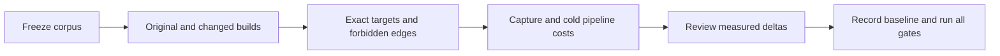

# Java ingestion correctness and scaling

See [measured before/after results](RESULTS.md) and the portable evaluation data
in [evaluation.json](evaluation.json).

Build the runtime being measured, then run this harness when other validation
processes are idle:

```sh
npm run build
npm run bench:java-ingestion -- --output /tmp/java-ingestion-candidate.json
```

The package command checks the committed baseline. Use the direct runner
without `--check` to collect a candidate before reviewing or recording a baseline.

For an oracle/debug run while other validation is active, use
`--correctness-only`. It executes each shape's capture and cold-pipeline arms
once, with no warmups, timers, timing samples, ratios, RSS measurement or scaling
certification. The report identifies its mode and reports semantic/workload
success through `complete` and `pass`. This mode cannot check or record a timing
baseline or accept timing profile overrides:

```sh
node bench/java-ingestion/measure.mjs --correctness-only --output /tmp/java-oracle.json
```

The corpus covers the Java provider changes through exact caller/target
identities and explicit negative controls. A larger edge count does not imply
better ingestion. Every positive must resolve its reviewed targets; every
negative must refuse incorrect ownership. `CALLS` expectations compare exact
target sets for their declared member names, while `INJECTS` expectations compare
the source's complete injection target set. Forbidden targets are checked across
all edges of that relation, independently of the member filter. Some negative
controls deliberately contain semantically invalid Java receiver operations;
those controls are identified by the corpus rather than presented as valid
Java programs.

Sibling lambdas and map parameters call distinct member names. Swapping their
owners must change the target set; caller/target edge deduplication cannot hide
that regression.

Three deterministic shapes separate breadth from field/accessor density:

| Shape | Independent units | Density fields per unit |
| ----- | ----------------: | ----------------------: |
| small |                 8 |                       8 |
| large |                32 |                       8 |
| dense |                32 |                      64 |

The harness independently counts source bytes, files, AST field declarations, expectations, positive
cases and negative cases, checks minimum workload floors, and fingerprints the
entire source/expectation contract. Final generated accessor counts must match
the independent field plan in graph declarations. The leaf capture arm measures
provisional candidates: its source-defined candidate count includes one getter
for each of the two shared custom-`Value` fields. Workspace annotation identity
validation must remove those candidates before the final graph. Capture counts
and actual name claims are
also recorded. A reviewed baseline pins these counts, the capture fingerprint,
the exact-target fingerprint and the full graph node/relationship fingerprint.
A reduced workload cannot silently pass by doing less work.

Two costs are measured:

- `captureMs` calls the production `emitJavaScopeCaptures` with ASTs parsed
  **before** timing. These are provisional capture candidates, not a final
  semantic graph. Every pass clears Java capture facts. The default estimator
  is the minimum of five samples after one warmup; `--full` uses fifteen after
  two. This isolates capture cost and does not include parsing.
- `pipelineMs` runs the selected built runtime's real scan, worker parsing,
  cross-file resolution, scope resolution, MRO and Spring DI. Every pass uses a
  fresh graph and private transient parsed-file storage, with no parse cache;
  every Java file must actually enter the worker. Database writes, community
  detection and process extraction are excluded. The default is the minimum of
  two samples after one warmup; `--full` uses three measured samples.

Fixture creation, capture AST parsing, target comparison and hashing are outside
the timers. Shape order rotates between rounds. The report includes all measured
samples, the estimator, runtime identity (including built-code and dependency
digests), the selected runtime's Git revision/status digest, and cumulative
process peak RSS. RSS is diagnostic and is not a per-shape memory gate. `HOME`
is preserved; the benchmark owns its temporary fixtures, transient stores,
`GITNEXUS_HOME` and `TMPDIR`.

Scaling budgets constrain normalized growth, never machine-specific absolute
milliseconds. Breadth compares large/small capture cost per independent input unit
and pipeline cost per source byte. Density compares dense/large cost per
declared field. Each normalized ratio must be at most **2.0**. These are bounded
regressions, not proof of linear complexity for arbitrary Java: fixed startup
costs can hide superlinear behavior at small sizes, and this corpus does not
grow every inheritance, overload or classpath dimension.

To compare an older build without changing or overwriting the active checkout,
build the historical revision in an isolated worktree/package and select it:

```sh
node bench/java-ingestion/measure.mjs \
  --root /path/to/built-historical/gitnexus --observe \
  --output /tmp/java-ingestion-historical.json
node bench/java-ingestion/measure.mjs \
  --root /path/to/built-candidate/gitnexus \
  --output /tmp/java-ingestion-candidate.json
```

Both commands use the same corpus from this harness and dynamically load the
chosen package's `dist/` APIs. Compare the runtime identities, workload
fingerprints, missing/wrong target details, actual-work counts and normalized
costs. `--observe` retains historical semantic/runtime failures as measurements
and exits successfully as an observation; `report.pass` still explicitly records
failure. It cannot be combined with `--check` or `--record`. Build/dependency
mutation during a run invalidates the result. Output paths must be new files.
Reports are checkpointed after passes so an interrupted run retains its evidence.

`--correctness-only --observe` is also available for a historical oracle run
without collecting performance data. Shared adversarial fixtures pin Lombok
annotation/package-root identity, imported generic argument declaration context,
and annotated qualified constructor inference. They do not multiply with the
scaling units.

Only after reviewing a successful candidate's corpus, all semantic results and
ratio measurements, explicitly record the baseline:

```sh
node bench/java-ingestion/measure.mjs --record --output /tmp/java-ingestion-record.json
node bench/java-ingestion/measure.mjs --check --output /tmp/java-ingestion-check.json
```

Recording is never automatic and is disabled in CI. It requires every correctness,
workload, stability and scaling check to pass. The recorded `recordedRuntime`
keeps only portable provenance: identity digests, Node version/ABI,
platform/architecture and the Git revision/status digest. Checkout, executable,
`dist`, manifest and lockfile paths are not persisted, and `--check` reads only
`shapes` and `budgets`. The baseline is written to an exclusively created
temporary file and renamed into place; a symlinked `baseline.json` is refused.
Checking requires an existing reviewed `baseline.json`. The minimum recording/checking profile is five capture
samples, one capture warmup and two pipeline samples. Diagnostic overrides
`--samples`, `--warmup` and `--pipeline-samples` can shorten exploratory runs;
undersampled runs cannot certify or record a baseline.



Conservative refusal is expected for raw or wildcard callback arguments,
custom container lookalikes and uncertain generated constructor annotations.
A raw JDK container whose element names a block-local class resolves to that
local class; the container itself is still proven where it is written.
Fully indexed multidimensional arrays and generic return substitution remain
deferred. These results describe this synthetic corpus; broader classpath and
real-repository coverage require additional evaluation.
